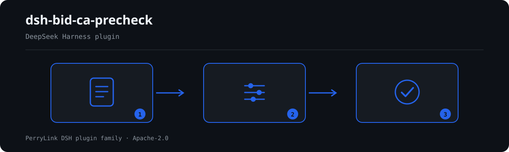

# dsh-bid-ca-precheck — Verificação prévia da conformidade da proposta face a cada requisito do caderno de encargos

[English](README.md) · [简体中文](README-zh.md) · [Español](README-es.md) · [Português](README-pt.md) · [हिन्दी](README-hi.md)

[](https://dsh.market/)
[](https://dshfind.com/en/plugins/PerryLink/dsh-bid-ca-precheck?ref=badge)

`dsh-bid-ca-precheck` lê um 投标符合性响应台账 —os requisitos do caderno de encargos e as respostas do proponente, obtidos com os próprios nomes de coluna do registo, em chinês ou em inglês—, aplica um pacote de regras versionado e verifica a completude e a coerência interna desse registo: que cada requisito do caderno de encargos tenha uma resposta registada, que o veredicto venha do vocabulário que você configurar, que os números de cláusula sejam únicos no registo, que o registo declare o seu projeto e o seu proponente, que uma cláusula que você marcou como de risco elevado traga evidência e que a coluna de requisitos contenha requisitos reais e não marcadores de modelo.

## Install

```sh
dsh plugin --profile <name> add dsh-bid-ca-precheck
dsh --profile <name> --dump-config | grep 'dsh-bid-ca-precheck'
```

## Como é a saída



*Visão geral do fluxo: chamada → plugin → resultado. Os exemplos abaixo usam a superfície real de comandos.*


Saída real deste plugin sobre o seu próprio fixture de teste `BC-001` — não é uma simulação. O pacote de regras não inventa citações, por isso cada achado nomeia a cláusula aplicada e avisa que o seu texto não foi obtido.

## O que ele responde

### Exemplos

A tabela abaixo é o conjunto de exemplos: a primeira linha é o caso detalhado e as demais são casos curtos.

| Você pergunta | O que ele responde |
|---|---|
| A coluna `response` de um requisito do caderno de encargos está vazia — isso é reportado? | Sim. `BC-001` assinala a linha, porque todo requisito do caderno de encargos deve ter uma resposta registada. Verifica apenas que a coluna `response` está preenchida: não julga se a resposta satisfaz o requisito, o que é competência da comissão de avaliação. |
| Preenchi a coluna `verdict` e o relatório diz que a regra não pôde ser executada. Porquê? | `BC-002` compara cada valor com o vocabulário de veredictos que você configurar, e essa lista vem vazia, por isso até preencher `values` a regra reporta-se a si mesma em `skipped` em vez de adivinhar. Depois de configurada, só reporta um valor que não esteja na sua lista; nunca julga se o veredicto está correto. |
| O mesmo número de cláusula aparece em duas linhas do registo. | `BC-003` reporta o valor `clause` repetido: se um número aparece duas vezes, ninguém consegue dizer que linha responde a que requisito. Os espaços são ignorados, por isso `3.2` e ` 3.2 ` contam como o mesmo número. Verifica apenas a unicidade; não decide qual das duas linhas está certa — um achado costuma significar registo duplicado ou número copiado mal. |
| O registo não diz que projeto cobre nem quem é o proponente. | `BC-004` reporta o campo de cabeçalho em falta e exige tanto `project` como `bidder`. Essa necessidade vem da rastreabilidade —um veredicto que não se liga a um projeto e a um proponente não pode ser revisto depois—, não de uma cláusula que exija um cabeçalho no registo. |
| Que linhas têm de trazer evidência? | `BC-005`: todas as linhas cujo texto de `requirement` contenha, por inclusão, uma das suas palavras-chave de risco elevado. `highRiskKeywords` vem vazia, por isso até a preencher a regra reporta-se em `skipped` em vez de passar em silêncio. Verifica apenas que a coluna `evidence` está preenchida, não se a evidência é válida ou suficiente. |
| Algumas linhas ainda dizem 【……】 ou `待填` na coluna de requisitos. | `BC-006` reporta-as: `【`, `】`, `{{`, `}}`, `XXX`, `待填`, `TBD` e termos semelhantes deixados na coluna `requirement` costumam indicar que o registo foi copiado de um modelo e nunca preenchido. A lista de termos é sua para ajustar. A regra assinala apenas o marcador; não decide se o requisito em si é real. |

## Normas que segue

| Documento | Número | Regras que o citam |
|---|---|---|
| 《中华人民共和国招标投标法》 | 1999年8月30日通过，2017年12月27日修正（全国人大常委会《关于修改〈中华人民共和国招标投标法〉、〈中华人民共和国计量法〉的决定》），本法自2000年1月1日起施行 | BC-001, BC-003, BC-004, BC-006 |
| 《中华人民共和国招标投标法实施条例》 | 国务院令第613号（2011 年 12 月 20 日公布，2017 年 3 月 1 日修订，自 2012 年 2 月 1 日起施行） | BC-002 |
| 《中华人民共和国招标投标法》 | 1999年8月30日通过，2017年12月27日修正，自2000年1月1日起施行 | BC-005 |

**Boundary:** this plugin checks a **投标符合性响应台账** for what a register can be held to — that every
tender requirement has a recorded response, that verdicts come from your vocabulary and clause numbers are
unique, that a high-risk clause carries evidence, and that the requirement column still holds real
requirements rather than template placeholders. It does **not** decide whether a bid is valid, whether it
should be rejected, or whether a response is a material deviation. **Those calls belong to the evaluation
committee, and this plugin never makes them** — a test asserts that no rule here can be `error`.

> ### ⚠️ Read this before trusting a citation in the report
>
> **Every `excerpt` in this plugin's rule pack says, in so many words, that the clause text was not
> obtained.** The regime lives in 《招标投标法》, 《招标投标法实施条例》 and each project's 评标办法. The
> verification pass for this plugin could not retrieve verbatim clause text from them, so rather than
> paraphrase a quotation the pack states the gap in the `excerpt` field itself and puts the honest
> reasoning in `note`. Every rule is therefore `warn` or `info`, and a test asserts that no rule claims a
> quotation it does not have. **When the texts are in hand, two things must be done: replace each
> `excerpt` with the real clause, and raise `kind` to `direct`.**
>
> The worst failure mode of a register tool is a register copied from a template and mistaken for a
> checked one, so `BC-006` looks for exactly that: `【】`, `{{}}`, `XXX`, `待填`, `TBD` left in the
> requirement column.
>
> Two lists are yours, not a standard's: the verdict vocabulary (`BC-002`) and the high-risk keywords
> (`BC-005`). Both ship **empty**, and a rule whose list is unset reports itself in `skipped` rather than
> passing silently.

## Compatibility

| Superfície | Estado |
|---|---|
| Harness | Faixa de peers `>=0.1.2-rc.1 <0.2.0 \|\| >=0.2.0-0 <0.3.0` — verificada para aceitar tanto `0.2.0-rc.2` quanto `0.2.1-rc.2`. **`engines.dsh` é declarado como `>=0.2.1-0 <0.3.0`** e o host o aplica desde 0.2.1 |
| Node | `^22.19.0 || >=24.0.0` |
| Plataformas | Todas (ESM puro; sem código nativo, sem rede, sem chamada ao modelo) |
| Modo de ferramenta | Funciona em `native` e `ptc`; para um diretório inteiro use `ptc` |

## What it does

A tabela de regras, os campos e o comportamento detalhado estão em [README.md](README.md#what-it-does) (versão principal em inglês). O plugin apenas lista divergências literais frente às cláusulas citadas e indica em `skipped` cada verificação que não pôde ser executada.

## Configuration

Todos os parâmetros ajustáveis ficam no esquema Schemastery de `src/config.ts`, portanto mudam pelo `cordis.yml` sem editar código; os limites por regra ficam no pacote de regras sob `rules/`.

| Chave | Tipo | Padrão | Descrição |
|---|---|---|---|
| `rulesFile` | string | `rules/bid-ca-precheck.yaml` | Caminho do pacote de regras, relativo à raiz do pacote |
| `disabledRules` | string[] | `[]` | Ids de regras a desativar; cada uma aparece em `skipped` |
| `onlyRules` | string[] | `[]` | Executar apenas estas regras; vazio executa todas |
| `skipNotes` | string | `""` | Nota acrescentada a cada motivo de `skipped` |
| `timeoutMs` | number | `120000` | Orçamento de tempo limite cooperativo da ferramenta |

## Material format

Aceita JSON ou YAML. O exemplo completo de campos está em [README.md](README.md#material-format) (versão principal em inglês). Os campos são opcionais na camada de leitura e validados pelo motor, de modo que uma exportação parcial gera achados sobre o que falta em vez de falhar.

## Rule sources

Os dados das regras ficam separados do código: cada regra traz documento, número, cláusula na numeração própria da fonte, trecho literal e URL de origem. O carregador impõe que o trecho seja citação real de pelo menos oito caracteres e que uma verificação baseada apenas em princípio geral (`kind: derived-from-principle`, teto `warn`) ou em política local (`kind: institutional-configuration`, teto `info`) nunca seja declarada `error`.

Os limites verificados e as conclusões deliberadamente **não** afirmadas estão em [README.md](README.md#rule-sources) (versão principal em inglês) e em `rules/evidence/`.

## Troubleshooting

- **O plugin instala mas a ferramenta não aparece**: confirme que `main` resolve para `lib/index.mjs` e que `pnpm run build` o gerou.
- **`dsh plugin add` recusa o pacote**: a faixa de peers cobre `0.1.x` e `0.2.x`; fora dela, conceda isenção explícita com `dsh plugin --profile <name> allow-version <pkg@ver> --dsh-version <runtime> --accept-risk`.
- **Uma regra não executou**: leia o arranjo `skipped`.
- **`check` informa `manifest-peers` como falha**: problema conhecido do `dsh-plugin-dev`; o runtime aplica a compatibilidade na instalação.
- **Os horários parecem deslocados**: toda a aritmética é de hora local sobre as cadeias fornecidas.

## Development

```sh
pnpm install
pnpm run typecheck
pnpm test
pnpm run build
node ../scripts/sync-shared.mjs dsh-bid-ca-precheck
```

O último comando copia o kit compartilhado de `../_shared` para `src/shared/`; execute-o novamente após cada alteração compartilhada.

## PerryLink DSH Plugin Family

Este projeto faz parte da família de plugins do DeepSeek Harness da [PerryLink](https://github.com/PerryLink). O registro fica recolhido abaixo para que cada README mantenha uma primeira tela curta; expanda para ver cada linha e seu status.

<details>
<summary>Expandir todos os plugins</summary>

| Plugin | Status |
|---|---|
| **[dsh-aqua-input-check](https://github.com/PerryLink/dsh-aqua-input-check)** |  |
| **[dsh-archive-check](https://github.com/PerryLink/dsh-archive-check)** |  |
| **[dsh-auto-review](https://github.com/PerryLink/dsh-auto-review)** |  |
| **[dsh-autotier](https://github.com/PerryLink/dsh-autotier)** |  |
| **[dsh-bid-ca-precheck](https://github.com/PerryLink/dsh-bid-ca-precheck)** |  |
| **[dsh-bid-qual-check](https://github.com/PerryLink/dsh-bid-qual-check)** |  |
| **[dsh-cert-mcp](https://github.com/PerryLink/dsh-cert-mcp)** |  |
| **[dsh-checkpoint-rewind](https://github.com/PerryLink/dsh-checkpoint-rewind)** |  |
| **[dsh-click](https://github.com/PerryLink/dsh-click)** |  |
| **[dsh-composer-history](https://github.com/PerryLink/dsh-composer-history)** |  |
| **[dsh-contract-stance](https://github.com/PerryLink/dsh-contract-stance)** |  |
| **[dsh-customs-doc-check](https://github.com/PerryLink/dsh-customs-doc-check)** |  |
| **[dsh-data-quality](https://github.com/PerryLink/dsh-data-quality)** |  |
| **[dsh-demurrage-ledger](https://github.com/PerryLink/dsh-demurrage-ledger)** |  |
| **[dsh-doublecheck](https://github.com/PerryLink/dsh-doublecheck)** |  |
| **[dsh-drill-script-check](https://github.com/PerryLink/dsh-drill-script-check)** |  |
| **[dsh-eia-guide-check](https://github.com/PerryLink/dsh-eia-guide-check)** |  |
| **[dsh-emergency-plan](https://github.com/PerryLink/dsh-emergency-plan)** |  |
| **[dsh-essay-rubric-check](https://github.com/PerryLink/dsh-essay-rubric-check)** |  |
| **[dsh-evidence-check](https://github.com/PerryLink/dsh-evidence-check)** |  |
| **[dsh-export-ctl-check](https://github.com/PerryLink/dsh-export-ctl-check)** |  |
| **[dsh-fast](https://github.com/PerryLink/dsh-fast)** |  |
| **[dsh-fmea-table-check](https://github.com/PerryLink/dsh-fmea-table-check)** |  |
| **[dsh-forecast-penalty](https://github.com/PerryLink/dsh-forecast-penalty)** |  |
| **[dsh-fund-research](https://github.com/PerryLink/dsh-fund-research)** |  |
| **[dsh-github](https://github.com/PerryLink/dsh-github)** |  |
| **[dsh-gongwen-flow-check](https://github.com/PerryLink/dsh-gongwen-flow-check)** |  |
| **[dsh-gongwen-word-check](https://github.com/PerryLink/dsh-gongwen-word-check)** |  |
| **[dsh-guard-plan-qc](https://github.com/PerryLink/dsh-guard-plan-qc)** |  |
| **[dsh-hazchem-check](https://github.com/PerryLink/dsh-hazchem-check)** |  |
| **[dsh-hazplan-check](https://github.com/PerryLink/dsh-hazplan-check)** |  |
| **[dsh-hidden-risk-map](https://github.com/PerryLink/dsh-hidden-risk-map)** |  |
| **[dsh-hs-classify](https://github.com/PerryLink/dsh-hs-classify)** |  |
| **[dsh-icd-rule-check](https://github.com/PerryLink/dsh-icd-rule-check)** |  |
| **[dsh-industry-research](https://github.com/PerryLink/dsh-industry-research)** |  |
| **[dsh-lawcite-adapter](https://github.com/PerryLink/dsh-lawcite-adapter)** |  |
| **[dsh-laya](https://github.com/PerryLink/dsh-laya)** |  |
| **[dsh-lc-doc-check](https://github.com/PerryLink/dsh-lc-doc-check)** |  |
| **[dsh-learning-gap-check](https://github.com/PerryLink/dsh-learning-gap-check)** |  |
| **[dsh-library](https://github.com/PerryLink/dsh-library)** |  |
| **[dsh-local-ai](https://github.com/PerryLink/dsh-local-ai)** |  |
| **[dsh-lsp-actions](https://github.com/PerryLink/dsh-lsp-actions)** |  |
| **[dsh-mask](https://github.com/PerryLink/dsh-mask)** |  |
| **[dsh-mcp-panel](https://github.com/PerryLink/dsh-mcp-panel)** |  |
| **[dsh-medrec-qc](https://github.com/PerryLink/dsh-medrec-qc)** |  |
| **[dsh-memento](https://github.com/PerryLink/dsh-memento)** |  |
| **[dsh-nsfc-form-check](https://github.com/PerryLink/dsh-nsfc-form-check)** |  |
| **[dsh-nurse-record-check](https://github.com/PerryLink/dsh-nurse-record-check)** |  |
| **[dsh-observe](https://github.com/PerryLink/dsh-observe)** |  |
| **[dsh-origin-rvc-check](https://github.com/PerryLink/dsh-origin-rvc-check)** |  |
| **[dsh-ota-review-check](https://github.com/PerryLink/dsh-ota-review-check)** |  |
| **[dsh-output-styles](https://github.com/PerryLink/dsh-output-styles)** |  |
| **[dsh-paper-doc-adapter](https://github.com/PerryLink/dsh-paper-doc-adapter)** |  |
| **[dsh-permission-rules](https://github.com/PerryLink/dsh-permission-rules)** |  |
| **[dsh-permit-report-check](https://github.com/PerryLink/dsh-permit-report-check)** |  |
| **[dsh-pipeline-check](https://github.com/PerryLink/dsh-pipeline-check)** |  |
| **[dsh-pleading-draft](https://github.com/PerryLink/dsh-pleading-draft)** |  |
| **[dsh-plugin-doctor](https://github.com/PerryLink/dsh-plugin-doctor)** |  |
| **[dsh-plugin-guide](https://github.com/PerryLink/dsh-plugin-guide)** |  |
| **[dsh-plugin-kit](https://github.com/PerryLink/dsh-plugin-kit)** |  |
| **[dsh-plugin-upgrade](https://github.com/PerryLink/dsh-plugin-upgrade)** |  |
| **[dsh-policy-brief-draft](https://github.com/PerryLink/dsh-policy-brief-draft)** |  |
| **[dsh-power-loss-split](https://github.com/PerryLink/dsh-power-loss-split)** |  |
| **[dsh-power-ticket-check](https://github.com/PerryLink/dsh-power-ticket-check)** |  |
| **[dsh-ppap-check](https://github.com/PerryLink/dsh-ppap-check)** |  |
| **[dsh-protest-deadline](https://github.com/PerryLink/dsh-protest-deadline)** |  |
| **[dsh-railway-window](https://github.com/PerryLink/dsh-railway-window)** |  |
| **[dsh-repair-order-qc](https://github.com/PerryLink/dsh-repair-order-qc)** |  |
| **[dsh-research-report](https://github.com/PerryLink/dsh-research-report)** |  |
| **[dsh-review-reply-check](https://github.com/PerryLink/dsh-review-reply-check)** |  |
| **[dsh-rulefile-check](https://github.com/PerryLink/dsh-rulefile-check)** |  |
| **[dsh-safety-brief-check](https://github.com/PerryLink/dsh-safety-brief-check)** |  |
| **[dsh-score](https://github.com/PerryLink/dsh-score)** |  |
| **[dsh-session-sync](https://github.com/PerryLink/dsh-session-sync)** |  |
| **[dsh-site-log-check](https://github.com/PerryLink/dsh-site-log-check)** |  |
| **[dsh-skill-pack-security](https://github.com/PerryLink/dsh-skill-pack-security)** |  |
| **[dsh-soe-decision-check](https://github.com/PerryLink/dsh-soe-decision-check)** |  |
| **[dsh-soilwater-check](https://github.com/PerryLink/dsh-soilwater-check)** |  |
| **[dsh-sop-sync-check](https://github.com/PerryLink/dsh-sop-sync-check)** |  |
| **[dsh-spc-gbt-adapter](https://github.com/PerryLink/dsh-spc-gbt-adapter)** |  |
| **[dsh-talk](https://github.com/PerryLink/dsh-talk)** |  |
| **[dsh-tender-extract](https://github.com/PerryLink/dsh-tender-extract)** |  |
| **[dsh-tender-matrix](https://github.com/PerryLink/dsh-tender-matrix)** |  |
| **[dsh-test-drive](https://github.com/PerryLink/dsh-test-drive)** |  |
| **[dsh-ticktick](https://github.com/PerryLink/dsh-ticktick)** |  |
| **[dsh-translate](https://github.com/PerryLink/dsh-translate)** |  |
| **[dsh-warranty-calc](https://github.com/PerryLink/dsh-warranty-calc)** |  |
| **[dsh-budget](https://github.com/PerryLink/dsh-budget)** | 🧊 CONGELADO — ver o README do repositório |
| **[dsh-claude-move](https://github.com/PerryLink/dsh-claude-move)** | 🧊 CONGELADO — ver o README do repositório |
| **[dsh-defend](https://github.com/PerryLink/dsh-defend)** | 🧊 CONGELADO — ver o README do repositório |
| **[dsh-draw](https://github.com/PerryLink/dsh-draw)** | 🧊 CONGELADO — ver o README do repositório |
| **[dsh-reach](https://github.com/PerryLink/dsh-reach)** | 🧊 CONGELADO — ver o README do repositório |
| **[dsh-background-agents](https://github.com/PerryLink/dsh-background-agents)** | 🚫 RETIRADO — ver o README do repositório |
| **[dsh-session-pin](https://github.com/PerryLink/dsh-session-pin)** | 🚫 RETIRADO — ver o README do repositório |
| **[dsh-team-rooms](https://github.com/PerryLink/dsh-team-rooms)** | 🚫 RETIRADO — ver o README do repositório |

</details>

## License

[Apache License 2.0](LICENSE) © 2026 dsh-bid-ca-precheck contributors.
