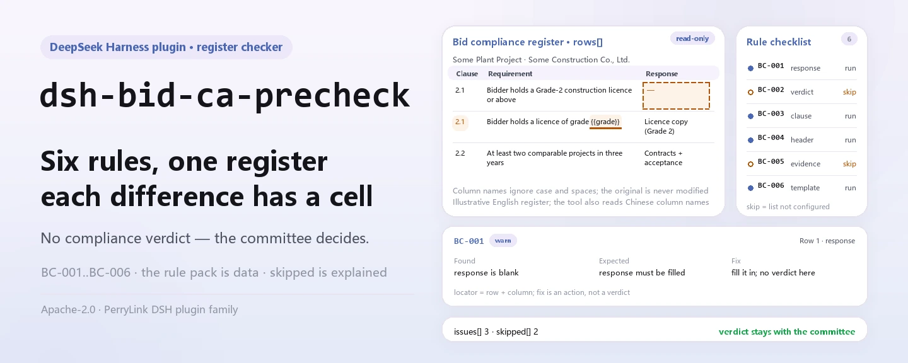
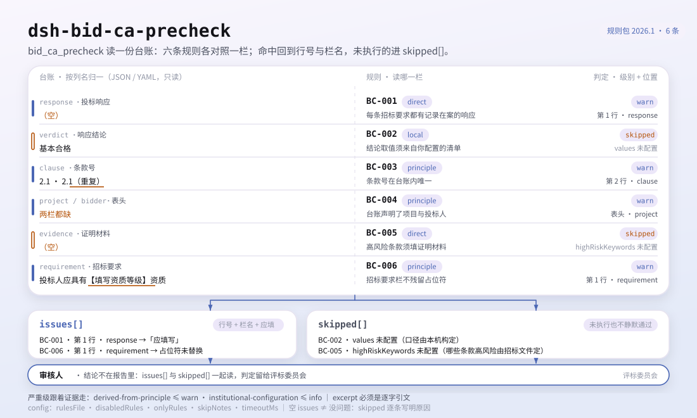
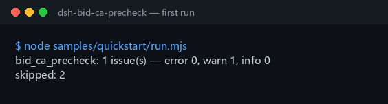

<div align="center">

<picture>
  <source media="(prefers-color-scheme: dark)" srcset="docs/assets/dsh-bid-ca-precheck-hero-en-dark.webp">
  
</picture>

# dsh-bid-ca-precheck

**Check a bid compliance response register for completeness and internal consistency — get a list of what is inconsistent, where, and what to fix; the verdict stays with the evaluation committee.**

A register-shaped checker for DeepSeek Harness: it reads one bid compliance response register (the tender's requirements and the bidder's responses, keyed by the register's own column names in Chinese or English), applies a versioned rule pack (BC-001..BC-006) rule by rule, and lists only the differences it can point to inside the material — no compliance verdict, no liability finding.

[Install](#three-step-setup) · [Configuration](#configuration) · [FAQ](#faq) · [简体中文](README.md) · [English](README.en.md) · [Español](README.es.md) · [Português](README.pt.md) · [हिन्दी](README.hi.md)

[](LICENSE)
[](#compatibility)
[](https://www.npmjs.com/package/dsh-bid-ca-precheck)
[](https://github.com/PerryLink/dsh-bid-ca-precheck/actions/workflows/ci.yml)
[](#compatibility)

[](https://github.com/PerryLink/dsh-bid-ca-precheck/stargazers)
[](https://www.npmjs.com/package/dsh-bid-ca-precheck)
[](https://dshfind.com/plugins/PerryLink/dsh-bid-ca-precheck?ref=badge)
[](https://securityscorecards.dev/viewer/?uri=github.com/PerryLink/dsh-bid-ca-precheck)
[](https://dsh.market/)
[](https://gitee.com/perrylink/dsh-bid-ca-precheck)

```sh
dsh plugin --profile <name> add dsh-bid-ca-precheck
```

</div>

<sub>Community plugin, not affiliated with DeepSeek. Canonical repository: <https://github.com/PerryLink/dsh-bid-ca-precheck> (Gitee is a mirror).</sub>

## What it is

`dsh-bid-ca-precheck` reads one bid compliance response register — the tender's requirements and the bidder's responses, keyed by the register's own column names in Chinese or English — applies a versioned rule pack, and checks that register's own completeness and internal consistency: that every tender requirement has a recorded response, that the verdict comes from the vocabulary you configure, that clause numbers are unique within the register, that the register declares its project and its bidder, that a clause you marked high-risk carries evidence, and that the requirement column still holds real requirements rather than template placeholders.

It does not decide whether a bid is valid, whether it should be rejected, whether a response is a material deviation, or who is at fault.

- **Who it is for**: bid specialists and tender agents; no command line required — hand it the material in chat.
- **What you give it**: the source material the check works on (a table, register or document); the original is never modified. Excel can be converted to JSON/YAML first, in chat if the platform supports it.
- **What it returns**: a list of what is inconsistent, where, and what to fix; every check that could not run is listed in `skipped` with its reason.

<picture>
  <source media="(prefers-color-scheme: dark)" srcset="docs/assets/dsh-bid-ca-precheck-flow-v5-dark.svg">
  
</picture>

## Three-step setup

1. **Install** (pick one channel):

   ```sh
   # git channel (latest main; equivalent to git+https://github.com/PerryLink/dsh-bid-ca-precheck.git)
   dsh plugin --profile <name> add github:PerryLink/dsh-bid-ca-precheck
   # npm channel (published releases)
   dsh plugin --profile <name> add dsh-bid-ca-precheck
   # tarball channel: pnpm pack in this repo, then
   dsh plugin --profile <name> add ./dsh-bid-ca-precheck-<version>.tgz
   ```

2. **Minimal config** (sane defaults; a bundle row without `config` runs entirely on defaults, with the rule pack at the bundled `rules/bid-ca-precheck.yaml`):

   ```yaml
   - insert:
       - id: dsh-bid-ca-precheck
         name: dsh-bid-ca-precheck
   ```

3. **Verify it mounts**:

   ```sh
   dsh --profile <name> --dump-config | grep 'dsh-bid-ca-precheck'
   ```

   Then hand it a register — for example the bundled sample (matching `samples/quickstart/expected/result.json`):

   ```text
   > Run the check on the bundled sample and tell me how many issues were found, at what severity.
   bid_ca_precheck: 1 issue(s) — error 0, warn 1, info 0
   skipped: 2
   ```

   

**Uninstall**: `dsh plugin --profile <name> remove dsh-bid-ca-precheck` (or remove the row from the profile patch).

<details>
<summary>Use it in WorkBuddy / Coze</summary>

Search for the Tender Compliance Suite in WorkBuddy / Coze (this check is one part of it; availability as listed) to call the same checking capability without a command line.

</details>

<details>
<summary>Install from the DSH Desktop market</summary>

Every PerryLink plugin is listed in the built-in DSH Desktop market: **Market → Sources → Add source → paste** `https://perrylink-dsh-catalog.perrylink.workers.dev/catalog-source.json` **→ select**. Installation still requires the market's npm identity check and your confirmation.

</details>

## Core capabilities

`dsh-bid-ca-precheck` registers the `bid_ca_precheck` tool: it reads one compliance response register, applies the versioned rule pack, and returns a report.

- **Six rules in one pack** — the rule pack is data, not code (`rules/bid-ca-precheck.yaml`); replacing it swaps the whole rule set without touching a line of TypeScript.
- **Read-only on the material** — accepts JSON or YAML and never modifies the original; pure ESM, no network requests, no model calls.
- **No fabricated citations** — every rule carries `document` / `number` / `clause` / `excerpt` / `kind` / `source`; `excerpt` must be a verbatim quotation, and a rule whose text was not obtained says so in `excerpt` rather than passing a paraphrase off as a quote.
- **Severity follows the evidence** — `derived-from-principle` is capped at `warn`, institutional configuration (`institutional-configuration`) at `info`, and a test asserts it; no rule in this pack can be `error`.
- **An empty list is never "nothing is wrong"** — every check that could not run is reported in `skipped` with its reason, and a rule whose required list is unset reports itself in `skipped` rather than passing silently.
- **No adjudicating wording** — the report lists differences only; a wording guard enforces this and every report carries the disclaimer.

| Rule | What it checks | Severity | Basis kind |
|---|---|---|---|
| `BC-001` | every requirement has a recorded response | warn | direct |
| `BC-002` | the verdict uses your vocabulary (off by default) | info | local |
| `BC-003` | clause numbers are unique in the register | warn | principle |
| `BC-004` | the register names its project and its bidder | warn | principle |
| `BC-005` | a high-risk clause carries evidence (off by default) | warn | direct |
| `BC-006` | the requirement column holds no unreplaced placeholder | warn | principle |

"Basis kind" is shorthand for the rule pack's `kind`: `direct` means the clause states the checked requirement itself, `principle` means `derived-from-principle` (inferred from principle only, capped at `warn`), and `local` means `institutional-configuration` (a threshold from your institution, capped at `info`).

### Examples

These are the plugin's real entry points; install once, then call one. The first row is the detailed walkthrough, the rest are short cases.

**Detailed example** — tool `bid_ca_precheck`, input:

```json
{"rows":[{"条款号":"2.1","招标要求":"投标人应具有建筑工程施工总承包二级及以上资质","投标响应":"","响应结论":"满足", ...}]}
```

Output:

```json
{
  "id": "dsh-bid-ca-precheck.BC-001.de09b5a6",
  "ruleId": "BC-001",
  "severity": "warn",
  "locator": {
    "row": 1,
    "field": "response"
  },
  "found": "第 1 行「response」为空",
  "expected": "「response」应填写",
  "fix": "补填响应内容；本条只核对是否填写，不判断该响应对招标要求是否构成实质性满足"
}
```

*Observed from `dsh-bid-ca-precheck/tests/fixtures/BC-001/BC-001-unsafe.json; dsh-bid-ca-precheck/tests/fixtures/BC-001/cases.json; dsh-bid-ca-precheck/rules/bid-ca-precheck.yaml; dsh-bid-ca-precheck/tests/index.test.ts`*

| You ask | What it answers |
|---|---|
| A tender requirement's `response` column is blank. Is that reported? | Yes. `BC-001` reports the row, because every tender requirement must have a recorded response. It only checks that the `response` column is filled — it does not judge whether the response satisfies the requirement, which is the evaluation committee's call. |
| I filled the `verdict` column and the report still says the rule could not run. Why? | `BC-002` compares each value with the verdict vocabulary you configure, and that list ships empty, so until you fill `values` the rule reports itself in `skipped` rather than guessing. Once configured it only reports a value that is not in your list; it never judges whether the verdict itself is correct. |
| The same clause number appears on two rows of the register. | `BC-003` reports the repeated `clause` value: when one number appears twice, nobody can tell which row answers which requirement. Whitespace is ignored, so `3.2` and ` 3.2 ` count as the same number. It only checks uniqueness — it does not decide which of the two rows is right; a hit usually means duplicate registration or a copied-wrong number. |
| The register does not say which project it covers or who the bidder is. | `BC-004` reports the missing header field and requires both `project` and `bidder`. That need comes from traceability — a verdict that cannot be tied to a project and a bidder cannot be reviewed later — not from a clause that requires a register header. |
| Which rows must carry evidence? | `BC-005`: every row whose `requirement` text contains one of your high-risk keywords, matched by containment. `highRiskKeywords` ships empty, so until you fill it the rule reports itself in `skipped` rather than passing silently. It only checks that the `evidence` column is filled, not whether the evidence is valid or sufficient. |
| A few rows still read 【……】 or `TBD` in the requirement column. | `BC-006` reports them: leftover `【`, `】`, `{{`, `}}`, `XXX`, `TBD` and similar terms in the `requirement` column usually mean the register was copied from a template and never filled in. The terms list is yours to adjust. The rule flags the placeholder only; it does not decide whether the requirement itself is real. |

## Standards it follows

| Document | Reference | Cited by rules |
|---|---|---|
| Tendering and Bidding Law of the People's Republic of China | Adopted 1999-08-30, amended 2017-12-27 (NPC Standing Committee decision amending the Tendering and Bidding Law and the Metrology Law); effective 2000-01-01 | BC-001, BC-003, BC-004, BC-006 |
| Implementing Regulations for the Tendering and Bidding Law of the People's Republic of China | State Council Decree No. 613 (promulgated 2011-12-20, revised 2017-03-01, effective 2012-02-01) | BC-002 |
| Tendering and Bidding Law of the People's Republic of China | Adopted 1999-08-30, amended 2017-12-27, effective 2000-01-01 | BC-005 |

**Boundary:** this plugin checks a **bid compliance response register** for what a register can be held to — that every tender requirement has a recorded response, that verdicts come from your vocabulary and clause numbers are unique, that a high-risk clause carries evidence, and that the requirement column still holds real requirements rather than template placeholders. It does **not** decide whether a bid is valid, whether it should be rejected, or whether a response is a material deviation. **Those calls belong to the evaluation committee, and this plugin never makes them** — a test asserts that no rule here can be `error`.

> ### ⚠️ Read this before trusting a citation in the report
>
> **`excerpt` status is per rule, not uniform.** Some rules quote the clause verbatim (`kind: direct`), some are derived from the principle of the cited articles (`kind: derived-from-principle`, capped at `warn`), and some use thresholds your institution configures (`kind: institutional-configuration`, capped at `info`). The pack never paraphrases a quotation: when the text was not obtained, the `excerpt` field says so and the reasoning lives in `note`; a test asserts that no rule claims a quotation it does not have. **For any rule still marked as not obtained, replace the `excerpt` with the real clause and raise `kind` to `direct` once the text is in hand.**
>
> The conclusion is the reviewer's: this plugin lists differences it can point to in the material and does not decide facts or compliance.

## Configuration

All tunables are Schemastery `Config` fields in `src/config.ts` (changeable from cordis.yml); per-rule thresholds live in the rule pack under `rules/`. An id-targeted override replaces the whole row — restate every key you need.

| Key | Type | Default | Description |
|---|---|---|---|
| `rulesFile` | string | `rules/bid-ca-precheck.yaml` | Rule-pack path, relative to the package root |
| `disabledRules` | string[] | `[]` | Rule ids to stop running; each appears in `skipped` |
| `onlyRules` | string[] | `[]` | Run only these rule ids; empty runs every rule |
| `skipNotes` | string | `""` | Note appended to every `skipped` reason |
| `timeoutMs` | number | `120000` | Cooperative tool timeout budget |

Rule-level parameters worth knowing (declared in the rule pack's rule entries, not in `Config`):

- `BC-002` `values` — your verdict vocabulary. Empty means the rule does not run.
- `BC-005` `highRiskKeywords` — the words that mark a clause as needing evidence. Empty means the rule does not run; `evidenceField` and `requirementField` rename the two columns it reads.
- `BC-006` `terms` — the placeholders to look for; the default list covers `【】`, `{{}}`, `XXX`, `TBD`, `todo` and the Chinese to-be-filled markers shipped with the pack.

Example values (yours to change):

```yaml
# BC-002 values
values: [满足, 部分满足, 不满足, 待确认]
# BC-005 highRiskKeywords
highRiskKeywords: [资格, 业绩, 实质性, 星号条款]
```

Example override in your profile patch:

```yaml
- insert:
    - id: dsh-bid-ca-precheck
      name: dsh-bid-ca-precheck
      config:
        disabledRules: [BC-006]
        timeoutMs: 180000
```

<details>
<summary>Full configuration table (5 keys)</summary>

| Key | Type | Default | Description |
|---|---|---|---|
| `rulesFile` | string | `rules/bid-ca-precheck.yaml` | Rule-pack path, relative to the package root |
| `disabledRules` | string[] | `[]` | Rule ids to stop running; each appears in `skipped` |
| `onlyRules` | string[] | `[]` | Run only these rule ids; empty runs every rule |
| `skipNotes` | string | `""` | Note appended to every `skipped` reason |
| `timeoutMs` | number | `120000` | Cooperative tool timeout budget |

</details>

## Material format

The tool accepts JSON or YAML:

```yaml
project: 某某厂房工程
bidder: 某某建设有限公司
rows:
  - { 条款号: "2.1", 招标要求: 投标人应具有建筑工程施工总承包二级及以上资质,
      投标响应: 已提供资质证书复印件，等级为二级, 响应结论: 满足, 证明材料: 资格文件第 12 页 }
  - { Clause: "2.2", Requirement: 近三年至少完成两项同类业绩,
      Response: 已提供合同及验收证明, Verdict: 满足, Evidence: 业绩文件第 3 页 }
```

Column names are matched case-insensitively and ignoring spaces, underscores and hyphens, so the Chinese requirement column and the English `requirement` column resolve to the same field; the register's own column names are kept, so a finding names the column it actually read. A row may declare its own number via `row` or one of the Chinese register aliases shipped with the reader. Fields are optional at the reading layer and validated by the check engine, so a partially exported register produces "missing" findings instead of crashing.

## Rule sources

Rule data lives in `rules/bid-ca-precheck.yaml`, separate from code: every rule carries document, number, clause in the source's own numbering, a verbatim excerpt and a source URL. The pack's header states the citation gap in full, and each rule's `note` repeats the part that matters for that rule. The load-time guard that normally enforces "an excerpt must be a real quotation of at least eight characters" cannot tell a quotation from a description — so this pack leans on the header, the per-rule notes and a test that asserts every `excerpt` admits the gap. A rule pack that overstates its evidence fails at load rather than shipping a confident-looking report. The boundaries confirmed during verification, and the conclusions deliberately **not** drawn, ship with the package under `rules/evidence/`.

## FAQ

<details>
<summary>Will it hand us a compliance / non-compliance or reject-the-bid verdict?</summary>

No. It lists only the differences it can point to inside the material (which row, which column, what is missing, how to fix it); it makes no finding of fact and no compliance judgement — that conclusion always belongs to the evaluation committee. The wording is enforced by a wording guard, every report carries the disclaimer, and a test asserts that no rule can be `error`.

</details>

<details>
<summary>My register is an Excel workbook — can I use it directly?</summary>

Yes: convert it to JSON or YAML first, in chat if the platform supports it. The tool only reads the material and never modifies the original.

</details>

<details>
<summary>Why do `BC-002` and `BC-005` never report?</summary>

Because the lists they depend on are yours, not a regulation's: `values` (the verdict vocabulary) and `highRiskKeywords` both ship empty, so the rules report themselves in `skipped`. They run once you fill them in the rule pack — and then `BC-002` only checks that the recorded verdict is in your list, while `BC-005` only checks that the `evidence` column is filled.

</details>

<details>
<summary>Is an empty `issues` list the same as "nothing is wrong"?</summary>

No. Every check that could not run is listed in `skipped` with its reason (an unset list, a missing column). Read `issues` and `skipped` together: an empty list means "no difference I can point to", not "the register is complete".

</details>

<details>
<summary>A whole register (hundreds or thousands of rows) at once — how heavy is it?</summary>

The tool runs in both `native` and `ptc`; for batch work (a whole directory of registers) use `ptc`, where the schema cost is paid once. The check itself is local table traversal and column matching — no network requests, no model calls; the rule pack is cached per process and parsed once; `timeoutMs` (120 s by default) is a cooperative timeout budget.

</details>

## Troubleshooting

- **`BC-002` or `BC-005` report themselves as skipped.** Their lists are empty. Both depend on your project, not on a regulation, and the plugin will not guess them.
- **`BC-006` fires on a requirement I meant literally.** A term such as `XXX` or `TBD` really appears in it. Narrow the `terms` list, or fix the register.
- **The reader refuses a register it used to accept.** It found none of the known column names; the error names the columns it saw. Rename one column to a known alias, or add the alias to the plugin's column spec.
- **`BC-001` fires on rows I consider informational.** A blank response means "not checked", which is the one thing a pre-check register must never be. If a clause genuinely needs no response, record that reason in the register rather than leaving it blank.
- **The plugin installs but the tool never appears.** Check that `main` resolves to `lib/index.mjs` and that `pnpm run build` produced it; a wrong `main` makes the loader skip the entry silently.
- **`dsh plugin add` refuses the package as incompatible.** The peer range covers `0.1.x` and `0.2.x`; if your runtime sits outside it, grant an explicit exemption: `dsh plugin --profile <name> allow-version dsh-bid-ca-precheck@0.1.0 --dsh-version <runtime> --accept-risk`
- **`check` reports `manifest-peers` as failed.** The static checker compares against a hard-coded peer range that predates the 0.2 line. The runtime enforces peer compatibility at install time, so the declared range is the correct one; this is a known upstream issue in `dsh-plugin-dev`.
- **Timestamps look shifted.** All arithmetic is wall-clock over the input strings, with no time-zone conversion.

## Security boundaries

- **Differences only, no adjudication.** The report never pronounces on compliance, liability or correctness; a wording guard enforces this, every report carries the disclaimer, and a test asserts that no rule can be `error`.
- **Citation gate.** `excerpt` must be a verbatim quotation; when the text was not obtained the pack says so and lowers `kind` to what the evidence supports, and severity is capped accordingly — a paraphrase is never presented as a quote.
- **Empty lists stay visible.** Every check that could not run is reported in `skipped` with its reason; a rule whose list is unset reports itself rather than passing silently.
- **Local and read-only.** No network requests, no model calls, no telemetry; it reads only the material handed to the tool and writes no second copy beyond the tool result and the host's own session/log storage (see [PRIVACY.md](PRIVACY.md)).
- **Registrations are effects.** Tool registration returns the disposer, so stop/hot-reload removes it, with no leftover listener or global state.

## Known limitations

- **Citation gaps remain.** For some rules the clause number or verbatim text was not obtained; the pack says so rule by rule in `excerpt` and `note`, and those rules are capped at `warn` or `info`. When the text is in hand, replace the `excerpt` and raise `kind` to `direct`.
- **Register-internal only.** It does not judge whether a response satisfies the requirement, whether evidence is authentic or sufficient, or whether a bid is valid or should be rejected — those calls need the evaluation committee, the tender documents and the evaluation method.
- **Two rules are off by default.** `BC-002`'s verdict vocabulary and `BC-005`'s high-risk keywords ship empty, so they report `skipped` until configured; this is deliberate — the plugin hard-codes no vocabulary.
- **Only known column aliases are read.** A register whose columns are all unfamiliar is refused by the reader, and the error names the columns it saw; rename a column or add the alias.
- **The rule pack ships with the package.** Swapping it swaps the check set; there is no online update channel — replace `rules/bid-ca-precheck.yaml` or point `rulesFile` elsewhere.

## Interoperability with other DSH plugins

This plugin reuses no surface of an existing plugin and modifies none:

- **One tool only.** The tool is `bid_ca_precheck`, in the plugin's own namespace; no slash command is added, no client slot is registered (there is no browser half), and no `webServer` prefix is claimed.
- **No service key.** It provides no service key, so it cannot collide on one.
- **No shared-event listener.** It does not hook ordering-sensitive events such as `agent/pre-step` or `tools/post-execute`, so neither starvation nor short-circuiting can occur.
- **Insert-only patch.** The bundle patch only `insert`s its own row; it never overrides a built-in row's `config`.
- **No global mutation.** It does not patch prototypes, rewrite `process.env`, or replace the global fetch dispatcher.
- **Concurrency-safe.** The tool declares `isConcurrencySafe: true`: read-only material access, no shared mutable state, and the rule pack is cached per path and reused read-only.

## Compatibility

| Surface | Status |
|---|---|
| Harness | Peer range `>=0.1.2-rc.1 <0.2.0 \|\| >=0.2.0-0 <0.3.0` — verified to accept both `0.2.0-rc.2` and `0.2.1-rc.2`. `engines.dsh` is declared as `>=0.2.1-0 <0.3.0` and is enforced by the host since 0.2.1 |
| Node | `^22.19.0 \|\| >=24.0.0` |
| Platforms | All (plain ESM; no native code, no network, no model call) |
| Tool mode | Works in `native` and `ptc`; for a batch of registers use `ptc` |

## Ecosystem & quality

- [Gitee mirror](https://gitee.com/perrylink/dsh-bid-ca-precheck) (sync mirror; GitHub is canonical)
- [dshfind plugin page](https://dshfind.com/plugins/PerryLink/dsh-bid-ca-precheck) (installs and ranking)
- [OpenSSF Scorecard report](https://securityscorecards.dev/viewer/?uri=github.com/PerryLink/dsh-bid-ca-precheck) (driven by [.github/workflows/scorecard.yml](.github/workflows/scorecard.yml))
- [DSH Market](https://dsh.market/) (listed)
- **1024 store channel**: `npm i -g dsh1024` once, then `dsh1024 plugin --profile <name> add dsh-bid-ca-precheck` (counts toward the [deepseek1024.com](https://deepseek1024.com) install ranking)
- [Ecosystem knowledge base](https://perrylink.github.io/dsh-plugin-guide/) — measured data, not marketing: plugin development guide · plugin-selection data · maintenance criteria

## Development

```sh
pnpm install                                           # node ^22.19 || >=24
pnpm run typecheck                                     # tsc --noEmit
pnpm test                                              # vitest: shared table-plugin suite + paired fixtures
pnpm run build                                         # tsdown -> lib/index.mjs + lib/index.d.mts
pnpm run verify:self-contained                         # dependency specs resolve from the registry
pnpm run check:lockfile                                # lockfile drift check
pnpm run check:readmes                                 # five-language README consistency
pnpm run check:citations                               # rule-pack citation baseline
node ../scripts/sync-shared.mjs dsh-bid-ca-precheck     # refresh src/shared from ../_shared
pnpm pack                                              # the published tarball
```

The plugin is **data-only**: `src/model.ts` declares the table shape, the shared kit supplies the reader and the check engine, and the rule pack declares every check. A new check that fits an existing kind needs a rule pack edit and nothing else.

Local sample run (run `pnpm run build` first so `lib/` exists):

```sh
node samples/quickstart/run.mjs --json
# => {"tool":"bid_ca_precheck","issueCount":1,"summary":{"error":0,"warn":1,"info":0},"skippedCount":2}
```

The sample input lives in `samples/quickstart/input/`, the expected output in `samples/quickstart/expected/result.json`, and the screenshot at `docs/assets/quickstart.png`. The README images are generated programmatically by [`scripts/gen-readme-assets.py`](scripts/gen-readme-assets.py) (Python + Pillow) and are safe to re-run; the older single-skin diagram and demo images stay in `docs/assets/` for external deep links, while the READMEs reference only the new light/dark pair.

Topics: `deepseek-harness`, `dsh`, `dsh-plugin`, `cordis`, `bid`, `precheck`

## Family & thanks

This project is part of the DeepSeek Harness plugin family from [PerryLink](https://github.com/PerryLink) (all Apache-2.0). Full family index: [choose a checker by material](https://perrylink.github.io/zh/checkers/choose/) and [all plugins](https://github.com/PerryLink). If it is useful, **a star helps the next person find it** — nothing is gated behind it.

- [@PerryLink](https://github.com/PerryLink) — creator and maintainer: the data-only rule pack (BC-001..BC-006), the `bid_ca_precheck` tool, the citation-verification record, and the five-language docs.

<details>
<summary>Expand all plugins</summary>

| Plugin | Status |
|---|---|
| **[dsh-aqua-input-check](https://github.com/PerryLink/dsh-aqua-input-check)** |  |
| **[dsh-archive-check](https://github.com/PerryLink/dsh-archive-check)** |  |
| **[dsh-auto-review](https://github.com/PerryLink/dsh-auto-review)** |  |
| **[dsh-autotier](https://github.com/PerryLink/dsh-autotier)** | 🧊 FROZEN — see the repo README |
| **[dsh-bid-ca-precheck](https://github.com/PerryLink/dsh-bid-ca-precheck)** |  |
| **[dsh-bid-qual-check](https://github.com/PerryLink/dsh-bid-qual-check)** |  |
| **[dsh-cert-mcp](https://github.com/PerryLink/dsh-cert-mcp)** | 🧊 FROZEN — see the repo README |
| **[dsh-checkpoint-rewind](https://github.com/PerryLink/dsh-checkpoint-rewind)** |  |
| **[dsh-click](https://github.com/PerryLink/dsh-click)** |  |
| **[dsh-composer-history](https://github.com/PerryLink/dsh-composer-history)** |  |
| **[dsh-contract-stance](https://github.com/PerryLink/dsh-contract-stance)** |  |
| **[dsh-customs-doc-check](https://github.com/PerryLink/dsh-customs-doc-check)** |  |
| **[dsh-data-quality](https://github.com/PerryLink/dsh-data-quality)** | 🧊 FROZEN — see the repo README |
| **[dsh-demurrage-ledger](https://github.com/PerryLink/dsh-demurrage-ledger)** |  |
| **[dsh-doublecheck](https://github.com/PerryLink/dsh-doublecheck)** |  |
| **[dsh-drill-script-check](https://github.com/PerryLink/dsh-drill-script-check)** |  |
| **[dsh-eia-guide-check](https://github.com/PerryLink/dsh-eia-guide-check)** |  |
| **[dsh-emergency-plan](https://github.com/PerryLink/dsh-emergency-plan)** |  |
| **[dsh-essay-rubric-check](https://github.com/PerryLink/dsh-essay-rubric-check)** |  |
| **[dsh-evidence-check](https://github.com/PerryLink/dsh-evidence-check)** |  |
| **[dsh-export-ctl-check](https://github.com/PerryLink/dsh-export-ctl-check)** |  |
| **[dsh-fast](https://github.com/PerryLink/dsh-fast)** |  |
| **[dsh-fmea-table-check](https://github.com/PerryLink/dsh-fmea-table-check)** |  |
| **[dsh-forecast-penalty](https://github.com/PerryLink/dsh-forecast-penalty)** |  |
| **[dsh-fund-research](https://github.com/PerryLink/dsh-fund-research)** |  |
| **[dsh-github](https://github.com/PerryLink/dsh-github)** |  |
| **[dsh-gongwen-flow-check](https://github.com/PerryLink/dsh-gongwen-flow-check)** |  |
| **[dsh-gongwen-word-check](https://github.com/PerryLink/dsh-gongwen-word-check)** |  |
| **[dsh-guard-plan-qc](https://github.com/PerryLink/dsh-guard-plan-qc)** |  |
| **[dsh-hazchem-check](https://github.com/PerryLink/dsh-hazchem-check)** |  |
| **[dsh-hazplan-check](https://github.com/PerryLink/dsh-hazplan-check)** |  |
| **[dsh-hidden-risk-map](https://github.com/PerryLink/dsh-hidden-risk-map)** |  |
| **[dsh-hs-classify](https://github.com/PerryLink/dsh-hs-classify)** |  |
| **[dsh-icd-rule-check](https://github.com/PerryLink/dsh-icd-rule-check)** |  |
| **[dsh-industry-research](https://github.com/PerryLink/dsh-industry-research)** |  |
| **[dsh-lawcite-adapter](https://github.com/PerryLink/dsh-lawcite-adapter)** |  |
| **[dsh-laya](https://github.com/PerryLink/dsh-laya)** |  |
| **[dsh-lc-doc-check](https://github.com/PerryLink/dsh-lc-doc-check)** |  |
| **[dsh-learning-gap-check](https://github.com/PerryLink/dsh-learning-gap-check)** |  |
| **[dsh-library](https://github.com/PerryLink/dsh-library)** |  |
| **[dsh-local-ai](https://github.com/PerryLink/dsh-local-ai)** |  |
| **[dsh-lsp-actions](https://github.com/PerryLink/dsh-lsp-actions)** |  |
| **[dsh-mask](https://github.com/PerryLink/dsh-mask)** |  |
| **[dsh-mcp-panel](https://github.com/PerryLink/dsh-mcp-panel)** |  |
| **[dsh-medrec-qc](https://github.com/PerryLink/dsh-medrec-qc)** |  |
| **[dsh-memento](https://github.com/PerryLink/dsh-memento)** | 🧊 FROZEN — see the repo README |
| **[dsh-nsfc-form-check](https://github.com/PerryLink/dsh-nsfc-form-check)** |  |
| **[dsh-nurse-record-check](https://github.com/PerryLink/dsh-nurse-record-check)** |  |
| **[dsh-observe](https://github.com/PerryLink/dsh-observe)** |  |
| **[dsh-origin-rvc-check](https://github.com/PerryLink/dsh-origin-rvc-check)** |  |
| **[dsh-ota-review-check](https://github.com/PerryLink/dsh-ota-review-check)** |  |
| **[dsh-output-styles](https://github.com/PerryLink/dsh-output-styles)** |  |
| **[dsh-paper-doc-adapter](https://github.com/PerryLink/dsh-paper-doc-adapter)** |  |
| **[dsh-permission-rules](https://github.com/PerryLink/dsh-permission-rules)** |  |
| **[dsh-permit-report-check](https://github.com/PerryLink/dsh-permit-report-check)** |  |
| **[dsh-pipeline-check](https://github.com/PerryLink/dsh-pipeline-check)** |  |
| **[dsh-pleading-draft](https://github.com/PerryLink/dsh-pleading-draft)** |  |
| **[dsh-plugin-doctor](https://github.com/PerryLink/dsh-plugin-doctor)** | 🚫 RETIRED (repo archived) |
| **[dsh-plugin-guide](https://github.com/PerryLink/dsh-plugin-guide)** |  |
| **[dsh-plugin-kit](https://github.com/PerryLink/dsh-plugin-kit)** | 🚫 RETIRED (repo archived) |
| **[dsh-plugin-upgrade](https://github.com/PerryLink/dsh-plugin-upgrade)** | 🚫 RETIRED (repo archived) |
| **[dsh-policy-brief-draft](https://github.com/PerryLink/dsh-policy-brief-draft)** |  |
| **[dsh-power-loss-split](https://github.com/PerryLink/dsh-power-loss-split)** |  |
| **[dsh-power-ticket-check](https://github.com/PerryLink/dsh-power-ticket-check)** |  |
| **[dsh-ppap-check](https://github.com/PerryLink/dsh-ppap-check)** |  |
| **[dsh-protest-deadline](https://github.com/PerryLink/dsh-protest-deadline)** |  |
| **[dsh-railway-window](https://github.com/PerryLink/dsh-railway-window)** |  |
| **[dsh-repair-order-qc](https://github.com/PerryLink/dsh-repair-order-qc)** |  |
| **[dsh-research-report](https://github.com/PerryLink/dsh-research-report)** |  |
| **[dsh-review-reply-check](https://github.com/PerryLink/dsh-review-reply-check)** |  |
| **[dsh-rulefile-check](https://github.com/PerryLink/dsh-rulefile-check)** |  |
| **[dsh-safety-brief-check](https://github.com/PerryLink/dsh-safety-brief-check)** |  |
| **[dsh-score](https://github.com/PerryLink/dsh-score)** | 🧊 FROZEN — see the repo README |
| **[dsh-session-sync](https://github.com/PerryLink/dsh-session-sync)** |  |
| **[dsh-site-log-check](https://github.com/PerryLink/dsh-site-log-check)** |  |
| **[dsh-skill-pack-security](https://github.com/PerryLink/dsh-skill-pack-security)** |  |
| **[dsh-soe-decision-check](https://github.com/PerryLink/dsh-soe-decision-check)** |  |
| **[dsh-soilwater-check](https://github.com/PerryLink/dsh-soilwater-check)** |  |
| **[dsh-sop-sync-check](https://github.com/PerryLink/dsh-sop-sync-check)** |  |
| **[dsh-spc-gbt-adapter](https://github.com/PerryLink/dsh-spc-gbt-adapter)** |  |
| **[dsh-talk](https://github.com/PerryLink/dsh-talk)** |  |
| **[dsh-tender-extract](https://github.com/PerryLink/dsh-tender-extract)** |  |
| **[dsh-tender-matrix](https://github.com/PerryLink/dsh-tender-matrix)** |  |
| **[dsh-test-drive](https://github.com/PerryLink/dsh-test-drive)** |  |
| **[dsh-ticktick](https://github.com/PerryLink/dsh-ticktick)** | 🚫 RETIRED (repo archived) |
| **[dsh-translate](https://github.com/PerryLink/dsh-translate)** |  |
| **[dsh-warranty-calc](https://github.com/PerryLink/dsh-warranty-calc)** |  |
| **[dsh-budget](https://github.com/PerryLink/dsh-budget)** | 🧊 FROZEN — see the repo README |
| **[dsh-claude-move](https://github.com/PerryLink/dsh-claude-move)** | 🧊 FROZEN — see the repo README |
| **[dsh-defend](https://github.com/PerryLink/dsh-defend)** | 🧊 FROZEN — see the repo README |
| **[dsh-draw](https://github.com/PerryLink/dsh-draw)** | 🧊 FROZEN — see the repo README |
| **[dsh-reach](https://github.com/PerryLink/dsh-reach)** | 🧊 FROZEN — see the repo README |
| **[dsh-background-agents](https://github.com/PerryLink/dsh-background-agents)** | 🚫 RETIRED (repo archived) |
| **[dsh-session-pin](https://github.com/PerryLink/dsh-session-pin)** | 🚫 RETIRED (repo archived) |
| **[dsh-team-rooms](https://github.com/PerryLink/dsh-team-rooms)** | 🚫 RETIRED (repo archived) |

</details>

## License

[LICENSE](LICENSE) (Apache License 2.0) © 2026 dsh-bid-ca-precheck contributors

<p align="center"><sub>Apache-2.0 · Community plugin, not affiliated with DeepSeek.</sub></p>
