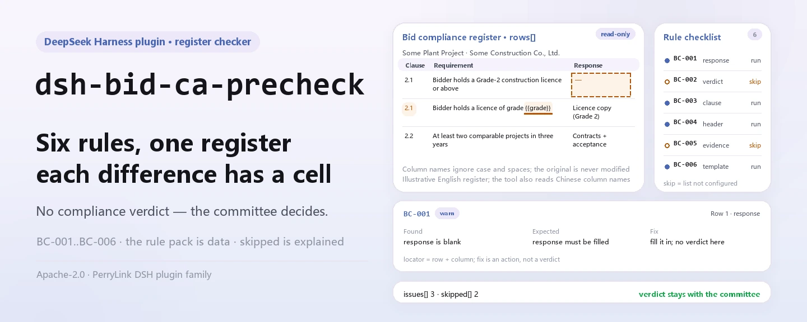
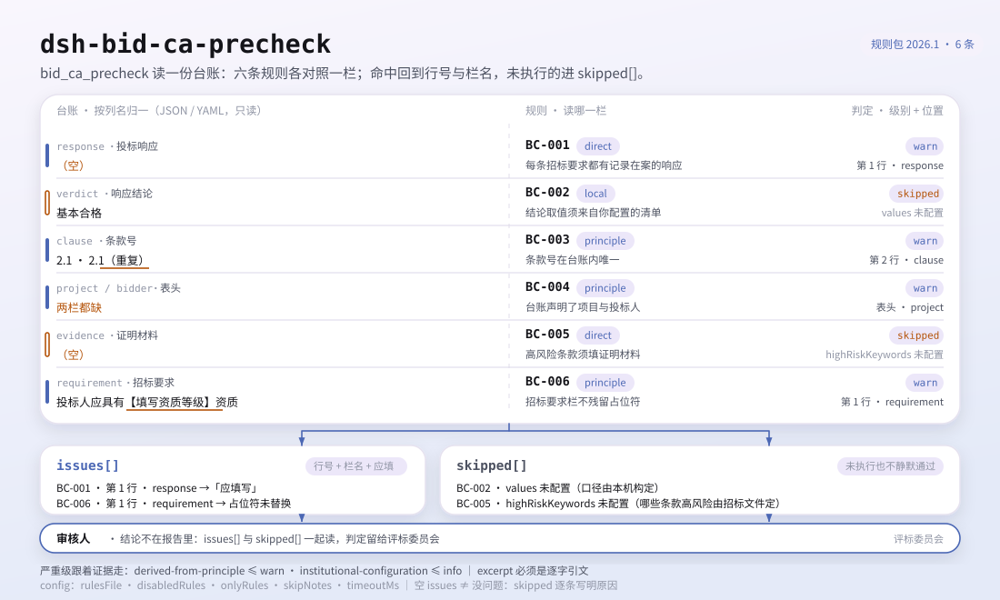
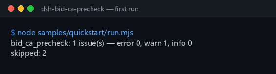

<div align="center">

<picture>
  <source media="(prefers-color-scheme: dark)" srcset="docs/assets/dsh-bid-ca-precheck-hero-en-dark.webp">
  
</picture>

# dsh-bid-ca-precheck

**Comprueba la completitud y la coherencia interna de un registro de respuesta de conformidad de la oferta: obtienes una lista de qué no cuadra, dónde y cómo corregirlo; el dictamen queda en manos de la comisión de evaluación.**

Un verificador con forma de registro para DeepSeek Harness: lee un registro de respuesta de conformidad de la oferta (los requisitos del pliego y las respuestas del licitador, tomados con los propios nombres de columna del registro, en chino o en inglés), aplica un paquete de reglas versionado (BC-001..BC-006) regla por regla y enumera solo las divergencias que puede señalar dentro del material: sin dictamen de cumplimiento, sin atribución de responsabilidad.

[Instalar](#instalación-en-tres-pasos) · [Configuración](#configuración) · [FAQ](#faq) · [简体中文](README.md) · [English](README.en.md) · [Español](README.es.md) · [Português](README.pt.md) · [हिन्दी](README.hi.md)

[](LICENSE)
[](#compatibilidad)
[](https://www.npmjs.com/package/dsh-bid-ca-precheck)
[](https://github.com/PerryLink/dsh-bid-ca-precheck/actions/workflows/ci.yml)
[](#compatibilidad)

[](https://github.com/PerryLink/dsh-bid-ca-precheck/stargazers)
[](https://www.npmjs.com/package/dsh-bid-ca-precheck)
[](https://dshfind.com/plugins/PerryLink/dsh-bid-ca-precheck?ref=badge)
[](https://securityscorecards.dev/viewer/?uri=github.com/PerryLink/dsh-bid-ca-precheck)
[](https://dsh.market/)
[](https://gitee.com/perrylink/dsh-bid-ca-precheck)

```sh
dsh plugin --profile <name> add dsh-bid-ca-precheck
```

</div>

<sub>Plugin de la comunidad, no afiliado a DeepSeek. Repositorio canónico: <https://github.com/PerryLink/dsh-bid-ca-precheck> (Gitee es un espejo).</sub>

## Qué es

`dsh-bid-ca-precheck` lee un registro de respuesta de conformidad de la oferta —los requisitos del pliego y las respuestas del licitador, tomados con los propios nombres de columna del registro, en chino o en inglés—, aplica un paquete de reglas versionado y comprueba la completitud y la coherencia interna de ese registro: que cada requisito del pliego tenga una respuesta registrada, que el veredicto proceda del vocabulario que usted configure, que los números de cláusula sean únicos dentro del registro, que el registro declare su proyecto y su licitador, que una cláusula que usted marcó como de alto riesgo lleve evidencia y que la columna de requisitos contenga requisitos reales y no marcadores de plantilla.

No decide si una oferta es válida, si debe rechazarse, si una respuesta constituye una desviación sustancial ni quién es responsable.

- **Para quién es**: especialistas en licitaciones y agentes de pliegos; no hace falta saber usar la línea de comandos — se le entrega el material en el chat.
- **Qué le entrega usted**: el material de origen sobre el que trabaja la comprobación (una tabla, un registro o un documento); el original nunca se modifica. Excel puede convertirse antes a JSON/YAML, en el chat si la plataforma lo permite.
- **Qué devuelve**: una lista de qué no cuadra, dónde y cómo corregirlo; cada comprobación que no pudo ejecutarse se lista en `skipped` con su motivo.

<picture>
  <source media="(prefers-color-scheme: dark)" srcset="docs/assets/dsh-bid-ca-precheck-flow-v5-dark.svg">
  
</picture>

## Instalación en tres pasos

1. **Instala** (elige un canal):

   ```sh
   # canal git (último main; equivalente a git+https://github.com/PerryLink/dsh-bid-ca-precheck.git)
   dsh plugin --profile <name> add github:PerryLink/dsh-bid-ca-precheck
   # canal npm (versiones publicadas)
   dsh plugin --profile <name> add dsh-bid-ca-precheck
   # canal tarball: pnpm pack en este repo y luego
   dsh plugin --profile <name> add ./dsh-bid-ca-precheck-<version>.tgz
   ```

2. **Configuración mínima** (los valores por defecto ya funcionan; una fila de bundle sin `config` corre entera con los valores por defecto y el paquete de reglas en `rules/bid-ca-precheck.yaml`):

   ```yaml
   - insert:
       - id: dsh-bid-ca-precheck
         name: dsh-bid-ca-precheck
   ```

3. **Verifica que se monta**:

   ```sh
   dsh --profile <name> --dump-config | grep 'dsh-bid-ca-precheck'
   ```

   Luego entrégale un registro — por ejemplo el ejemplo incluido (corresponde a `samples/quickstart/expected/result.json`):

   ```text
   > Ejecuta la comprobación con el ejemplo incluido y dime cuántos problemas hay y de qué nivel.
   bid_ca_precheck: 1 issue(s) — error 0, warn 1, info 0
   skipped: 2
   ```

   

**Desinstalar**: `dsh plugin --profile <name> remove dsh-bid-ca-precheck` (o elimina la fila del patch del perfil).

<details>
<summary>Usarlo en WorkBuddy / Coze</summary>

Busca «Tender Compliance Suite» en WorkBuddy / Coze (esta comprobación es una de sus partes; disponibilidad según catálogo) para usar la misma capacidad sin línea de comandos.

</details>

<details>
<summary>Instalar desde el mercado de DSH Desktop</summary>

Todos los plugins de PerryLink pueden explorarse en el mercado integrado de DSH Desktop: **Market → Sources → add source → pegar** `https://perrylink-dsh-catalog.perrylink.workers.dev/catalog-source.json` **→ seleccionarlo**. La instalación sigue pasando por la verificación de identidad npm del mercado y tu confirmación.

</details>

## Capacidades clave

`dsh-bid-ca-precheck` registra la herramienta `bid_ca_precheck`: lee un registro de respuesta de conformidad, aplica el paquete de reglas versionado y devuelve un informe.

- **Seis reglas en un solo paquete** — el paquete de reglas es datos, no código (`rules/bid-ca-precheck.yaml`); reemplazarlo cambia todo el conjunto de comprobaciones sin tocar una línea de TypeScript.
- **Solo lectura sobre el material** — acepta JSON o YAML y nunca modifica el original; ESM puro, sin peticiones de red, sin llamadas al modelo.
- **Sin citas inventadas** — cada regla lleva `document` / `number` / `clause` / `excerpt` / `kind` / `source`; `excerpt` debe ser una cita literal, y una regla cuyo texto no se obtuvo lo dice en `excerpt` en lugar de presentar una paráfrasis como cita.
- **La gravedad sigue a la evidencia** — `derived-from-principle` tiene tope `warn`, la configuración institucional (`institutional-configuration`) tope `info`, y hay un test que lo afirma; ninguna regla de este paquete puede ser `error`.
- **Una lista vacía nunca es «no hay nada malo»** — cada comprobación que no pudo ejecutarse se informa en `skipped` con su motivo, y una regla cuya lista requerida no está configurada se informa a sí misma en `skipped` en lugar de pasar en silencio.
- **Sin lenguaje que adjudique** — el informe solo enumera divergencias; un guardián de redacción (wording guard) lo impone y todo informe lleva el descargo de responsabilidad.

| Regla | Qué comprueba | Gravedad | Tipo de base |
|---|---|---|---|
| `BC-001` | todo requisito tiene una respuesta registrada | warn | direct |
| `BC-002` | el veredicto usa su vocabulario (desactivada por defecto) | info | local |
| `BC-003` | los números de cláusula son únicos en el registro | warn | principle |
| `BC-004` | el registro nombra su proyecto y su licitador | warn | principle |
| `BC-005` | una cláusula de alto riesgo lleva evidencia (desactivada por defecto) | warn | direct |
| `BC-006` | la columna de requisitos no conserva marcadores sin sustituir | warn | principle |

«Tipo de base» es la forma abreviada del `kind` del paquete: `direct` significa que la cláusula regula directamente lo comprobado, `principle` es `derived-from-principle` (solo deducible del principio, tope `warn`) y `local` es `institutional-configuration` (umbral de su institución, tope `info`).

### Ejemplos

Son los puntos de entrada reales del plugin; instala una vez y llama a uno. La primera fila es el caso detallado y las demás son casos breves.

**Ejemplo detallado** — herramienta `bid_ca_precheck`, entrada:

```json
{"rows":[{"条款号":"2.1","招标要求":"投标人应具有建筑工程施工总承包二级及以上资质","投标响应":"","响应结论":"满足", ...}]}
```

Salida:

```json
{
  "id": "dsh-bid-ca-precheck.BC-001.de09b5a6",
  "ruleId": "BC-001",
  "severity": "warn",
  "locator": {
    "row": 1,
    "field": "response"
  },
  "found": "第 1 行「response」为空",
  "expected": "「response」应填写",
  "fix": "补填响应内容；本条只核对是否填写，不判断该响应对招标要求是否构成实质性满足"
}
```

*Observado en `dsh-bid-ca-precheck/tests/fixtures/BC-001/BC-001-unsafe.json; dsh-bid-ca-precheck/tests/fixtures/BC-001/cases.json; dsh-bid-ca-precheck/rules/bid-ca-precheck.yaml; dsh-bid-ca-precheck/tests/index.test.ts`*

| Usted pregunta | Qué responde |
|---|---|
| La columna `response` de un requisito del pliego está vacía, ¿se informa de ello? | Sí. `BC-001` señala la fila, porque todo requisito del pliego debe tener una respuesta registrada. Solo comprueba que la columna `response` esté rellena: no juzga si la respuesta satisface el requisito, que es competencia de la comisión de evaluación. |
| Rellené la columna `verdict` y el informe dice que la regla no pudo ejecutarse. ¿Por qué? | `BC-002` compara cada valor con el vocabulario de veredictos que usted configure, y esa lista viene vacía, así que hasta que rellene `values` la regla se informa a sí misma en `skipped` en lugar de adivinar. Una vez configurada solo informa de un valor que no esté en su lista; nunca juzga si el veredicto es correcto. |
| El mismo número de cláusula aparece en dos filas del registro. | `BC-003` informa del valor `clause` repetido: si un número aparece dos veces, nadie puede decir qué fila responde a qué requisito. Se ignoran los espacios, así que `3.2` y ` 3.2 ` cuentan como el mismo número. Solo comprueba la unicidad; no decide cuál de las dos filas es correcta: un hallazgo suele significar registro duplicado o un número copiado mal. |
| El registro no dice qué proyecto cubre ni quién es el licitador. | `BC-004` informa del campo de cabecera que falta y exige tanto `project` como `bidder`. Esa necesidad viene de la trazabilidad —un veredicto que no puede ligarse a un proyecto y a un licitador no se puede revisar después—, no de una cláusula que exija una cabecera en el registro. |
| ¿Qué filas deben llevar evidencia? | `BC-005`: toda fila cuyo texto de `requirement` contenga por inclusión una de sus palabras clave de alto riesgo. `highRiskKeywords` viene vacía, así que hasta que la rellene la regla se informa en `skipped` en lugar de pasar en silencio. Solo comprueba que la columna `evidence` esté rellena, no si la evidencia es válida o suficiente. |
| Algunas filas aún dicen 【……】 o `待填` en la columna de requisitos. | `BC-006` las informa: `【`, `】`, `{{`, `}}`, `XXX`, `待填`, `TBD` y términos parecidos que quedan en la columna `requirement` suelen indicar que el registro se copió de una plantilla y nunca se rellenó. La lista de términos es suya para ajustarla. La regla solo señala el marcador; no decide si el requisito en sí es real. |

## Normas que sigue

| Documento | Referencia | Reglas que la citan |
|---|---|---|
| Ley de Licitación y Contratación de la República Popular China | Aprobada el 1999-08-30, modificada el 2017-12-27 (decisión del Comité Permanente de la APN); en vigor desde el 2000-01-01 | BC-001, BC-003, BC-004, BC-006 |
| Reglamento de aplicación de la Ley de Licitación y Contratación de la República Popular China | Decreto del Consejo de Estado n.º 613 (publicado el 2011-12-20, revisado el 2017-03-01, en vigor desde el 2012-02-01) | BC-002 |
| Ley de Licitación y Contratación de la República Popular China | Aprobada el 1999-08-30, modificada el 2017-12-27, en vigor desde el 2000-01-01 | BC-005 |

**Límite:** este plugin comprueba un **registro de respuesta de conformidad de la oferta** en lo que un registro puede exigirse a sí mismo —que todo requisito del pliego tenga una respuesta registrada, que los veredictos procedan de su vocabulario y los números de cláusula sean únicos, que una cláusula de alto riesgo lleve evidencia y que la columna de requisitos contenga requisitos reales y no marcadores de plantilla—. **No** decide si una oferta es válida, si debe rechazarse ni si una respuesta constituye una desviación sustancial. **Esas decisiones corresponden a la comisión de evaluación y este plugin nunca las toma**: un test afirma que ninguna regla de aquí puede ser `error`.

> ### ⚠️ Lea esto antes de confiar en una cita del informe
>
> **El estado de `excerpt` es por regla, no uniforme.** Algunas reglas citan la cláusula literalmente (`kind: direct`), otras se derivan del principio de los artículos citados (`kind: derived-from-principle`, tope `warn`) y otras usan umbrales que configura su institución (`kind: institutional-configuration`, tope `info`). El paquete nunca parafrasea una cita: cuando el texto no se obtuvo, el campo `excerpt` lo dice y el razonamiento vive en `note`; un test afirma que ninguna regla reclama una cita que no tiene. **Para toda regla aún marcada como no obtenida, sustituya el `excerpt` por la cláusula real y eleve `kind` a `direct` cuando tenga el texto.**
>
> La conclusión es del revisor: este plugin enumera divergencias que puede señalar en el material y no decide hechos ni cumplimiento.

## Configuración

Todos los parámetros ajustables son campos Schemastery `Config` en `src/config.ts` (modificables desde cordis.yml); los umbrales por regla están en el paquete de reglas bajo `rules/`. Una sobrescritura dirigida por id reemplaza toda la fila: repita todas las claves que necesite.

| Clave | Tipo | Predeterminado | Descripción |
|---|---|---|---|
| `rulesFile` | string | `rules/bid-ca-precheck.yaml` | Ruta del paquete de reglas, relativa a la raíz del paquete |
| `disabledRules` | string[] | `[]` | Ids de reglas que se dejan de ejecutar; cada una aparece en `skipped` |
| `onlyRules` | string[] | `[]` | Ejecutar solo estas reglas; vacío ejecuta todas |
| `skipNotes` | string | `""` | Nota añadida a cada motivo de `skipped` |
| `timeoutMs` | number | `120000` | Presupuesto de tiempo de espera cooperativo de la herramienta |

Parámetros por regla que conviene conocer (declarados en las entradas de regla del paquete, no en `Config`):

- `BC-002` `values` — su vocabulario de veredictos, p. ej. `[满足, 部分满足, 不满足, 待确认]`. Vacío significa que la regla no se ejecuta.
- `BC-005` `highRiskKeywords` — las palabras que marcan una cláusula como necesitada de evidencia, p. ej. `[资格, 业绩, 实质性, 星号条款]`. Vacío significa que la regla no se ejecuta; `evidenceField` y `requirementField` renombran las dos columnas que lee.
- `BC-006` `terms` — los marcadores a buscar; la lista por defecto cubre `【】`, `{{}}`, `XXX`, `待填`, `待补充`, `TBD`, `todo`.

Ejemplo de sobrescritura en el patch de su perfil:

```yaml
- insert:
    - id: dsh-bid-ca-precheck
      name: dsh-bid-ca-precheck
      config:
        disabledRules: [BC-006]
        timeoutMs: 180000
```

<details>
<summary>Tabla de configuración completa (5 claves)</summary>

| Clave | Tipo | Predeterminado | Descripción |
|---|---|---|---|
| `rulesFile` | string | `rules/bid-ca-precheck.yaml` | Ruta del paquete de reglas, relativa a la raíz del paquete |
| `disabledRules` | string[] | `[]` | Ids de reglas que se dejan de ejecutar; cada una aparece en `skipped` |
| `onlyRules` | string[] | `[]` | Ejecutar solo estas reglas; vacío ejecuta todas |
| `skipNotes` | string | `""` | Nota añadida a cada motivo de `skipped` |
| `timeoutMs` | number | `120000` | Presupuesto de tiempo de espera cooperativo de la herramienta |

</details>

## Formato del material

La herramienta acepta JSON o YAML:

```yaml
project: 某某厂房工程
bidder: 某某建设有限公司
rows:
  - { 条款号: "2.1", 招标要求: 投标人应具有建筑工程施工总承包二级及以上资质,
      投标响应: 已提供资质证书复印件，等级为二级, 响应结论: 满足, 证明材料: 资格文件第 12 页 }
  - { Clause: "2.2", Requirement: 近三年至少完成两项同类业绩,
      Response: 已提供合同及验收证明, Verdict: 满足, Evidence: 业绩文件第 3 页 }
```

Los nombres de columna se comparan sin distinguir mayúsculas y sin contar espacios, guiones bajos ni guiones, así que la columna china de requisitos y la columna inglesa `requirement` se resuelven al mismo campo; el registro conserva sus propios nombres, por lo que un hallazgo nombra la columna que realmente leyó. Una fila puede declarar su propio número vía `row`, `序号` o `行号`. Los campos son opcionales en la capa de lectura y los valida el motor, de modo que un registro exportado parcialmente produce hallazgos de «falta» en lugar de un fallo.

## Fuentes de las reglas

Los datos de las reglas viven en `rules/bid-ca-precheck.yaml`, separados del código: cada regla lleva documento, número, cláusula en la numeración propia de la fuente, extracto literal y URL de origen. La cabecera del paquete declara la brecha de citas por completo, y el `note` de cada regla repite la parte que le afecta. El guardián de carga que normalmente exige «el extracto debe ser una cita real de al menos ocho caracteres» no distingue una cita de una descripción, así que este paquete se apoya en la cabecera, en los `note` por regla y en un test que afirma que todo `excerpt` admite la brecha. Un paquete que exagere su base falla al cargar en lugar de producir un informe de apariencia sólida. Los límites confirmados en la verificación y las conclusiones deliberadamente **no** afirmadas se incluyen con el paquete en `rules/evidence/`.

## FAQ

<details>
<summary>¿Nos dará un veredicto de «cumple / no cumple» o de rechazo de la oferta?</summary>

No. Solo enumera las divergencias que puede señalar dentro del material (qué fila, qué columna, qué falta, cómo corregirlo); no hace juicios de hecho ni de cumplimiento —esa conclusión corresponde siempre a la comisión de evaluación—. La redacción la impone un wording guard, todo informe lleva el descargo de responsabilidad y un test afirma que ninguna regla puede ser `error`.

</details>

<details>
<summary>Mi registro es un libro de Excel, ¿puedo usarlo directamente?</summary>

Sí: conviértalo antes a JSON o YAML, en el chat si la plataforma lo permite. La herramienta solo lee el material y nunca modifica el original.

</details>

<details>
<summary>¿Por qué `BC-002` y `BC-005` nunca informan?</summary>

Porque las listas de las que dependen son suyas, no de una norma: `values` (vocabulario de veredictos) y `highRiskKeywords` vienen vacías, así que las reglas se informan en `skipped`. Se ejecutan cuando las rellena en el paquete de reglas; y entonces `BC-002` solo comprueba que el veredicto registrado esté en su lista, y `BC-005` solo que la columna `evidence` esté rellena.

</details>

<details>
<summary>¿Una lista `issues` vacía equivale a «no hay nada malo»?</summary>

No. Cada comprobación que no pudo ejecutarse figura en `skipped` con su motivo (una lista sin configurar, una columna ausente). Lea `issues` y `skipped` juntos: una lista vacía significa «ninguna divergencia que pueda señalar», no «el registro está completo».

</details>

<details>
<summary>¿Aguanta un registro entero (cien o miles de filas) de una vez?</summary>

La herramienta funciona en `native` y en `ptc`; para lotes (un directorio entero de registros) use `ptc`, donde el coste del esquema se paga una vez. La comprobación es recorrido de tabla y coincidencia de columnas en local: sin peticiones de red, sin llamadas al modelo; el paquete de reglas se cachea por proceso y se analiza una sola vez; `timeoutMs` (120 s por defecto) es un presupuesto de tiempo cooperativo.

</details>

## Solución de problemas

- **`BC-002` o `BC-005` se informan como `skipped`.** Sus listas están vacías. Ambas dependen de su proyecto, no de una norma, y el plugin no las adivina.
- **`BC-006` salta en un requisito que escribí a propósito.** Un término como `XXX` o `待填` aparece de verdad. Recoja la lista `terms` o corrija el registro.
- **El lector rechaza un registro que antes aceptaba.** No encontró ningún nombre de columna conocido; el error enumera las columnas que vio. Renombre una columna a un alias conocido o añada el alias a la especificación de columnas del plugin.
- **`BC-001` salta en filas que considero informativas.** Una respuesta en blanco significa «sin comprobar», justo lo que un registro de precomprobación no debe tener. Si una cláusula realmente no necesita respuesta, anote el motivo en el registro en lugar de dejarla en blanco.
- **El plugin se instala pero la herramienta no aparece.** Compruebe que `main` resuelve a `lib/index.mjs` y que `pnpm run build` lo generó; un `main` incorrecto hace que el cargador omita la entrada en silencio.
- **`dsh plugin add` rechaza el paquete por incompatibilidad.** El rango de peers cubre `0.1.x` y `0.2.x`; si su runtime queda fuera, conceda una exención explícita: `dsh plugin --profile <name> allow-version dsh-bid-ca-precheck@0.1.0 --dsh-version <runtime> --accept-risk`
- **`check` informa `manifest-peers` como fallo.** El verificador estático compara con un rango de peers fijo anterior a la línea 0.2. El runtime aplica la compatibilidad de peers al instalar, así que el rango declarado es el correcto; es un problema conocido de `dsh-plugin-dev`.
- **Las horas parecen desplazadas.** Toda la aritmética es de hora local sobre las cadenas de entrada, sin conversión de zona horaria.

## Límites de seguridad

- **Solo divergencias, sin adjudicación.** El informe nunca se pronuncia sobre cumplimiento, responsabilidad o corrección; un wording guard lo impone, todo informe lleva el descargo y un test afirma que ninguna regla puede ser `error`.
- **Puerta de citas.** `excerpt` debe ser una cita literal; cuando el texto no se obtuvo, el paquete lo dice y baja `kind` a lo que la evidencia sostiene, con la gravedad topada en consecuencia — una paráfrasis nunca se presenta como cita.
- **Las listas vacías siguen visibles.** Cada comprobación que no pudo ejecutarse se informa en `skipped` con su motivo; una regla cuya lista no está configurada se informa a sí misma en lugar de pasar en silencio.
- **Local y de solo lectura.** Sin peticiones de red, sin llamadas al modelo, sin telemetría; solo lee el material entregado a la herramienta y no escribe una segunda copia fuera del resultado y del almacenamiento de sesión/log del propio host (véase [PRIVACY.md](PRIVACY.md)).
- **El registro es un efecto.** El registro de la herramienta devuelve el disposer, así que detener o recargar en caliente lo retira, sin listeners ni estado global residual.

## Limitaciones conocidas

- **Quedan brechas de citas.** En algunas reglas no se obtuvo el número de cláusula ni el texto literal; el paquete lo dice regla por regla en `excerpt` y `note`, y esas reglas quedan topadas en `warn` o `info`. Cuando tenga el texto, sustituya el `excerpt` y eleve `kind` a `direct`.
- **Solo el interior del registro.** No juzga si una respuesta satisface el requisito, si la evidencia es auténtica o suficiente, ni si una oferta es válida o debe rechazarse: esas decisiones necesitan la comisión de evaluación, el pliego y el método de evaluación.
- **Dos reglas están desactivadas por defecto.** El vocabulario de `BC-002` y las palabras clave de `BC-005` vienen vacíos, así que informan `skipped` hasta configurarse; es deliberado: el plugin no codifica ningún vocabulario.
- **Solo se leen los alias de columna conocidos.** Un registro con columnas totalmente desconocidas es rechazado por el lector, y el error enumera las columnas que vio; renombre una columna o añada el alias.
- **El paquete de reglas viaja con el paquete.** Cambiarlo cambia el conjunto de comprobaciones; no hay canal de actualización en línea: reemplace `rules/bid-ca-precheck.yaml` o apunte `rulesFile` a otro sitio.

## Interoperabilidad con otros plugins DSH

Este plugin no reutiliza ninguna superficie de otro plugin ni modifica ninguna:

- **Una sola herramienta.** La herramienta es `bid_ca_precheck`, en el espacio de nombres del propio plugin; no añade comandos con barra, no registra slots de cliente (no hay mitad de navegador) y no reclama ningún prefijo `webServer`.
- **Sin clave de servicio.** No provee ninguna clave de servicio, así que no puede colisionar en una.
- **Sin listeners de eventos compartidos.** No se engancha a eventos sensibles al orden como `agent/pre-step` o `tools/post-execute`, así que no puede haber inanición ni cortocircuito.
- **Patch que solo inserta.** El patch del bundle solo hace `insert` de su propia fila; nunca sobrescribe el `config` de una fila integrada.
- **Sin mutación global.** No parchea prototipos, no reescribe `process.env` ni sustituye el dispatcher global de fetch.
- **Seguro para concurrencia.** La herramienta declara `isConcurrencySafe: true`: acceso de solo lectura al material, sin estado mutable compartido, y el paquete de reglas se cachea por ruta y se reutiliza en solo lectura.

## Compatibilidad

| Superficie | Estado |
|---|---|
| Harness | Rango de peers `>=0.1.2-rc.1 <0.2.0 \|\| >=0.2.0-0 <0.3.0` — verificado para aceptar tanto `0.2.0-rc.2` como `0.2.1-rc.2`. `engines.dsh` se declara como `>=0.2.1-0 <0.3.0` y el host lo aplica desde 0.2.1 |
| Node | `^22.19.0 \|\| >=24.0.0` |
| Plataformas | Todas (ESM puro; sin código nativo, sin red, sin llamada al modelo) |
| Modo de herramienta | Funciona en `native` y `ptc`; para un lote de registros use `ptc` |

## Ecosistema y calidad

- [Espejo en Gitee](https://gitee.com/perrylink/dsh-bid-ca-precheck) (espejo sincronizado; GitHub es canónico)
- [Página del plugin en dshfind](https://dshfind.com/plugins/PerryLink/dsh-bid-ca-precheck) (instalaciones y ranking)
- [Informe OpenSSF Scorecard](https://securityscorecards.dev/viewer/?uri=github.com/PerryLink/dsh-bid-ca-precheck) (impulsado por [.github/workflows/scorecard.yml](.github/workflows/scorecard.yml))
- [DSH Market](https://dsh.market/) (listado)
- **Canal de la tienda 1024**: `npm i -g dsh1024` una vez y luego `dsh1024 plugin --profile <name> add dsh-bid-ca-precheck` (cuenta para el ranking de instalaciones de [deepseek1024.com](https://deepseek1024.com))
- [Base de conocimiento del ecosistema](https://perrylink.github.io/dsh-plugin-guide/) — datos medidos, no marketing: guía de desarrollo · datos de selección · criterios de mantenimiento

## Desarrollo

```sh
pnpm install                                           # node ^22.19 || >=24
pnpm run typecheck                                     # tsc --noEmit
pnpm test                                              # vitest: suite compartida de plugins de tabla + fixtures emparejados
pnpm run build                                         # tsdown -> lib/index.mjs + lib/index.d.mts
pnpm run verify:self-contained                         # las dependencias se resuelven desde el registry
pnpm run check:lockfile                                # comprobación de deriva del lockfile
pnpm run check:readmes                                 # consistencia de los README en cinco idiomas
pnpm run check:citations                               # línea base de citas del paquete de reglas
node ../scripts/sync-shared.mjs dsh-bid-ca-precheck     # refresca src/shared desde ../_shared
pnpm pack                                              # el tarball publicado
```

El plugin es **solo datos**: `src/model.ts` declara la forma de la tabla, el kit compartido aporta el lector y el motor de comprobación, y el paquete de reglas declara cada comprobación. Una nueva comprobación que encaje en un tipo existente solo necesita editar el paquete de reglas.

Ejecución local del ejemplo (ejecute antes `pnpm run build` para que exista `lib/`):

```sh
node samples/quickstart/run.mjs --json
# => {"tool":"bid_ca_precheck","issueCount":1,"summary":{"error":0,"warn":1,"info":0},"skippedCount":2}
```

La entrada del ejemplo está en `samples/quickstart/input/`, la salida esperada en `samples/quickstart/expected/result.json` y la captura en `docs/assets/quickstart.png`. Las imágenes del README se generan programáticamente con [`scripts/gen-readme-assets.py`](scripts/gen-readme-assets.py) (Python + Pillow) y se pueden volver a ejecutar sin riesgo; el diagrama de una sola versión y las imágenes de demostración antiguas se conservan en `docs/assets/` para enlaces externos, y los README solo citan el nuevo par claro/oscuro.

Topics: `deepseek-harness`, `dsh`, `dsh-plugin`, `cordis`, `bid`, `precheck`

## Familia y agradecimientos

Este proyecto forma parte de la familia de plugins de DeepSeek Harness de [PerryLink](https://github.com/PerryLink) (todos Apache-2.0). Índice completo: [elige un verificador por material](https://perrylink.github.io/zh/checkers/choose/) y [todos los plugins](https://github.com/PerryLink). Si te resulta útil, **una estrella ayuda a que la siguiente persona lo encuentre**: nada queda bloqueado por ello.

- [@PerryLink](https://github.com/PerryLink) — creador y mantenedor: el paquete de reglas de datos (BC-001..BC-006), la herramienta `bid_ca_precheck`, el registro de verificación de citas y la documentación en cinco idiomas.

<details>
<summary>Desplegar todos los plugins</summary>

| Plugin | Estado |
|---|---|
| **[dsh-aqua-input-check](https://github.com/PerryLink/dsh-aqua-input-check)** |  |
| **[dsh-archive-check](https://github.com/PerryLink/dsh-archive-check)** |  |
| **[dsh-auto-review](https://github.com/PerryLink/dsh-auto-review)** |  |
| **[dsh-autotier](https://github.com/PerryLink/dsh-autotier)** | 🧊 CONGELADO — ver el README del repo |
| **[dsh-bid-ca-precheck](https://github.com/PerryLink/dsh-bid-ca-precheck)** |  |
| **[dsh-bid-qual-check](https://github.com/PerryLink/dsh-bid-qual-check)** |  |
| **[dsh-cert-mcp](https://github.com/PerryLink/dsh-cert-mcp)** | 🧊 CONGELADO — ver el README del repo |
| **[dsh-checkpoint-rewind](https://github.com/PerryLink/dsh-checkpoint-rewind)** |  |
| **[dsh-click](https://github.com/PerryLink/dsh-click)** |  |
| **[dsh-composer-history](https://github.com/PerryLink/dsh-composer-history)** |  |
| **[dsh-contract-stance](https://github.com/PerryLink/dsh-contract-stance)** |  |
| **[dsh-customs-doc-check](https://github.com/PerryLink/dsh-customs-doc-check)** |  |
| **[dsh-data-quality](https://github.com/PerryLink/dsh-data-quality)** | 🧊 CONGELADO — ver el README del repo |
| **[dsh-demurrage-ledger](https://github.com/PerryLink/dsh-demurrage-ledger)** |  |
| **[dsh-doublecheck](https://github.com/PerryLink/dsh-doublecheck)** |  |
| **[dsh-drill-script-check](https://github.com/PerryLink/dsh-drill-script-check)** |  |
| **[dsh-eia-guide-check](https://github.com/PerryLink/dsh-eia-guide-check)** |  |
| **[dsh-emergency-plan](https://github.com/PerryLink/dsh-emergency-plan)** |  |
| **[dsh-essay-rubric-check](https://github.com/PerryLink/dsh-essay-rubric-check)** |  |
| **[dsh-evidence-check](https://github.com/PerryLink/dsh-evidence-check)** |  |
| **[dsh-export-ctl-check](https://github.com/PerryLink/dsh-export-ctl-check)** |  |
| **[dsh-fast](https://github.com/PerryLink/dsh-fast)** |  |
| **[dsh-fmea-table-check](https://github.com/PerryLink/dsh-fmea-table-check)** |  |
| **[dsh-forecast-penalty](https://github.com/PerryLink/dsh-forecast-penalty)** |  |
| **[dsh-fund-research](https://github.com/PerryLink/dsh-fund-research)** |  |
| **[dsh-github](https://github.com/PerryLink/dsh-github)** |  |
| **[dsh-gongwen-flow-check](https://github.com/PerryLink/dsh-gongwen-flow-check)** |  |
| **[dsh-gongwen-word-check](https://github.com/PerryLink/dsh-gongwen-word-check)** |  |
| **[dsh-guard-plan-qc](https://github.com/PerryLink/dsh-guard-plan-qc)** |  |
| **[dsh-hazchem-check](https://github.com/PerryLink/dsh-hazchem-check)** |  |
| **[dsh-hazplan-check](https://github.com/PerryLink/dsh-hazplan-check)** |  |
| **[dsh-hidden-risk-map](https://github.com/PerryLink/dsh-hidden-risk-map)** |  |
| **[dsh-hs-classify](https://github.com/PerryLink/dsh-hs-classify)** |  |
| **[dsh-icd-rule-check](https://github.com/PerryLink/dsh-icd-rule-check)** |  |
| **[dsh-industry-research](https://github.com/PerryLink/dsh-industry-research)** |  |
| **[dsh-lawcite-adapter](https://github.com/PerryLink/dsh-lawcite-adapter)** |  |
| **[dsh-laya](https://github.com/PerryLink/dsh-laya)** |  |
| **[dsh-lc-doc-check](https://github.com/PerryLink/dsh-lc-doc-check)** |  |
| **[dsh-learning-gap-check](https://github.com/PerryLink/dsh-learning-gap-check)** |  |
| **[dsh-library](https://github.com/PerryLink/dsh-library)** |  |
| **[dsh-local-ai](https://github.com/PerryLink/dsh-local-ai)** |  |
| **[dsh-lsp-actions](https://github.com/PerryLink/dsh-lsp-actions)** |  |
| **[dsh-mask](https://github.com/PerryLink/dsh-mask)** |  |
| **[dsh-mcp-panel](https://github.com/PerryLink/dsh-mcp-panel)** |  |
| **[dsh-medrec-qc](https://github.com/PerryLink/dsh-medrec-qc)** |  |
| **[dsh-memento](https://github.com/PerryLink/dsh-memento)** | 🧊 CONGELADO — ver el README del repo |
| **[dsh-nsfc-form-check](https://github.com/PerryLink/dsh-nsfc-form-check)** |  |
| **[dsh-nurse-record-check](https://github.com/PerryLink/dsh-nurse-record-check)** |  |
| **[dsh-observe](https://github.com/PerryLink/dsh-observe)** |  |
| **[dsh-origin-rvc-check](https://github.com/PerryLink/dsh-origin-rvc-check)** |  |
| **[dsh-ota-review-check](https://github.com/PerryLink/dsh-ota-review-check)** |  |
| **[dsh-output-styles](https://github.com/PerryLink/dsh-output-styles)** |  |
| **[dsh-paper-doc-adapter](https://github.com/PerryLink/dsh-paper-doc-adapter)** |  |
| **[dsh-permission-rules](https://github.com/PerryLink/dsh-permission-rules)** |  |
| **[dsh-permit-report-check](https://github.com/PerryLink/dsh-permit-report-check)** |  |
| **[dsh-pipeline-check](https://github.com/PerryLink/dsh-pipeline-check)** |  |
| **[dsh-pleading-draft](https://github.com/PerryLink/dsh-pleading-draft)** |  |
| **[dsh-plugin-doctor](https://github.com/PerryLink/dsh-plugin-doctor)** | 🚫 RETIRADO (repo archivado) |
| **[dsh-plugin-guide](https://github.com/PerryLink/dsh-plugin-guide)** |  |
| **[dsh-plugin-kit](https://github.com/PerryLink/dsh-plugin-kit)** | 🚫 RETIRADO (repo archivado) |
| **[dsh-plugin-upgrade](https://github.com/PerryLink/dsh-plugin-upgrade)** | 🚫 RETIRADO (repo archivado) |
| **[dsh-policy-brief-draft](https://github.com/PerryLink/dsh-policy-brief-draft)** |  |
| **[dsh-power-loss-split](https://github.com/PerryLink/dsh-power-loss-split)** |  |
| **[dsh-power-ticket-check](https://github.com/PerryLink/dsh-power-ticket-check)** |  |
| **[dsh-ppap-check](https://github.com/PerryLink/dsh-ppap-check)** |  |
| **[dsh-protest-deadline](https://github.com/PerryLink/dsh-protest-deadline)** |  |
| **[dsh-railway-window](https://github.com/PerryLink/dsh-railway-window)** |  |
| **[dsh-repair-order-qc](https://github.com/PerryLink/dsh-repair-order-qc)** |  |
| **[dsh-research-report](https://github.com/PerryLink/dsh-research-report)** |  |
| **[dsh-review-reply-check](https://github.com/PerryLink/dsh-review-reply-check)** |  |
| **[dsh-rulefile-check](https://github.com/PerryLink/dsh-rulefile-check)** |  |
| **[dsh-safety-brief-check](https://github.com/PerryLink/dsh-safety-brief-check)** |  |
| **[dsh-score](https://github.com/PerryLink/dsh-score)** | 🧊 CONGELADO — ver el README del repo |
| **[dsh-session-sync](https://github.com/PerryLink/dsh-session-sync)** |  |
| **[dsh-site-log-check](https://github.com/PerryLink/dsh-site-log-check)** |  |
| **[dsh-skill-pack-security](https://github.com/PerryLink/dsh-skill-pack-security)** |  |
| **[dsh-soe-decision-check](https://github.com/PerryLink/dsh-soe-decision-check)** |  |
| **[dsh-soilwater-check](https://github.com/PerryLink/dsh-soilwater-check)** |  |
| **[dsh-sop-sync-check](https://github.com/PerryLink/dsh-sop-sync-check)** |  |
| **[dsh-spc-gbt-adapter](https://github.com/PerryLink/dsh-spc-gbt-adapter)** |  |
| **[dsh-talk](https://github.com/PerryLink/dsh-talk)** |  |
| **[dsh-tender-extract](https://github.com/PerryLink/dsh-tender-extract)** |  |
| **[dsh-tender-matrix](https://github.com/PerryLink/dsh-tender-matrix)** |  |
| **[dsh-test-drive](https://github.com/PerryLink/dsh-test-drive)** |  |
| **[dsh-ticktick](https://github.com/PerryLink/dsh-ticktick)** | 🚫 RETIRADO (repo archivado) |
| **[dsh-translate](https://github.com/PerryLink/dsh-translate)** |  |
| **[dsh-warranty-calc](https://github.com/PerryLink/dsh-warranty-calc)** |  |
| **[dsh-budget](https://github.com/PerryLink/dsh-budget)** | 🧊 CONGELADO — ver el README del repo |
| **[dsh-claude-move](https://github.com/PerryLink/dsh-claude-move)** | 🧊 CONGELADO — ver el README del repo |
| **[dsh-defend](https://github.com/PerryLink/dsh-defend)** | 🧊 CONGELADO — ver el README del repo |
| **[dsh-draw](https://github.com/PerryLink/dsh-draw)** | 🧊 CONGELADO — ver el README del repo |
| **[dsh-reach](https://github.com/PerryLink/dsh-reach)** | 🧊 CONGELADO — ver el README del repo |
| **[dsh-background-agents](https://github.com/PerryLink/dsh-background-agents)** | 🚫 RETIRADO (repo archivado) |
| **[dsh-session-pin](https://github.com/PerryLink/dsh-session-pin)** | 🚫 RETIRADO (repo archivado) |
| **[dsh-team-rooms](https://github.com/PerryLink/dsh-team-rooms)** | 🚫 RETIRADO (repo archivado) |

</details>

## Licencia

[LICENSE](LICENSE) (Apache License 2.0) © 2026 dsh-bid-ca-precheck contributors

<p align="center"><sub>Apache-2.0 · Plugin de la comunidad, no afiliado a DeepSeek.</sub></p>
