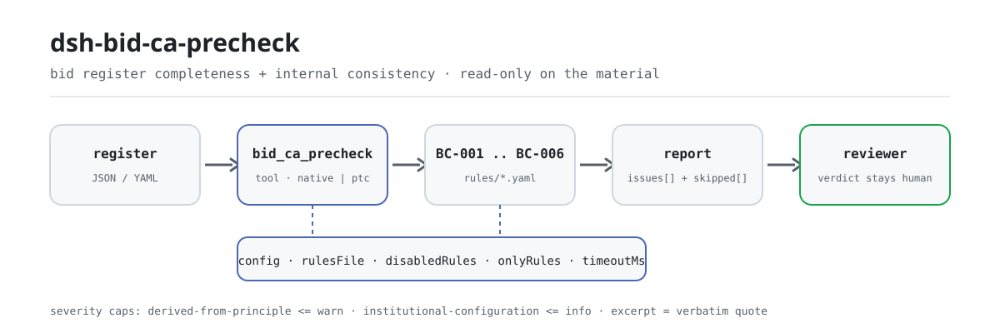
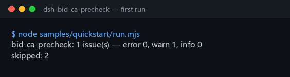

<div align="center">

<picture>
  <source media="(prefers-color-scheme: dark)" srcset="docs/assets/dsh-bid-ca-precheck-flow-dark.svg">
  
</picture>

# dsh-bid-ca-precheck

**बोली अनुरूपता प्रतिक्रिया रजिस्टर की पूर्णता और आंतरिक सहमति जाँचता है — «कौन-सी पंक्ति, कौन-सा कॉलम, क्या अंतर» की सूची देता है; अंतिम निर्णय मूल्यांकन समिति का रहता है।**

DeepSeek Harness के लिए रजिस्टर-आकार का जाँचकर्ता: एक बोली अनुरूपता प्रतिक्रिया रजिस्टर पढ़ता है (निविदा की आवश्यकताएँ और बोली लगाने वाले के उत्तर, रजिस्टर के अपने चीनी या अंग्रेज़ी कॉलम-नामों से लिए गए), संस्करण-बद्ध नियम-पैक (BC-001..BC-006) नियम-दर-नियम लागू करता है, और केवल वही अंतर सूचीबद्ध करता है जिन्हें सामग्री के भीतर इंगित किया जा सकता है — कोई अनुरूपता निर्णय नहीं, कोई दायित्व-निर्धारण नहीं।

[इंस्टॉल](#तीन-चरणों-में-शुरुआत) · [कॉन्फ़िगरेशन](#कॉन्फ़िगरेशन) · [FAQ](#faq) · [简体中文](README.md) · [English](README.en.md) · [Español](README.es.md) · [Português](README.pt.md) · [हिन्दी](README.hi.md)

[](LICENSE)
[](#संगतता)
[](https://www.npmjs.com/package/dsh-bid-ca-precheck)
[](https://github.com/PerryLink/dsh-bid-ca-precheck/actions/workflows/ci.yml)
[](#संगतता)

[](https://github.com/PerryLink/dsh-bid-ca-precheck/stargazers)
[](https://www.npmjs.com/package/dsh-bid-ca-precheck)
[](https://dshfind.com/plugins/PerryLink/dsh-bid-ca-precheck?ref=badge)
[](https://securityscorecards.dev/viewer/?uri=github.com/PerryLink/dsh-bid-ca-precheck)
[](https://dsh.market/)
[](https://gitee.com/perrylink/dsh-bid-ca-precheck)

```sh
dsh plugin --profile <name> add dsh-bid-ca-precheck
```

</div>

<sub>समुदाय प्लगइन, DeepSeek से संबद्ध नहीं। एकमात्र रेपो: <https://github.com/PerryLink/dsh-bid-ca-precheck> (Gitee दर्पण है)।</sub>

## यह क्या है

`dsh-bid-ca-precheck` एक बोली अनुरूपता प्रतिक्रिया रजिस्टर पढ़ता है — निविदा दस्तावेज़ की आवश्यकताएँ और बोली लगाने वाले के उत्तर, रजिस्टर के अपने चीनी या अंग्रेज़ी कॉलम-नामों से लिए गए — और उसी रजिस्टर की पूर्णता तथा आंतरिक सहमति जाँचता है: हर निविदा आवश्यकता के सामने उत्तर दर्ज है या नहीं, निर्णय (verdict) आपके द्वारा कॉन्फ़िगर की गई सूची से लिया गया है या नहीं, क्लॉज़ क्रमांक रजिस्टर में अनन्य हैं या नहीं, रजिस्टर अपना प्रोजेक्ट और बोली लगाने वाला बताता है या नहीं, आपके चिह्नित किए उच्च-जोखिम क्लॉज़ के साथ प्रमाण दर्ज है या नहीं, और आवश्यकता-कॉलम में टेम्पलेट प्लेसहोल्डर के बजाय वास्तविक आवश्यकताएँ हैं या नहीं।

यह तय नहीं करता कि बोली वैध है, अस्वीकार की जानी चाहिए, कोई उत्तर सारभूत विचलन है, या दोष किसका है।

- **किसके लिए**: निविदा विशेषज्ञ और निविदा एजेंट; कमांड लाइन जानने की ज़रूरत नहीं — सामग्री चैट में दे दीजिए।
- **आप क्या देते हैं**: जाँच जिस मूल सामग्री पर चलती है (तालिका, रजिस्टर या दस्तावेज़); मूल कभी नहीं बदला जाता। Excel को पहले JSON/YAML में बदला जा सकता है, मंच अनुमति दे तो चैट में ही।
- **यह क्या देता है**: «कौन-सी पंक्ति, कौन-सा कॉलम, क्या अंतर, कैसे सुधारें» की सूची; हर वह जाँच जो नहीं चल सकी, कारण के साथ `skipped` में दर्ज होती है।

## तीन चरणों में शुरुआत

1. **इंस्टॉल** (एक चैनल चुनें):

   ```sh
   # git चैनल (नवीनतम main; git+https://github.com/PerryLink/dsh-bid-ca-precheck.git के बराबर)
   dsh plugin --profile <name> add github:PerryLink/dsh-bid-ca-precheck
   # npm चैनल (प्रकाशित संस्करण)
   dsh plugin --profile <name> add dsh-bid-ca-precheck
   # tarball चैनल: इस रेपो में pnpm pack के बाद
   dsh plugin --profile <name> add ./dsh-bid-ca-precheck-<version>.tgz
   ```

2. **न्यूनतम कॉन्फ़िगरेशन** (डिफ़ॉल्ट ही काफ़ी हैं; `config` के बिना bundle पंक्ति पूरी तरह डिफ़ॉल्ट से चलती है और नियम-पैक `rules/bid-ca-precheck.yaml` पर रहता है):

   ```yaml
   - insert:
       - id: dsh-bid-ca-precheck
         name: dsh-bid-ca-precheck
   ```

3. **जाँचें कि माउंट हुआ**:

   ```sh
   dsh --profile <name> --dump-config | grep 'dsh-bid-ca-precheck'
   ```

   फिर एक रजिस्टर सौंपिए — जैसे साथ आया नमूना (जो `samples/quickstart/expected/result.json` से मेल खाता है):

   ```text
   > साथ आए नमूने पर यह जाँच चलाइए और बताइए कि कितनी समस्याएँ मिलीं और किस स्तर की।
   bid_ca_precheck: 1 issue(s) — error 0, warn 1, info 0
   skipped: 2
   ```

   

**अनइंस्टॉल**: `dsh plugin --profile <name> remove dsh-bid-ca-precheck` (या प्रोफ़ाइल patch से वह पंक्ति हटा दें)।

<details>
<summary>WorkBuddy / Coze में उपयोग</summary>

WorkBuddy / Coze में «Tender Compliance Suite» खोजें (यह जाँच उसका एक हिस्सा है; उपलब्धता कैटलॉग के अनुसार) और बिना कमांड लाइन वही जाँच क्षमता पाएँ।

</details>

<details>
<summary>DSH Desktop मार्केट से इंस्टॉल</summary>

सभी PerryLink प्लगइन DSH Desktop के अंतर्निहित मार्केट में देखे जा सकते हैं: **Market → Sources → add source → चिपकाएँ** `https://perrylink-dsh-catalog.perrylink.workers.dev/catalog-source.json` **→ चुनें**। इंस्टॉल फिर भी मार्केट की npm पहचान जाँच और आपकी पुष्टि से होता है।

</details>

## मुख्य क्षमताएँ

`dsh-bid-ca-precheck` टूल `bid_ca_precheck` पंजीकृत करता है: एक अनुरूपता प्रतिक्रिया रजिस्टर पढ़ता है, संस्करण-बद्ध नियम-पैक लागू करता है, और रिपोर्ट लौटाता है।

- **एक पैक में छह नियम** — नियम-पैक डेटा है, कोड नहीं (`rules/bid-ca-precheck.yaml`); उसे बदलने से पूरा जाँच-समुच्चय बदल जाता है, TypeScript की एक पंक्ति छुए बिना।
- **सामग्री पर केवल पढ़ाई** — JSON या YAML स्वीकार करता है और मूल कभी नहीं बदलता; शुद्ध ESM, कोई नेटवर्क अनुरोध नहीं, कोई मॉडल कॉल नहीं।
- **कोई गढ़ा उद्धरण नहीं** — हर नियम में `document` / `number` / `clause` / `excerpt` / `kind` / `source` होता है; `excerpt` शब्दशः उद्धरण ही हो सकता है, और जिस नियम का पाठ नहीं मिला वह `excerpt` में यह बताता है, किसी व्याख्या को उद्धरण बताकर नहीं चलाता।
- **गंभीरता प्रमाण के अनुसार** — `derived-from-principle` अधिकतम `warn`, संस्थागत कॉन्फ़िगरेशन (`institutional-configuration`) अधिकतम `info`, और एक टेस्ट इसकी पुष्टि करता है; इस पैक का कोई नियम `error` नहीं हो सकता।
- **खाली सूची का अर्थ «कुछ गड़बड़ नहीं» नहीं** — हर वह जाँच जो नहीं चल सकी, कारण के साथ `skipped` में दर्ज होती है; जिस नियम की आवश्यक सूची सेट नहीं है वह चुपचाप पास होने के बजाय स्वयं को `skipped` में दर्ज करता है।
- **कोई निर्णायक भाषा नहीं** — रिपोर्ट केवल अंतर गिनाती है; wording guard इसे लागू करता है और हर रिपोर्ट के साथ अस्वीकरण रहता है।

| नियम | क्या जाँचता है | गंभीरता | आधार प्रकार |
|---|---|---|---|
| `BC-001` | हर आवश्यकता के सामने उत्तर दर्ज है | warn | direct |
| `BC-002` | निर्णय आपके शब्दावली से लिया गया है (डिफ़ॉल्ट रूप से बंद) | info | local |
| `BC-003` | क्लॉज़ क्रमांक रजिस्टर में अनन्य हैं | warn | principle |
| `BC-004` | रजिस्टर अपना प्रोजेक्ट और बोली लगाने वाला बताता है | warn | principle |
| `BC-005` | उच्च-जोखिम क्लॉज़ के साथ प्रमाण दर्ज है (डिफ़ॉल्ट रूप से बंद) | warn | direct |
| `BC-006` | आवश्यकता-कॉलम में बिना बदला प्लेसहोल्डर नहीं बचा | warn | principle |

«आधार प्रकार» नियम-पैक के `kind` का संक्षिप्त रूप है: `direct` का अर्थ है कि धारा स्वयं जाँची जा रही बात कहती है, `principle` यानी `derived-from-principle` (केवल सिद्धांत से निकाला गया, अधिकतम `warn`), और `local` यानी `institutional-configuration` (सीमा आपकी संस्था की, अधिकतम `info`)।

### उदाहरण

ये प्लगइन के वास्तविक प्रवेश-बिंदु हैं; एक बार इंस्टॉल करके कोई एक चलाएँ। पहली पंक्ति विस्तृत केस है, बाकी संक्षिप्त केस हैं।

**विस्तृत उदाहरण** — टूल `bid_ca_precheck`, इनपुट:

```json
{"rows":[{"条款号":"2.1","招标要求":"投标人应具有建筑工程施工总承包二级及以上资质","投标响应":"","响应结论":"满足", ...}]}
```

आउटपुट:

```json
{
  "id": "dsh-bid-ca-precheck.BC-001.de09b5a6",
  "ruleId": "BC-001",
  "severity": "warn",
  "locator": {
    "row": 1,
    "field": "response"
  },
  "found": "第 1 行「response」为空",
  "expected": "「response」应填写",
  "fix": "补填响应内容；本条只核对是否填写，不判断该响应对招标要求是否构成实质性满足"
}
```

*स्रोत `dsh-bid-ca-precheck/tests/fixtures/BC-001/BC-001-unsafe.json; dsh-bid-ca-precheck/tests/fixtures/BC-001/cases.json; dsh-bid-ca-precheck/rules/bid-ca-precheck.yaml; dsh-bid-ca-precheck/tests/index.test.ts`*

| आपका सवाल | इसका जवाब |
|---|---|
| किसी निविदा आवश्यकता का `response` कॉलम खाली है — क्या यह दर्ज होता है? | हाँ। `BC-001` उस पंक्ति को दर्ज करता है, क्योंकि हर निविदा आवश्यकता के सामने उत्तर दर्ज होना चाहिए। यह केवल देखता है कि `response` कॉलम भरा है या नहीं — यह नहीं आँकता कि उत्तर उस आवश्यकता को पूरा करता है या नहीं, जो मूल्यांकन समिति का निर्णय है। |
| मैंने `verdict` कॉलम भर दिया, फिर भी रिपोर्ट कहती है कि नियम चल नहीं सका। क्यों? | `BC-002` हर मान की तुलना उस निर्णय-शब्दावली से करता है जो आप कॉन्फ़िगर करते हैं, और वह सूची खाली आती है; इसलिए जब तक आप `values` नहीं भरते, नियम अनुमान लगाने के बजाय स्वयं को `skipped` में दर्ज करता है। कॉन्फ़िगर होने पर यह केवल वह मान दर्ज करता है जो आपकी सूची में न हो; निर्णय सही है या नहीं, यह कभी नहीं आँकता। |
| रजिस्टर की दो पंक्तियों में एक ही क्लॉज़ क्रमांक है। | `BC-003` दोहराया गया `clause` मान दर्ज करता है: एक ही क्रमांक दो बार आने पर यह तय नहीं होता कि कौन-सी पंक्ति किस आवश्यकता का उत्तर है। तुलना में खाली जगह नहीं गिनी जाती, इसलिए `3.2` और ` 3.2 ` एक ही क्रमांक माने जाते हैं। यह केवल अनन्यता देखता है — दोनों में से कौन-सी पंक्ति सही है, यह नहीं तय करता; ऐसा मिलना आम तौर पर दोहरी प्रविष्टि या गलत कॉपी किए क्रमांक का संकेत है। |
| रजिस्टर में यह नहीं लिखा कि यह किस प्रोजेक्ट का है और बोली लगाने वाला कौन है। | `BC-004` छूटा हुआ हेडर-फ़ील्ड दर्ज करता है और `project` तथा `bidder` दोनों की अपेक्षा करता है। यह आवश्यकता पता-लगाने (traceability) से आती है — जो निर्णय किसी प्रोजेक्ट और बोली लगाने वाले से न जुड़े, उसकी बाद में समीक्षा नहीं हो सकती — किसी ऐसी धारा से नहीं जो रजिस्टर में हेडर अनिवार्य करती हो। |
| किन पंक्तियों में प्रमाण देना ज़रूरी है? | `BC-005`: हर उस पंक्ति में जिसके `requirement` पाठ में आपका कोई उच्च-जोखिम कीवर्ड समावेशन (containment) से मेल खाता हो। `highRiskKeywords` खाली आती है, इसलिए जब तक आप उसे नहीं भरते, नियम चुपचाप पास होने के बजाय स्वयं को `skipped` में दर्ज करता है। यह केवल देखता है कि `evidence` कॉलम भरा है या नहीं, यह नहीं कि प्रमाण वैध या पर्याप्त है। |
| कुछ पंक्तियों के आवश्यकता-कॉलम में अब भी 【……】 या `待填` लिखा है। | `BC-006` उन पंक्तियों को दर्ज करता है: `requirement` कॉलम में बचे `【`, `】`, `{{`, `}}`, `XXX`, `待填`, `TBD` जैसे शब्द आम तौर पर बताते हैं कि रजिस्टर टेम्पलेट से कॉपी किया गया और कभी भरा ही नहीं गया। शब्दों की यह सूची आप अपने टेम्पलेट के अनुसार बदल सकते हैं। नियम केवल प्लेसहोल्डर दर्ज करता है; आवश्यकता स्वयं वास्तविक है या नहीं, यह नहीं तय करता। |

## यह किन मानकों पर आधारित है

| दस्तावेज़ | संदर्भ | इन्हें उद्धृत करने वाले नियम |
|---|---|---|
| चीन जनवादी गणराज्य का निविदा एवं अनुबंध कानून | 1999-08-30 को पारित, 2017-12-27 को संशोधित (राष्ट्रीय जन कांग्रेस स्थायी समिति का निर्णय); 2000-01-01 से प्रभावी | BC-001, BC-003, BC-004, BC-006 |
| चीन जनवादी गणराज्य के निविदा एवं अनुबंध कानून की कार्यान्वयन नियमावली | राज्य परिषद अध्यादेश संख्या 613 (2011-12-20 को जारी, 2017-03-01 को संशोधित, 2012-02-01 से प्रभावी) | BC-002 |
| चीन जनवादी गणराज्य का निविदा एवं अनुबंध कानून | 1999-08-30 को पारित, 2017-12-27 को संशोधित, 2000-01-01 से प्रभावी | BC-005 |

**सीमा:** यह प्लगइन एक **बोली अनुरूपता प्रतिक्रिया रजिस्टर** को उतना ही जाँचता है जितना रजिस्टर से अपेक्षित हो सकता है — हर निविदा आवश्यकता के सामने उत्तर दर्ज हो, निर्णय आपकी शब्दावली से आए और क्लॉज़ क्रमांक अनन्य हों, उच्च-जोखिम क्लॉज़ के साथ प्रमाण हो, और आवश्यकता-कॉलम में टेम्पलेट प्लेसहोल्डर के बजाय वास्तविक आवश्यकताएँ हों। यह **तय नहीं करता** कि बोली वैध है, अस्वीकार की जानी चाहिए, या कोई उत्तर सारभूत विचलन है। **ये निर्णय मूल्यांकन समिति के हैं, और यह प्लगइन उन्हें कभी नहीं लेता** — एक टेस्ट पुष्टि करता है कि यहाँ कोई नियम `error` नहीं हो सकता।

> ### ⚠️ रिपोर्ट के किसी उद्धरण पर भरोसा करने से पहले यह पढ़ें
>
> **`excerpt` की स्थिति नियम-दर-नियम अलग है, एक जैसी नहीं।** कुछ नियम धारा को शब्दशः उद्धृत करते हैं (`kind: direct`), कुछ उद्धृत अनुच्छेदों के सिद्धांत से निकाले गए हैं (`kind: derived-from-principle`, अधिकतम `warn`), और कुछ में सीमा आपकी संस्था तय करती है (`kind: institutional-configuration`, अधिकतम `info`)। पैक किसी उद्धरण की व्याख्या नहीं लिखता: जब पाठ नहीं मिला, `excerpt` यह बता देता है और तर्क `note` में रहता है; एक टेस्ट पुष्टि करता है कि कोई नियम ऐसा उद्धरण नहीं दावा करता जो उसके पास नहीं है। **जो नियम अब भी «पाठ नहीं मिला» कहते हैं, उनके लिए पाठ मिलने पर `excerpt` को वास्तविक धारा से बदलें और `kind` को `direct` तक बढ़ाएँ।**
>
> निष्कर्ष समीक्षक का है: यह प्लगइन केवल वे अंतर गिनाता है जिन्हें सामग्री के भीतर इंगित किया जा सकता है, तथ्य या अनुरूपता का फ़ैसला नहीं करता।

## कॉन्फ़िगरेशन

सभी समायोज्य पैरामीटर `src/config.ts` के Schemastery `Config` फ़ील्ड हैं (cordis.yml से बदले जा सकते हैं); प्रति-नियम सीमाएँ `rules/` के नियम-पैक में हैं। id-लक्षित ओवरराइड पूरी पंक्ति बदल देता है — ज़रूरी सभी कुंजियाँ दोबारा लिखें।

| कुंजी | प्रकार | डिफ़ॉल्ट | विवरण |
|---|---|---|---|
| `rulesFile` | string | `rules/bid-ca-precheck.yaml` | नियम-पैक का पथ, पैकेज रूट के सापेक्ष |
| `disabledRules` | string[] | `[]` | बंद करने वाले नियम id; प्रत्येक `skipped` में दिखता है |
| `onlyRules` | string[] | `[]` | केवल ये नियम चलाएँ; खाली होने पर सभी नियम चलते हैं |
| `skipNotes` | string | `""` | हर `skipped` कारण के आगे जोड़ी जाने वाली टिप्पणी |
| `timeoutMs` | number | `120000` | उपकरण का सहकारी समय-सीमा बजट |

जानने योग्य प्रति-नियम पैरामीटर (नियम-पैक की rule प्रविष्टियों में, `Config` में नहीं):

- `BC-002` `values` — आपकी निर्णय-शब्दावली, जैसे `[满足, 部分满足, 不满足, 待确认]`। खाली होने पर नियम नहीं चलता।
- `BC-005` `highRiskKeywords` — वे शब्द जो किसी क्लॉज़ को प्रमाण-आवश्यक चिह्नित करते हैं, जैसे `[资格, 业绩, 实质性, 星号条款]`। खाली होने पर नियम नहीं चलता; `evidenceField` और `requirementField` उन दो कॉलमों का नाम बदलते हैं जिन्हें वह पढ़ता है।
- `BC-006` `terms` — खोजे जाने वाले प्लेसहोल्डर; डिफ़ॉल्ट सूची `【】`, `{{}}`, `XXX`, `待填`, `待补充`, `TBD`, `todo` को कवर करती है।

प्रोफ़ाइल patch में ओवरराइड का उदाहरण:

```yaml
- insert:
    - id: dsh-bid-ca-precheck
      name: dsh-bid-ca-precheck
      config:
        disabledRules: [BC-006]
        timeoutMs: 180000
```

<details>
<summary>पूरी कॉन्फ़िगरेशन तालिका (5 कुंजियाँ)</summary>

| कुंजी | प्रकार | डिफ़ॉल्ट | विवरण |
|---|---|---|---|
| `rulesFile` | string | `rules/bid-ca-precheck.yaml` | नियम-पैक का पथ, पैकेज रूट के सापेक्ष |
| `disabledRules` | string[] | `[]` | बंद करने वाले नियम id; प्रत्येक `skipped` में दिखता है |
| `onlyRules` | string[] | `[]` | केवल ये नियम चलाएँ; खाली होने पर सभी नियम चलते हैं |
| `skipNotes` | string | `""` | हर `skipped` कारण के आगे जोड़ी जाने वाली टिप्पणी |
| `timeoutMs` | number | `120000` | उपकरण का सहकारी समय-सीमा बजट |

</details>

## सामग्री प्रारूप

टूल JSON या YAML स्वीकार करता है:

```yaml
project: 某某厂房工程
bidder: 某某建设有限公司
rows:
  - { 条款号: "2.1", 招标要求: 投标人应具有建筑工程施工总承包二级及以上资质,
      投标响应: 已提供资质证书复印件，等级为二级, 响应结论: 满足, 证明材料: 资格文件第 12 页 }
  - { Clause: "2.2", Requirement: 近三年至少完成两项同类业绩,
      Response: 已提供合同及验收证明, Verdict: 满足, Evidence: 业绩文件第 3 页 }
```

कॉलम-नाम बिना केस-भेद और खाली जगह, अंडरस्कोर तथा हाइफ़न छोड़कर मिलाए जाते हैं, इसलिए चीनी आवश्यकता-कॉलम और अंग्रेज़ी `requirement` कॉलम एक ही फ़ील्ड पर जाते हैं; रजिस्टर के अपने नाम सुरक्षित रहते हैं, इसलिए निष्कर्ष में वही कॉलम लिखा जाता है जो वास्तव में पढ़ा गया। कोई पंक्ति `row`, `序号` या `行号` से अपना क्रमांक बता सकती है। पढ़ने की परत में फ़ील्ड वैकल्पिक हैं और जाँच इंजन उन्हें सत्यापित करता है, इसलिए आंशिक निर्यात पर क्रैश के बजाय «अनुपस्थित» श्रेणी के निष्कर्ष मिलते हैं।

## नियमों के स्रोत

नियम-डेटा `rules/bid-ca-precheck.yaml` में, कोड से अलग रहता है: प्रत्येक नियम में दस्तावेज़, संख्या, स्रोत की अपनी क्रमांकन-प्रणाली के अनुसार धारा, शब्दशः उद्धरण और स्रोत URL होता है। पैक का हेडर उद्धरण-अंतराल पूरा बताता है, और हर नियम का `note` उससे जुड़ा हिस्सा दोहराता है। लोड-समय का गार्ड आम तौर पर «उद्धरण कम से कम आठ अक्षरों का वास्तविक उद्धरण हो» लागू करता है, पर वह उद्धरण और विवरण में भेद नहीं कर सकता — इसलिए यह पैक हेडर, प्रति-नियम `note`, और उस टेस्ट पर टिकता है जो पुष्टि करता है कि हर `excerpt` अंतराल स्वीकार करता है। अपने आधार को बढ़ा-चढ़ाकर बताने वाला पैक लोड पर विफल होता है, ठोस दिखने वाली रिपोर्ट नहीं देता। सत्यापन में तय सीमाएँ और जान-बूझकर **न** कहे गए निष्कर्ष पैकेज के साथ `rules/evidence/` में आते हैं।

## FAQ

<details>
<summary>क्या यह हमारे लिए «अनुरूप / अनुरूप नहीं» या «बोली अस्वीकार» का निर्णय देगा?</summary>

नहीं। यह केवल वे अंतर गिनाता है जिन्हें सामग्री के भीतर इंगित किया जा सकता है (कौन-सी पंक्ति, कौन-सा कॉलम, क्या कमी, कैसे सुधारें); यह तथ्य का या अनुरूपता का निर्णय नहीं करता — वह निष्कर्ष सदा मूल्यांकन समिति का है। शब्दावली wording guard लागू करता है, हर रिपोर्ट के साथ अस्वीकरण रहता है, और एक टेस्ट पुष्टि करता है कि कोई नियम `error` नहीं हो सकता।

</details>

<details>
<summary>मेरा रजिस्टर Excel वर्कबुक है — सीधे उपयोग कर सकते हैं?</summary>

हाँ: पहले उसे JSON या YAML में बदलें, मंच अनुमति दे तो चैट में ही। टूल केवल सामग्री पढ़ता है और मूल कभी नहीं बदलता।

</details>

<details>
<summary>`BC-002` और `BC-005` कभी रिपोर्ट क्यों नहीं करते?</summary>

क्योंकि जिन सूचियों पर वे निर्भर हैं वे आपकी हैं, किसी विनियम की नहीं: `values` (निर्णय-शब्दावली) और `highRiskKeywords` दोनों खाली आती हैं, इसलिए नियम स्वयं को `skipped` में दर्ज करते हैं। नियम-पैक में भरने पर वे चलते हैं — और तब `BC-002` केवल यह देखता है कि दर्ज निर्णय आपकी सूची में है, जबकि `BC-005` केवल यह कि `evidence` कॉलम भरा है।

</details>

<details>
<summary>खाली `issues` सूची का अर्थ «कुछ गड़बड़ नहीं» है?</summary>

नहीं। हर वह जाँच जो नहीं चल सकी, कारण के साथ `skipped` में दर्ज होती है (सूची सेट नहीं, कॉलम अनुपस्थित)। `issues` और `skipped` साथ पढ़ें: खाली सूची का अर्थ «कोई ऐसा अंतर नहीं जिसे इंगित किया जा सके» है, «रजिस्टर पूरा है» नहीं।

</details>

<details>
<summary>पूरा रजिस्टर (सैकड़ों या हज़ारों पंक्तियाँ) एक साथ — भार कैसा रहेगा?</summary>

टूल `native` और `ptc` दोनों में चलता है; बैच (रजिस्टरों की पूरी निर्देशिका) के लिए `ptc` चुनें, जहाँ schema लागत एक बार चुकाई जाती है। जाँच स्वयं स्थानीय तालिका-चहलकदमी और कॉलम-मिलान है: कोई नेटवर्क अनुरोध नहीं, कोई मॉडल कॉल नहीं; नियम-पैक प्रक्रिया के अनुसार कैश होता है और एक ही बार पढ़ा जाता है; `timeoutMs` (डिफ़ॉल्ट 120 सेकंड) सहकारी समय-सीमा बजट है।

</details>

## समस्या निवारण

- **`BC-002` या `BC-005` स्वयं को `skipped` बताते हैं।** उनकी सूचियाँ खाली हैं। दोनों आपके प्रोजेक्ट पर निर्भर हैं, किसी विनियम पर नहीं, और प्लगइन उनका अनुमान नहीं लगाता।
- **`BC-006` उस आवश्यकता पर चलता है जिसे मैंने जान-बूझकर ऐसा लिखा।** `XXX` या `待填` जैसा शब्द वास्तव में उसमें है। `terms` सूची सँकरी करें, या रजिस्टर सुधारें।
- **पढ़ने वाला उस रजिस्टर को अस्वीकार करता है जो पहले चलता था।** उसे कोई ज्ञात कॉलम-नाम नहीं मिला; त्रुटि में वे कॉलम लिखे होते हैं जो उसने देखे। किसी कॉलम का नाम ज्ञात उपनाम में बदलें, या उपनाम प्लगइन की कॉलम-सूची में जोड़ें।
- **`BC-001` उन पंक्तियों पर चलता है जिन्हें मैं केवल सूचनात्मक मानता हूँ।** खाली उत्तर का अर्थ «जाँचा नहीं गया» है, और प्री-चेक रजिस्टर में यही सबसे बड़ी कमी है। यदि किसी धारा को सचमुच उत्तर की ज़रूरत नहीं, तो कारण रजिस्टर में लिखें, खाली न छोड़ें।
- **प्लगइन इंस्टॉल हो गया पर टूल दिखता नहीं।** जाँचें कि `main` `lib/index.mjs` पर जाता है और `pnpm run build` ने उसे बनाया है; गलत `main` पर लोडर उस प्रविष्टि को चुपचाप छोड़ देता है।
- **`dsh plugin add` असंगत बताकर मना करता है।** peer रेंज `0.1.x` और `0.2.x` दोनों को कवर करती है; बाहर होने पर स्पष्ट छूट दें: `dsh plugin --profile <name> allow-version dsh-bid-ca-precheck@0.1.0 --dsh-version <runtime> --accept-risk`
- **`check` में `manifest-peers` विफल दिखता है।** स्थैतिक जाँचकर्ता 0.2 पंक्ति से पहले की निश्चित peer रेंज से तुलना करता है। इंस्टॉल के समय अनुकूलता रनटाइम लागू करता है, इसलिए घोषित रेंज सही है; यह `dsh-plugin-dev` की ज्ञात अपस्ट्रीम समस्या है।
- **समय खिसका हुआ लगता है।** सारी गणना दिए गए स्ट्रिंग पर वॉल-क्लॉक है, कोई समय-क्षेत्र रूपांतरण नहीं।

## सुरक्षा सीमाएँ

- **केवल अंतर, कोई निर्णय नहीं।** रिपोर्ट अनुरूपता, दायित्व या सत्यता पर कभी निर्णय नहीं देती; wording guard इसे लागू करता है, हर रिपोर्ट के साथ अस्वीकरण रहता है, और एक टेस्ट पुष्टि करता है कि कोई नियम `error` नहीं हो सकता।
- **उद्धरण-द्वार।** `excerpt` शब्दशः उद्धरण ही हो सकता है; जब पाठ नहीं मिला तो पैक यह बताता है और `kind` को प्रमाण के अनुसार नीचे लाता है, गंभीरता भी उसी हद तक सीमित रहती है — व्याख्या को कभी उद्धरण बताकर नहीं चलाया जाता।
- **खाली सूचियाँ दिखती रहें।** हर वह जाँच जो नहीं चल सकी, कारण के साथ `skipped` में दर्ज होती है; जिस नियम की सूची सेट नहीं, वह चुपचाप पास होने के बजाय स्वयं को दर्ज करता है।
- **स्थानीय और केवल-पढ़ाई।** कोई नेटवर्क अनुरोध नहीं, कोई मॉडल कॉल नहीं, कोई टेलीमेट्री नहीं; केवल टूल को दी गई सामग्री पढ़ता है और टूल परिणाम तथा होस्ट के अपने सत्र/लॉग भंडार के अलावा दूसरी प्रति नहीं लिखता (देखें [PRIVACY.md](PRIVACY.md))।
- **पंजीकरण एक effect है।** टूल पंजीकरण disposer लौटाता है, इसलिए रोकने या हॉट-रीलोड पर वह हट जाता है, कोई शेष लिसनर या वैश्विक स्थिति नहीं बचती।

## ज्ञात सीमाएँ

- **उद्धरण-अंतराल अब भी हैं।** कुछ नियमों का धारा-क्रमांक या शब्दशः पाठ नहीं मिला; पैक यह नियम-दर-नियम `excerpt` और `note` में बताता है, और वे नियम `warn` या `info` तक सीमित रहते हैं। पाठ मिलने पर `excerpt` बदलें और `kind` को `direct` तक बढ़ाएँ।
- **केवल रजिस्टर के भीतर।** यह नहीं आँकता कि उत्तर आवश्यकता पूरा करता है, प्रमाण प्रामाणिक या पर्याप्त है, या बोली वैध है / अस्वीकार की जानी चाहिए — वे निर्णय मूल्यांकन समिति, निविदा दस्तावेज़ और मूल्यांकन पद्धति के साथ चाहिए।
- **दो नियम डिफ़ॉल्ट रूप से बंद हैं।** `BC-002` की शब्दावली और `BC-005` के उच्च-जोखिम कीवर्ड खाली आते हैं, इसलिए कॉन्फ़िगर होने तक `skipped` दर्ज करते हैं; यह जान-बूझकर है — प्लगइन कोई शब्दावली हार्डकोड नहीं करता।
- **केवल ज्ञात कॉलम उपनाम पढ़े जाते हैं।** जिस रजिस्टर के सभी कॉलम अपरिचित हों, उसे पढ़ने वाला अस्वीकार करता है और त्रुटि वे कॉलम बताती है जो उसने देखे; कॉलम का नाम बदलें या उपनाम जोड़ें।
- **नियम-पैक पैकेज के साथ आता है।** उसे बदलने से जाँच-समुच्चय बदल जाता है; कोई ऑनलाइन अद्यतन चैनल नहीं — `rules/bid-ca-precheck.yaml` बदलें या `rulesFile` कहीं और इंगित करें।

## अन्य DSH प्लगइनों के साथ इंटरऑपरेबिलिटी

यह प्लगइन किसी मौजूदा प्लगइन की सतह दोबारा नहीं लेता और उनमें बदलाव नहीं करता:

- **केवल एक टूल।** टूल `bid_ca_precheck` है, प्लगइन के अपने नामस्थान में; कोई स्लैश कमांड नहीं जोड़ता, कोई क्लाइंट slot पंजीकृत नहीं करता (ब्राउज़र-आधा नहीं है), और कोई `webServer` उपसर्ग नहीं लेता।
- **कोई सेवा-कुंजी नहीं।** कोई सेवा-कुंजी नहीं देता, इसलिए उस पर टकराव असंभव है।
- **कोई साझा इवेंट लिसनर नहीं।** `agent/pre-step` या `tools/post-execute` जैसे क्रम-संवेदी इवेंट पर नहीं जुड़ता, इसलिए न भुखमरी न शॉर्ट-सर्किट हो सकता है।
- **केवल insert करने वाला patch।** bundle patch केवल अपनी पंक्ति `insert` करता है; अंतर्निहित पंक्ति का `config` कभी नहीं लिखता।
- **कोई वैश्विक बदलाव नहीं।** प्रोटोटाइप नहीं बदलता, `process.env` नहीं लिखता, वैश्विक fetch dispatcher नहीं बदलता।
- **कॉन्करेंसी-सुरक्षित।** टूल `isConcurrencySafe: true` घोषित करता है: सामग्री पर केवल-पढ़ाई पहुँच, कोई साझा परिवर्तनीय स्थिति नहीं, और नियम-पैक पथ के अनुसार कैश होकर केवल-पढ़ाई दोबारा उपयोग होता है।

## संगतता

| सतह | स्थिति |
|---|---|
| Harness | peer रेंज `>=0.1.2-rc.1 <0.2.0 \|\| >=0.2.0-0 <0.3.0` — `0.2.0-rc.2` और `0.2.1-rc.2` दोनों को स्वीकार करने के लिए सत्यापित। `engines.dsh` `>=0.2.1-0 <0.3.0` के रूप में घोषित है और 0.2.1 से होस्ट इसे लागू करता है |
| Node | `^22.19.0 \|\| >=24.0.0` |
| प्लेटफ़ॉर्म | सभी (शुद्ध ESM; कोई नेटिव कोड नहीं, कोई नेटवर्क नहीं, कोई मॉडल कॉल नहीं) |
| टूल मोड | `native` और `ptc` में काम करता है; रजिस्टरों के बैच के लिए `ptc` चुनें |

## इकोसिस्टम और गुणवत्ता

- [Gitee दर्पण](https://gitee.com/perrylink/dsh-bid-ca-precheck) (समन्वित दर्पण; GitHub ही मानक है)
- [dshfind प्लगइन पृष्ठ](https://dshfind.com/plugins/PerryLink/dsh-bid-ca-precheck) (इंस्टॉल और रैंकिंग)
- [OpenSSF Scorecard रिपोर्ट](https://securityscorecards.dev/viewer/?uri=github.com/PerryLink/dsh-bid-ca-precheck) ([.github/workflows/scorecard.yml](.github/workflows/scorecard.yml) द्वारा संचालित)
- [DSH Market](https://dsh.market/) (सूचीबद्ध)
- **1024 स्टोर चैनल**: एक बार `npm i -g dsh1024`, फिर `dsh1024 plugin --profile <name> add dsh-bid-ca-precheck` ([deepseek1024.com](https://deepseek1024.com) की इंस्टॉल रैंकिंग में गिना जाता है)
- [इकोसिस्टम ज्ञान-कोश](https://perrylink.github.io/dsh-plugin-guide/) — मापे गए आँकड़े, विपणन नहीं: प्लगइन विकास मार्गदर्शिका · चयन डेटा · रखरखाव के मानदंड

## डेवलपमेंट

```sh
pnpm install                                           # node ^22.19 || >=24
pnpm run typecheck                                     # tsc --noEmit
pnpm test                                              # vitest: साझा table-plugin सूट + युग्मित फ़िक्स्चर
pnpm run build                                         # tsdown -> lib/index.mjs + lib/index.d.mts
pnpm run verify:self-contained                         # निर्भरताएँ registry से हल होती हैं
pnpm run check:lockfile                                # lockfile ड्रिफ़्ट जाँच
pnpm run check:readmes                                 # पाँच-भाषा README संगति
pnpm run check:citations                               # नियम-पैक उद्धरण आधार-रेखा
node ../scripts/sync-shared.mjs dsh-bid-ca-precheck     # ../_shared से src/shared ताज़ा करें
pnpm pack                                              # प्रकाशित tarball
```

प्लगइन **केवल-डेटा** है: `src/model.ts` तालिका का आकार बताता है, साझा किट पढ़ने वाला और जाँच इंजन देता है, और नियम-पैक हर जाँच घोषित करता है। किसी मौजूदा प्रकार में फ़िट होने वाली नई जाँच के लिए केवल नियम-पैक बदलना काफ़ी है।

स्थानीय नमूना रन (पहले `pnpm run build` चलाएँ ताकि `lib/` बने):

```sh
node samples/quickstart/run.mjs --json
# => {"tool":"bid_ca_precheck","issueCount":1,"summary":{"error":0,"warn":1,"info":0},"skippedCount":2}
```

नमूना इनपुट `samples/quickstart/input/` में, अपेक्षित आउटपुट `samples/quickstart/expected/result.json` में, और स्क्रीनशॉट `docs/assets/quickstart.png` में है। README की छवियाँ [`scripts/gen-readme-assets.py`](scripts/gen-readme-assets.py) (Python + Pillow) से प्रोग्रामेटिक रूप से बनती हैं और दोबारा चलाई जा सकती हैं; पुराना एक-संस्करण आरेख और डेमो चित्र बाहरी लिंक के लिए `docs/assets/` में रहते हैं, README केवल नए light/dark जोड़े को संदर्भित करते हैं।

Topics: `deepseek-harness`, `dsh`, `dsh-plugin`, `cordis`, `bid`, `precheck`

## परिवार और आभार

यह परियोजना [PerryLink](https://github.com/PerryLink) द्वारा अनुरक्षित DeepSeek Harness प्लगइन परिवार का हिस्सा है (सभी Apache-2.0)। पूरा सूचकांक: [सामग्री के अनुसार जाँचकर्ता चुनें](https://perrylink.github.io/zh/checkers/choose/) और [सभी प्लगइन](https://github.com/PerryLink)। अगर यह उपयोगी लगे, तो **एक स्टार अगले व्यक्ति को इसे खोजने में मदद करता है** — इसके पीछे कोई सुविधा नहीं रुकी है।

- [@PerryLink](https://github.com/PerryLink) — निर्माता और अनुरक्षक: डेटा-आधारित नियम-पैक (BC-001..BC-006), `bid_ca_precheck` टूल, उद्धरण-सत्यापन रिकॉर्ड और पाँच-भाषा दस्तावेज़।

<details>
<summary>सभी प्लगइन खोलें</summary>

| प्लगइन | स्थिति |
|---|---|
| **[dsh-aqua-input-check](https://github.com/PerryLink/dsh-aqua-input-check)** |  |
| **[dsh-archive-check](https://github.com/PerryLink/dsh-archive-check)** |  |
| **[dsh-auto-review](https://github.com/PerryLink/dsh-auto-review)** |  |
| **[dsh-autotier](https://github.com/PerryLink/dsh-autotier)** | 🧊 फ़्रोज़न — रेपो README देखें |
| **[dsh-bid-ca-precheck](https://github.com/PerryLink/dsh-bid-ca-precheck)** |  |
| **[dsh-bid-qual-check](https://github.com/PerryLink/dsh-bid-qual-check)** |  |
| **[dsh-cert-mcp](https://github.com/PerryLink/dsh-cert-mcp)** | 🧊 फ़्रोज़न — रेपो README देखें |
| **[dsh-checkpoint-rewind](https://github.com/PerryLink/dsh-checkpoint-rewind)** |  |
| **[dsh-click](https://github.com/PerryLink/dsh-click)** |  |
| **[dsh-composer-history](https://github.com/PerryLink/dsh-composer-history)** |  |
| **[dsh-contract-stance](https://github.com/PerryLink/dsh-contract-stance)** |  |
| **[dsh-customs-doc-check](https://github.com/PerryLink/dsh-customs-doc-check)** |  |
| **[dsh-data-quality](https://github.com/PerryLink/dsh-data-quality)** | 🧊 फ़्रोज़न — रेपो README देखें |
| **[dsh-demurrage-ledger](https://github.com/PerryLink/dsh-demurrage-ledger)** |  |
| **[dsh-doublecheck](https://github.com/PerryLink/dsh-doublecheck)** |  |
| **[dsh-drill-script-check](https://github.com/PerryLink/dsh-drill-script-check)** |  |
| **[dsh-eia-guide-check](https://github.com/PerryLink/dsh-eia-guide-check)** |  |
| **[dsh-emergency-plan](https://github.com/PerryLink/dsh-emergency-plan)** |  |
| **[dsh-essay-rubric-check](https://github.com/PerryLink/dsh-essay-rubric-check)** |  |
| **[dsh-evidence-check](https://github.com/PerryLink/dsh-evidence-check)** |  |
| **[dsh-export-ctl-check](https://github.com/PerryLink/dsh-export-ctl-check)** |  |
| **[dsh-fast](https://github.com/PerryLink/dsh-fast)** |  |
| **[dsh-fmea-table-check](https://github.com/PerryLink/dsh-fmea-table-check)** |  |
| **[dsh-forecast-penalty](https://github.com/PerryLink/dsh-forecast-penalty)** |  |
| **[dsh-fund-research](https://github.com/PerryLink/dsh-fund-research)** |  |
| **[dsh-github](https://github.com/PerryLink/dsh-github)** |  |
| **[dsh-gongwen-flow-check](https://github.com/PerryLink/dsh-gongwen-flow-check)** |  |
| **[dsh-gongwen-word-check](https://github.com/PerryLink/dsh-gongwen-word-check)** |  |
| **[dsh-guard-plan-qc](https://github.com/PerryLink/dsh-guard-plan-qc)** |  |
| **[dsh-hazchem-check](https://github.com/PerryLink/dsh-hazchem-check)** |  |
| **[dsh-hazplan-check](https://github.com/PerryLink/dsh-hazplan-check)** |  |
| **[dsh-hidden-risk-map](https://github.com/PerryLink/dsh-hidden-risk-map)** |  |
| **[dsh-hs-classify](https://github.com/PerryLink/dsh-hs-classify)** |  |
| **[dsh-icd-rule-check](https://github.com/PerryLink/dsh-icd-rule-check)** |  |
| **[dsh-industry-research](https://github.com/PerryLink/dsh-industry-research)** |  |
| **[dsh-lawcite-adapter](https://github.com/PerryLink/dsh-lawcite-adapter)** |  |
| **[dsh-laya](https://github.com/PerryLink/dsh-laya)** |  |
| **[dsh-lc-doc-check](https://github.com/PerryLink/dsh-lc-doc-check)** |  |
| **[dsh-learning-gap-check](https://github.com/PerryLink/dsh-learning-gap-check)** |  |
| **[dsh-library](https://github.com/PerryLink/dsh-library)** |  |
| **[dsh-local-ai](https://github.com/PerryLink/dsh-local-ai)** |  |
| **[dsh-lsp-actions](https://github.com/PerryLink/dsh-lsp-actions)** |  |
| **[dsh-mask](https://github.com/PerryLink/dsh-mask)** |  |
| **[dsh-mcp-panel](https://github.com/PerryLink/dsh-mcp-panel)** |  |
| **[dsh-medrec-qc](https://github.com/PerryLink/dsh-medrec-qc)** |  |
| **[dsh-memento](https://github.com/PerryLink/dsh-memento)** | 🧊 फ़्रोज़न — रेपो README देखें |
| **[dsh-nsfc-form-check](https://github.com/PerryLink/dsh-nsfc-form-check)** |  |
| **[dsh-nurse-record-check](https://github.com/PerryLink/dsh-nurse-record-check)** |  |
| **[dsh-observe](https://github.com/PerryLink/dsh-observe)** |  |
| **[dsh-origin-rvc-check](https://github.com/PerryLink/dsh-origin-rvc-check)** |  |
| **[dsh-ota-review-check](https://github.com/PerryLink/dsh-ota-review-check)** |  |
| **[dsh-output-styles](https://github.com/PerryLink/dsh-output-styles)** |  |
| **[dsh-paper-doc-adapter](https://github.com/PerryLink/dsh-paper-doc-adapter)** |  |
| **[dsh-permission-rules](https://github.com/PerryLink/dsh-permission-rules)** |  |
| **[dsh-permit-report-check](https://github.com/PerryLink/dsh-permit-report-check)** |  |
| **[dsh-pipeline-check](https://github.com/PerryLink/dsh-pipeline-check)** |  |
| **[dsh-pleading-draft](https://github.com/PerryLink/dsh-pleading-draft)** |  |
| **[dsh-plugin-doctor](https://github.com/PerryLink/dsh-plugin-doctor)** | 🚫 रिटायर्ड (रेपो संग्रहीत) |
| **[dsh-plugin-guide](https://github.com/PerryLink/dsh-plugin-guide)** |  |
| **[dsh-plugin-kit](https://github.com/PerryLink/dsh-plugin-kit)** | 🚫 रिटायर्ड (रेपो संग्रहीत) |
| **[dsh-plugin-upgrade](https://github.com/PerryLink/dsh-plugin-upgrade)** | 🚫 रिटायर्ड (रेपो संग्रहीत) |
| **[dsh-policy-brief-draft](https://github.com/PerryLink/dsh-policy-brief-draft)** |  |
| **[dsh-power-loss-split](https://github.com/PerryLink/dsh-power-loss-split)** |  |
| **[dsh-power-ticket-check](https://github.com/PerryLink/dsh-power-ticket-check)** |  |
| **[dsh-ppap-check](https://github.com/PerryLink/dsh-ppap-check)** |  |
| **[dsh-protest-deadline](https://github.com/PerryLink/dsh-protest-deadline)** |  |
| **[dsh-railway-window](https://github.com/PerryLink/dsh-railway-window)** |  |
| **[dsh-repair-order-qc](https://github.com/PerryLink/dsh-repair-order-qc)** |  |
| **[dsh-research-report](https://github.com/PerryLink/dsh-research-report)** |  |
| **[dsh-review-reply-check](https://github.com/PerryLink/dsh-review-reply-check)** |  |
| **[dsh-rulefile-check](https://github.com/PerryLink/dsh-rulefile-check)** |  |
| **[dsh-safety-brief-check](https://github.com/PerryLink/dsh-safety-brief-check)** |  |
| **[dsh-score](https://github.com/PerryLink/dsh-score)** | 🧊 फ़्रोज़न — रेपो README देखें |
| **[dsh-session-sync](https://github.com/PerryLink/dsh-session-sync)** |  |
| **[dsh-site-log-check](https://github.com/PerryLink/dsh-site-log-check)** |  |
| **[dsh-skill-pack-security](https://github.com/PerryLink/dsh-skill-pack-security)** |  |
| **[dsh-soe-decision-check](https://github.com/PerryLink/dsh-soe-decision-check)** |  |
| **[dsh-soilwater-check](https://github.com/PerryLink/dsh-soilwater-check)** |  |
| **[dsh-sop-sync-check](https://github.com/PerryLink/dsh-sop-sync-check)** |  |
| **[dsh-spc-gbt-adapter](https://github.com/PerryLink/dsh-spc-gbt-adapter)** |  |
| **[dsh-talk](https://github.com/PerryLink/dsh-talk)** |  |
| **[dsh-tender-extract](https://github.com/PerryLink/dsh-tender-extract)** |  |
| **[dsh-tender-matrix](https://github.com/PerryLink/dsh-tender-matrix)** |  |
| **[dsh-test-drive](https://github.com/PerryLink/dsh-test-drive)** |  |
| **[dsh-ticktick](https://github.com/PerryLink/dsh-ticktick)** | 🚫 रिटायर्ड (रेपो संग्रहीत) |
| **[dsh-translate](https://github.com/PerryLink/dsh-translate)** |  |
| **[dsh-warranty-calc](https://github.com/PerryLink/dsh-warranty-calc)** |  |
| **[dsh-budget](https://github.com/PerryLink/dsh-budget)** | 🧊 फ़्रोज़न — रेपो README देखें |
| **[dsh-claude-move](https://github.com/PerryLink/dsh-claude-move)** | 🧊 फ़्रोज़न — रेपो README देखें |
| **[dsh-defend](https://github.com/PerryLink/dsh-defend)** | 🧊 फ़्रोज़न — रेपो README देखें |
| **[dsh-draw](https://github.com/PerryLink/dsh-draw)** | 🧊 फ़्रोज़न — रेपो README देखें |
| **[dsh-reach](https://github.com/PerryLink/dsh-reach)** | 🧊 फ़्रोज़न — रेपो README देखें |
| **[dsh-background-agents](https://github.com/PerryLink/dsh-background-agents)** | 🚫 रिटायर्ड (रेपो संग्रहीत) |
| **[dsh-session-pin](https://github.com/PerryLink/dsh-session-pin)** | 🚫 रिटायर्ड (रेपो संग्रहीत) |
| **[dsh-team-rooms](https://github.com/PerryLink/dsh-team-rooms)** | 🚫 रिटायर्ड (रेपो संग्रहीत) |

</details>

## लाइसेंस

[LICENSE](LICENSE) (Apache License 2.0) © 2026 dsh-bid-ca-precheck contributors

<p align="center"><sub>Apache-2.0 · समुदाय प्लगइन, DeepSeek से संबद्ध नहीं।</sub></p>
