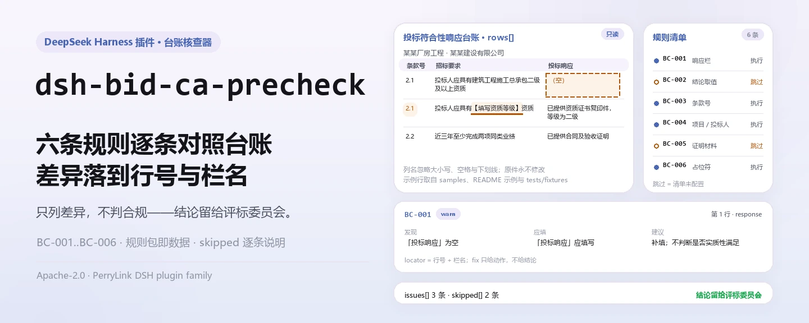
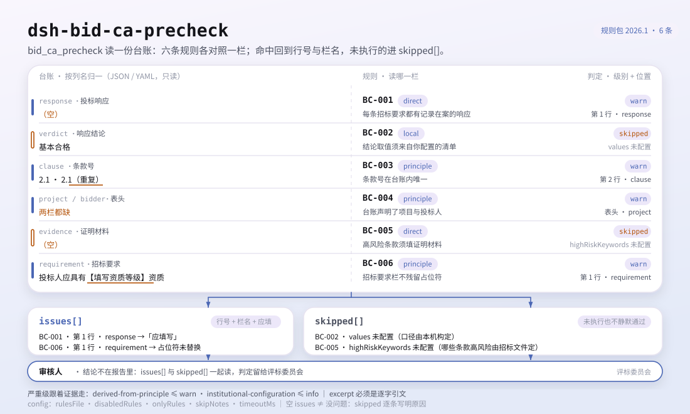
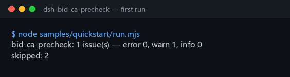

<div align="center">

<picture>
  <source media="(prefers-color-scheme: dark)" srcset="docs/assets/dsh-bid-ca-precheck-hero-zh-dark.webp">
  
</picture>

# dsh-bid-ca-precheck

**核对投标符合性响应台账的齐备与自洽——输出一份「哪一行、哪一栏、差什么」的清单，结论留给评标委员会。**

面向 DeepSeek Harness 的台账型核查插件：读取一份投标符合性响应台账（招标要求与投标响应，按台账自己的中英文列名取值），套用随包的版本化规则包（BC-001..BC-006）逐条核对，只列材料内部能指认的差异，不判合规、不认定责任。

[安装](#三步上手) · [配置](#配置) · [FAQ](#faq) · [简体中文](README.md) · [English](README.en.md)

[](LICENSE)
[](#兼容性)
[](https://www.npmjs.com/package/dsh-bid-ca-precheck)
[](https://github.com/PerryLink/dsh-bid-ca-precheck/actions/workflows/ci.yml)
[](#兼容性)

[](https://github.com/PerryLink/dsh-bid-ca-precheck/stargazers)
[](https://www.npmjs.com/package/dsh-bid-ca-precheck)
[](https://dshfind.com/plugins/PerryLink/dsh-bid-ca-precheck?ref=badge)
[](https://securityscorecards.dev/viewer/?uri=github.com/PerryLink/dsh-bid-ca-precheck)
[](https://dsh.market/)
[](https://gitee.com/perrylink/dsh-bid-ca-precheck)

```sh
dsh plugin --profile <name> add dsh-bid-ca-precheck
```

</div>

<sub>社区插件，与 DeepSeek 官方无关。唯一仓库：<https://github.com/PerryLink/dsh-bid-ca-precheck>（Gitee 为镜像）。</sub>

## 它是什么

`dsh-bid-ca-precheck` 读取一份投标符合性响应台账——招标文件的要求与投标人的响应，按台账自己的中英文列名取值——套用一版规则库，核对这份台账自身的齐备与自洽：每条招标要求是否记录了响应、响应结论是否取自你配置的取值清单、条款号在台账内是否唯一、台账是否声明了项目与投标人、你标记为高风险的条款是否填写了证明材料、招标要求栏里是不是真实要求而不是模板占位符。

它不判定投标是否有效、是否应当被否决、某项响应是否构成实质性偏离，也不认定责任。

- **给谁用**：投标专员、招标代理；不用懂命令行，在对话里把材料交给它即可。
- **你交什么**：这项核对用到的原始材料（表格、清单或文书）；不改原件。Excel 可先转成 JSON/YAML，对话里也能代转。
- **它交什么**：一份「哪一行、哪一栏、差什么、怎么补」的清单；没能执行的检查逐条列入 `skipped` 并写明原因。

<picture>
  <source media="(prefers-color-scheme: dark)" srcset="docs/assets/dsh-bid-ca-precheck-flow-v5-dark.svg">
  
</picture>

## 三步上手

1. **安装**（三选一）：

   ```sh
   # git 通道（最新 main；等价于 git+https://github.com/PerryLink/dsh-bid-ca-precheck.git）
   dsh plugin --profile <name> add github:PerryLink/dsh-bid-ca-precheck
   # npm 通道（已发布版本）
   dsh plugin --profile <name> add dsh-bid-ca-precheck
   # tarball 通道：本仓库 pnpm pack 后
   dsh plugin --profile <name> add ./dsh-bid-ca-precheck-<version>.tgz
   ```

2. **最小配置**（默认即可用；bundle 行不带 `config` 时全部走默认值，规则包路径指向随包的 `rules/bid-ca-precheck.yaml`）：

   ```yaml
   - insert:
       - id: dsh-bid-ca-precheck
         name: dsh-bid-ca-precheck
   ```

3. **验证已生效**：

   ```sh
   dsh --profile <name> --dump-config | grep 'dsh-bid-ca-precheck'
   ```

   然后把一份台账交给它，例如用仓内自带样例（对应 `samples/quickstart/expected/result.json`）：

   ```text
   > 用自带样例跑一次这项检查，告诉我发现了几条问题、分别是什么级别。
   bid_ca_precheck: 1 issue(s) — error 0, warn 1, info 0
   skipped: 2
   ```

   

**卸载**：`dsh plugin --profile <name> remove dsh-bid-ca-precheck`（或从 profile patch 删掉该行）。

<details>
<summary>在 WorkBuddy / 扣子中使用</summary>

在 WorkBuddy / 扣子搜「投标合规核对包」（本检查是其中一项；上架以商城为准）即可调用同一套核对能力，无需命令行。

</details>

<details>
<summary>从 DSH Desktop 市场安装</summary>

所有 PerryLink 插件均可在 DSH Desktop 内置市场中浏览：**市场 → 来源 → 添加来源 → 粘贴** `https://perrylink-dsh-catalog.perrylink.workers.dev/catalog-source.json` **→ 选中**。安装仍需通过市场的 npm 身份校验与你的确认。

</details>

## 核心能力

`dsh-bid-ca-precheck` 注册 `bid_ca_precheck` 工具：读入一份符合性响应台账，套用版本化规则包，返回一份报告。

- **六条规则一包带走** —— 规则包是数据不是代码（`rules/bid-ca-precheck.yaml`），换掉规则包即换掉整套检查，不动一行 TypeScript。
- **只读材料** —— 接受 JSON 或 YAML，原件永不修改；纯 ESM，无网络请求、不调用模型。
- **引文不造假** —— 每条规则带 `document` / `number` / `clause` / `excerpt` / `kind` / `source`；`excerpt` 必须是逐字引文，本次未取得原文的规则在 `excerpt` 里如实写明，不拿转述冒充引文。
- **严重级跟着证据走** —— `derived-from-principle` 最高 `warn`，本机构配置（`institutional-configuration`）最高 `info`，并有测试断言；本插件没有任何规则是 `error`。
- **空清单 ≠ 没问题** —— 每条没能执行的检查都进 `skipped` 并写明原因；必填清单未配置的规则自我报告 `skipped`，绝不静默通过。
- **措辞不作裁决** —— 报告只列差异，不判定合规、责任或正确性；措辞守卫（wording guard）强制执行，报告永远附带免责声明。

| 规则 | 核对内容 | 严重级 | 依据类别 |
|---|---|---|---|
| `BC-001` | 每条招标要求都有记录在案的响应 | warn | direct |
| `BC-002` | 响应结论取自你配置的取值清单（默认不执行） | info | local |
| `BC-003` | 条款号在台账内唯一 | warn | principle |
| `BC-004` | 台账声明了它的招标项目与投标人 | warn | principle |
| `BC-005` | 高风险条款填写了证明材料（默认不执行） | warn | direct |
| `BC-006` | 招标要求栏不残留未替换的占位符 | warn | principle |

依据类别是规则包里 `kind` 的简写：`direct` 指条文直接规定了所检查的要求，`principle` 即 `derived-from-principle`（只能由原则性条款推论，最高 `warn`），`local` 即 `institutional-configuration`（阈值出自本机构配置，最高 `info`）。

### 示例

以下为插件真实入口；安装后调用一次即可。第一行是详细走查，其余是简短案例。

**详细示例** — 工具 `bid_ca_precheck`，输入：

```json
{"rows":[{"条款号":"2.1","招标要求":"投标人应具有建筑工程施工总承包二级及以上资质","投标响应":"","响应结论":"满足", ...}]}
```

输出：

```json
{
  "id": "dsh-bid-ca-precheck.BC-001.de09b5a6",
  "ruleId": "BC-001",
  "severity": "warn",
  "locator": {
    "row": 1,
    "field": "response"
  },
  "found": "第 1 行「response」为空",
  "expected": "「response」应填写",
  "fix": "补填响应内容；本条只核对是否填写，不判断该响应对招标要求是否构成实质性满足"
}
```

*Observed from `dsh-bid-ca-precheck/tests/fixtures/BC-001/BC-001-unsafe.json; dsh-bid-ca-precheck/tests/fixtures/BC-001/cases.json; dsh-bid-ca-precheck/rules/bid-ca-precheck.yaml; dsh-bid-ca-precheck/tests/index.test.ts`*

| 你会问 | 它怎么答 |
|---|---|
| 某条招标要求的 `response` 栏是空的，会报出来吗？ | 会。`BC-001` 会报出这一行，因为每条招标要求都应当有响应记录。它只核对 `response` 栏是否填写，不判断该响应是否满足这条要求——那是评标委员会的判断。 |
| 我在 `verdict` 栏填了值，报告却说这条规则没跑起来，为什么？ | `BC-002` 拿每个值与你自己配置的结论取值清单比对，而该清单出厂为空，所以在填好 `values` 之前，本条报告「无法执行」（`skipped`），而不是替你猜。配置之后它也只报出不在清单里的值，不判断该结论本身是否正确。 |
| 同一台账里有两行的条款号相同。 | `BC-003` 会报出重复的 `clause` 值：同一个编号出现两次，就无法判断哪一行对应哪一条要求。比较时忽略空白字符，`3.2` 与 ` 3.2 ` 算同一个编号。它只核对唯一性，不判断这两行哪一行是对的；命中通常意味着重复登记，或条款号抄错。 |
| 台账没有写明是哪个项目、哪家投标人。 | `BC-004` 会报出缺失的表头栏，它要求 `project` 与 `bidder` 都存在。这两栏的必要性来自可追溯性——结论若不能对应到具体项目与投标人，事后就无从复核——而不是来自要求台账写表头的条文。 |
| 哪些行必须填写证明材料？ | `BC-005`：凡是 `requirement` 栏文本按包含匹配命中你所填高风险关键词的行。`highRiskKeywords` 出厂为空，所以在填好它之前本条报告「无法执行」，而不是静默通过。它只核对 `evidence` 栏是否填写，不判断证明材料是否真实、是否充分。 |
| 有几行的招标要求栏里还写着【……】或 `待填`。 | `BC-006` 会报出这些行：`requirement` 栏里残留 `【`、`】`、`{{`、`}}`、`XXX`、`待填`、`TBD` 之类的词，通常说明台账是照模板抄的、并没有真正填过。这个词表可以按你自己的模板调整。本条只报出占位符，不判断这条要求本身是否真实。 |

## 依据的标准

| 文件 | 文号 | 引用它的规则 |
|---|---|---|
| 《中华人民共和国招标投标法》 | 1999年8月30日通过，2017年12月27日修正（全国人大常委会《关于修改〈中华人民共和国招标投标法〉、〈中华人民共和国计量法〉的决定》），本法自2000年1月1日起施行 | BC-001, BC-003, BC-004, BC-006 |
| 《中华人民共和国招标投标法实施条例》 | 国务院令第613号（2011 年 12 月 20 日公布，2017 年 3 月 1 日修订，自 2012 年 2 月 1 日起施行） | BC-002 |
| 《中华人民共和国招标投标法》 | 1999年8月30日通过，2017年12月27日修正，自2000年1月1日起施行 | BC-005 |

**边界：** 本插件核对一份**投标符合性响应台账**在台账层面可以要求到的内容——每条招标要求是否记录了响应，响应结论是否取自你的取值口径，条款号是否唯一，高风险条款是否附有证明材料，以及招标要求栏里是否仍是真实要求而不是模板占位符。它**不**判定投标是否有效、是否应当被否决，也不判定某项响应是否构成重大偏离。**这些判断属于评标委员会，本插件从不作出这些判断**——有测试断言本插件中没有任何规则会是 `error`。

> ### ⚠️ 在采信报告中的引文之前，请先读这一段
>
> **每条 `excerpt` 的状态逐条不同，不是统一的。** 有的规则引用逐字条文（`kind: direct`），有的按条文原则推导（`kind: derived-from-principle`，最高 `warn`），有的阈值由本机构配置（`kind: institutional-configuration`，最高 `info`）。规则包从不概括引文：取不到原文时，`excerpt` 会如实写明，推理写在 `note` 里；并有测试断言没有任何规则声称拥有它并不拥有的引文。**对仍标为「未取得原文」的规则，取得文本后必须把 `excerpt` 换成真实条款，并把 `kind` 提升为 `direct`。**
>
> 结论性判断留给审核人：本插件只列出材料内部可以逐条指认的差异，不判断事实真伪，也不评价合规性。

## 配置

全部可调参数都是 `src/config.ts` 里的 Schemastery `Config` 字段（可从 cordis.yml 覆盖），逐条阈值在 `rules/` 下的规则库文件里。按 id 覆盖会替换整行——请重述所有需要的键。

| 键 | 类型 | 默认值 | 说明 |
|---|---|---|---|
| `rulesFile` | string | `rules/bid-ca-precheck.yaml` | 规则库文件路径，相对插件包根目录 |
| `disabledRules` | string[] | `[]` | 要停用的规则 id 列表；每条都会出现在 `skipped` 中 |
| `onlyRules` | string[] | `[]` | 只执行这些规则 id；留空表示执行全部规则 |
| `skipNotes` | string | `""` | 附加到每条 `skipped` 说明后的备注 |
| `timeoutMs` | number | `120000` | 工具协作式超时预算（毫秒） |

值得了解的规则级参数（写在规则库的 rule 条目里，不在 Config 中）：

- `BC-002` `values` —— 你的响应结论口径，例如 `[满足, 部分满足, 不满足, 待确认]`。留空表示不执行。
- `BC-005` `highRiskKeywords` —— 标记条款需要证明材料的词，例如 `[资格, 业绩, 实质性, 星号条款]`。留空表示不执行；`evidenceField` 与 `requirementField` 用于重命名它读取的两栏。
- `BC-006` `terms` —— 要查找的占位符；默认覆盖 `【】`、`{{}}`、`XXX`、`待填`、`待补充`、`TBD`、`todo`。

profile patch 覆盖示例：

```yaml
- insert:
    - id: dsh-bid-ca-precheck
      name: dsh-bid-ca-precheck
      config:
        disabledRules: [BC-006]
        timeoutMs: 180000
```

<details>
<summary>完整配置表（5 个键）</summary>

| 键 | 类型 | 默认值 | 说明 |
|---|---|---|---|
| `rulesFile` | string | `rules/bid-ca-precheck.yaml` | 规则库文件路径，相对插件包根目录 |
| `disabledRules` | string[] | `[]` | 要停用的规则 id 列表；每条都会出现在 `skipped` 中 |
| `onlyRules` | string[] | `[]` | 只执行这些规则 id；留空表示执行全部规则 |
| `skipNotes` | string | `""` | 附加到每条 `skipped` 说明后的备注 |
| `timeoutMs` | number | `120000` | 工具协作式超时预算（毫秒） |

</details>

## 材料格式

工具接受 JSON 或 YAML：

```yaml
project: 某某厂房工程
bidder: 某某建设有限公司
rows:
  - { 条款号: "2.1", 招标要求: 投标人应具有建筑工程施工总承包二级及以上资质,
      投标响应: 已提供资质证书复印件，等级为二级, 响应结论: 满足, 证明材料: 资格文件第 12 页 }
  - { Clause: "2.2", Requirement: 近三年至少完成两项同类业绩,
      Response: 已提供合同及验收证明, Verdict: 满足, Evidence: 业绩文件第 3 页 }
```

列名匹配忽略大小写，并忽略空格、下划线与连字符，因此 `招标要求` 与 `requirement` 解析到同一个字段；台账自己的列名会被保留，发现里写明的列就是它实际读到的列。台账的一行可以用 `row`、`序号` 或 `行号` 声明自己的编号。字段在读取层是可选的，由检查引擎校验，因此部分导出的台账会产生「缺项」类差异，而不是让程序崩溃。

## 规则来源

规则数据在 `rules/bid-ca-precheck.yaml`，与代码分离：每条规则都带文件名、文号、按原文自身编号体系的条款号、逐字摘录与来源地址。规则包头部完整写明本次引文缺口，每条规则的 `note` 复述与该条相关的部分。加载期守卫通常强制「摘录必须是不少于八个字符的真实引文」，但它分不清引文与描述——因此本规则包依靠头部声明、逐条 `note`，以及一条断言所有 `excerpt` 都承认缺口的测试来兜底。夸大依据的规则库会在加载期失败，而不会产出一份看起来很有底气的报告。核验中确认的边界与「刻意没有作出的结论」随包收录在 `rules/evidence/` 目录。

## FAQ

<details>
<summary>它会替我们下「合规 / 不合规」或「是否废标」的结论吗？</summary>

不会。它只列出材料内部能逐条指认的差异（哪一行、哪一栏、差什么、怎么补），不下事实判断，也不评价合规性——结论永远留给评标委员会。报告措辞由 wording guard 强制约束，且每份报告都带免责声明；测试还断言没有任何规则是 `error`。

</details>

<details>
<summary>我的台账是 Excel，能直接用吗？</summary>

可以，先转成 JSON 或 YAML；平台支持时在对话里就能代为转换。工具只读材料，永不修改原件。

</details>

<details>
<summary>为什么 `BC-002` 与 `BC-005` 从来不报？</summary>

因为这两条依赖的清单是你的，不是法规的：`values`（响应结论口径）与 `highRiskKeywords`（高风险关键词）都出厂为空，规则自我报告 `skipped`。在规则库里填好之后才生效——生效后 `BC-002` 只核对所填结论是否在你的取值里，`BC-005` 只核对 `evidence` 栏是否填写。

</details>

<details>
<summary>`issues` 为空能当作「没问题」吗？</summary>

不能。每条没能执行的检查都列在 `skipped` 里并写明原因（例如清单未配置、栏位缺失）。判读报告时请把 `issues` 与 `skipped` 一起看完：空清单只表示「没有可指认的差异」，不表示台账齐备。

</details>

<details>
<summary>一整本台账（几百上千行）一起查，性能吃得消吗？</summary>

工具在 `native` 与 `ptc` 两种模式都能跑；批量校验（例如整个目录的台账）建议 `ptc`，schema 成本只付一次。检查本身是纯本地的表格遍历与列匹配，无网络请求、不调用模型；规则包按路径在进程内缓存，只解析一次；`timeoutMs`（默认 120 秒）是协作式超时预算。

</details>

## 排障

- **`BC-002` 或 `BC-005` 报告自身为 `skipped`。** 两条的清单都是空的，它们取决于你的项目口径，而不是某条法规，插件不会替你猜。
- **`BC-006` 命中了一条我确实想这么写的要求。** `XXX` 或 `待填` 之类真的出现在里面。收窄 `terms` 列表，或修正台账。
- **读取器拒绝了一份以前能读的台账。** 它一个已知列名都没找到，报错里列出了它看到的列名。把某一栏改成已知别名，或把别名加进插件的列名表。
- **`BC-001` 命中了我认为只是告知性的行。** 响应栏留空意味着「未核对」，而这正是预检台账最不该出现的东西。若某条确实无需响应，请在台账里写明理由，而不是留空。
- **插件装上了但工具不出现。** 确认 `main` 解析到 `lib/index.mjs`，且 `pnpm run build` 已产出该文件；`main` 写错会让加载器静默跳过该条目。
- **`dsh plugin add` 以不兼容为由拒绝安装。** peer 范围覆盖 `0.1.x` 与 `0.2.x`；若运行时在其之外，可显式豁免：`dsh plugin --profile <name> allow-version dsh-bid-ca-precheck@0.1.0 --dsh-version <runtime> --accept-risk`
- **`check` 把 `manifest-peers` 报为失败。** 静态检查器比对的是一份早于 0.2 世代的硬编码 peer 范围；安装期的 peer 校验以运行时为准，声明的范围才是正确的。这是 `dsh-plugin-dev` 的已知上游问题。
- **时间看起来偏移。** 全部计算都是对输入字符串做墙上时钟运算，不做时区换算。

## 安全边界

- **只列差异，不作定性结论。** 报告不判定合规、责任或正确性；措辞守卫（wording guard）强制执行这条，报告永远附带免责声明，并有测试断言没有任何规则是 `error`。
- **引文闸门。** `excerpt` 必须是逐字引文；取不到原文时如实写明并把 `kind` 降到证据允许的档次，严重级随证据封顶——绝不拿转述冒充原文。
- **空清单必须可见。** 每条没能执行的检查都进 `skipped` 并写明原因；清单未配置的规则自我报告 `skipped`，不静默通过。
- **只读本地。** 无网络请求、无模型调用、无遥测；只读传给工具的材料，除工具结果与宿主自己的会话/日志存储外不写第二份副本（见 [PRIVACY.md](PRIVACY.md)）。
- **注册即 effect。** 工具注册返回 disposer，停止或热重载即撤销，不残留监听器或全局状态。

## 已知限制

- **引文仍有缺口。** 部分规则的条款号或逐字原文本次未取得，规则包在 `excerpt` 与 `note` 里逐条写明；这些规则的严重级因此封顶在 `warn` 或 `info`。取得文本后应替换 `excerpt` 并把 `kind` 提升为 `direct`。
- **只核对台账自身的齐备与自洽。** 不判断响应内容是否满足招标要求、证明材料是否真实充分、投标是否有效或是否应被否决——这些都需要评标委员会依据招标文件与评标办法作出。
- **两条规则默认不执行。** `BC-002` 的取值清单与 `BC-005` 的高风险关键词出厂为空，未配置即进 `skipped`；这是刻意的，插件不硬编码任何取值口径。
- **列名只认已收录的别名。** 一份列名全部陌生的台账会被读取器拒绝，报错里列出它看到的列名；此时需要改名或补别名。
- **规则包随包发布。** 换规则包即换检查集，没有联网更新通道；要换版本请替换 `rules/bid-ca-precheck.yaml` 或用 `rulesFile` 指向别处。

## 与其他 DSH 插件的互操作性

本插件不复用任何既有插件的表面，也不改动它们：

- **只注册一个工具。** 工具名为 `bid_ca_precheck`，属插件自有命名空间；不新增斜杠命令，不注册客户端 slot（本插件没有浏览器半），不注册 `webServer` 前缀。
- **不提供服务键。** 因此不存在服务键冲突。
- **不监听共享事件。** 不挂在 `agent/pre-step`、`tools/post-execute` 之类的顺序敏感事件上，事件链竞争与短路都无从发生。
- **patch 层只 insert。** bundle patch 只 `insert` 自己那一行，从不覆写内置行的 `config`。
- **无全局改写。** 不改原型、不改写 `process.env`、不替换全局 fetch。
- **并发安全。** 工具声明 `isConcurrencySafe: true`：只读材料、无共享可变状态，规则包按路径缓存后只读复用。

## 兼容性

| 项目 | 状态 |
|---|---|
| Harness | 对等版本范围 `>=0.1.2-rc.1 <0.2.0 \|\| >=0.2.0-0 <0.3.0` —— 已实测同时接受 `0.2.0-rc.2` 与 `0.2.1-rc.2`。已声明 `engines.dsh`：0.2.1 起由宿主单独裁决，范围为 `>=0.2.1-0 <0.3.0` |
| Node | `^22.19.0 \|\| >=24.0.0` |
| 平台 | 全平台（纯 ESM；无原生代码、无联网、不调用模型） |
| 工具模式 | `native` / `ptc` 均可；批量校验整个目录时建议 `ptc`，schema 成本只付一次 |

## 生态与质量

- [Gitee 镜像](https://gitee.com/perrylink/dsh-bid-ca-precheck)（同步镜像，以 GitHub 为准）
- [dshfind 插件页](https://dshfind.com/plugins/PerryLink/dsh-bid-ca-precheck)（安装量与排名）
- [OpenSSF Scorecard 报告](https://securityscorecards.dev/viewer/?uri=github.com/PerryLink/dsh-bid-ca-precheck)（由 [.github/workflows/scorecard.yml](.github/workflows/scorecard.yml) 驱动）
- [DSH Market](https://dsh.market/)（已上架）
- **1024 商店渠道**：先 `npm i -g dsh1024`，再 `dsh1024 plugin --profile <name> add dsh-bid-ca-precheck`（计入 [deepseek1024.com](https://deepseek1024.com) 安装排行）
- [生态实测知识库](https://perrylink.github.io/dsh-plugin-guide/)：插件开发指南 · 选型实测数据 · 维护取舍判据

## 开发

```sh
pnpm install                                           # node ^22.19 || >=24
pnpm run typecheck                                     # tsc --noEmit
pnpm test                                              # vitest：共享表格插件套件 + 成对夹具
pnpm run build                                         # tsdown -> lib/index.mjs + lib/index.d.mts
pnpm run verify:self-contained                         # 依赖 spec 均来自 registry
pnpm run check:lockfile                                # lockfile 漂移检查
pnpm run check:readmes                                 # 五语 README 一致性
pnpm run check:citations                               # 规则包引文基线
node ../scripts/sync-shared.mjs dsh-bid-ca-precheck     # 从 ../_shared 刷新 src/shared
pnpm pack                                              # 发布 tarball
```

本插件是**数据型**的：`src/model.ts` 声明表格结构，共享套件提供读取器与检查引擎，规则包声明每一条检查。新增一条落在既有检查类型里的规则，只需要改规则包，不必动 TypeScript。

本地样例试跑（需先 `pnpm run build` 产出 `lib/`）：

```sh
node samples/quickstart/run.mjs --json
# => {"tool":"bid_ca_precheck","issueCount":1,"summary":{"error":0,"warn":1,"info":0},"skippedCount":2}
```

样例输入在 `samples/quickstart/input/`，期望输出在 `samples/quickstart/expected/result.json`，截图见 `docs/assets/quickstart.png`。README 配图由 [`scripts/gen-readme-assets.py`](scripts/gen-readme-assets.py) 程序化生成（Python + Pillow），可重复执行；旧的单版流程图与演示图保留在 `docs/assets/` 供外链使用，README 只引用新生成的深浅双版。

Topics：`deepseek-harness`, `dsh`, `dsh-plugin`, `cordis`, `bid`, `precheck`

## 家族与致谢

本项目是 [PerryLink](https://github.com/PerryLink) 维护的 DeepSeek Harness 插件家族成员（全部 Apache-2.0）。完整家族索引见[按材料选核查器](https://perrylink.github.io/zh/checkers/choose/)与 [PerryLink 主页](https://github.com/PerryLink)。如果这个插件帮到了你，**给个 star**——它不解锁任何功能，但会让下一个人更容易找到它。

- [@PerryLink](https://github.com/PerryLink) —— 创建者与维护者：数据型规则包（BC-001..BC-006）、`bid_ca_precheck` 工具、引文核验记录与五语文档。

<details>
<summary>展开全部插件</summary>

| 插件 | 状态 |
|---|---|
| **[dsh-aqua-input-check](https://github.com/PerryLink/dsh-aqua-input-check)** |  |
| **[dsh-archive-check](https://github.com/PerryLink/dsh-archive-check)** |  |
| **[dsh-auto-review](https://github.com/PerryLink/dsh-auto-review)** |  |
| **[dsh-autotier](https://github.com/PerryLink/dsh-autotier)** | 🧊 已冻结 — 见仓库 README |
| **[dsh-bid-ca-precheck](https://github.com/PerryLink/dsh-bid-ca-precheck)** |  |
| **[dsh-bid-qual-check](https://github.com/PerryLink/dsh-bid-qual-check)** |  |
| **[dsh-cert-mcp](https://github.com/PerryLink/dsh-cert-mcp)** | 🧊 已冻结 — 见仓库 README |
| **[dsh-checkpoint-rewind](https://github.com/PerryLink/dsh-checkpoint-rewind)** |  |
| **[dsh-click](https://github.com/PerryLink/dsh-click)** |  |
| **[dsh-composer-history](https://github.com/PerryLink/dsh-composer-history)** |  |
| **[dsh-contract-stance](https://github.com/PerryLink/dsh-contract-stance)** |  |
| **[dsh-customs-doc-check](https://github.com/PerryLink/dsh-customs-doc-check)** |  |
| **[dsh-data-quality](https://github.com/PerryLink/dsh-data-quality)** | 🧊 已冻结 — 见仓库 README |
| **[dsh-demurrage-ledger](https://github.com/PerryLink/dsh-demurrage-ledger)** |  |
| **[dsh-doublecheck](https://github.com/PerryLink/dsh-doublecheck)** |  |
| **[dsh-drill-script-check](https://github.com/PerryLink/dsh-drill-script-check)** |  |
| **[dsh-eia-guide-check](https://github.com/PerryLink/dsh-eia-guide-check)** |  |
| **[dsh-emergency-plan](https://github.com/PerryLink/dsh-emergency-plan)** |  |
| **[dsh-essay-rubric-check](https://github.com/PerryLink/dsh-essay-rubric-check)** |  |
| **[dsh-evidence-check](https://github.com/PerryLink/dsh-evidence-check)** |  |
| **[dsh-export-ctl-check](https://github.com/PerryLink/dsh-export-ctl-check)** |  |
| **[dsh-fast](https://github.com/PerryLink/dsh-fast)** |  |
| **[dsh-fmea-table-check](https://github.com/PerryLink/dsh-fmea-table-check)** |  |
| **[dsh-forecast-penalty](https://github.com/PerryLink/dsh-forecast-penalty)** |  |
| **[dsh-fund-research](https://github.com/PerryLink/dsh-fund-research)** |  |
| **[dsh-github](https://github.com/PerryLink/dsh-github)** |  |
| **[dsh-gongwen-flow-check](https://github.com/PerryLink/dsh-gongwen-flow-check)** |  |
| **[dsh-gongwen-word-check](https://github.com/PerryLink/dsh-gongwen-word-check)** |  |
| **[dsh-guard-plan-qc](https://github.com/PerryLink/dsh-guard-plan-qc)** |  |
| **[dsh-hazchem-check](https://github.com/PerryLink/dsh-hazchem-check)** |  |
| **[dsh-hazplan-check](https://github.com/PerryLink/dsh-hazplan-check)** |  |
| **[dsh-hidden-risk-map](https://github.com/PerryLink/dsh-hidden-risk-map)** |  |
| **[dsh-hs-classify](https://github.com/PerryLink/dsh-hs-classify)** |  |
| **[dsh-icd-rule-check](https://github.com/PerryLink/dsh-icd-rule-check)** |  |
| **[dsh-industry-research](https://github.com/PerryLink/dsh-industry-research)** |  |
| **[dsh-lawcite-adapter](https://github.com/PerryLink/dsh-lawcite-adapter)** |  |
| **[dsh-laya](https://github.com/PerryLink/dsh-laya)** |  |
| **[dsh-lc-doc-check](https://github.com/PerryLink/dsh-lc-doc-check)** |  |
| **[dsh-learning-gap-check](https://github.com/PerryLink/dsh-learning-gap-check)** |  |
| **[dsh-library](https://github.com/PerryLink/dsh-library)** |  |
| **[dsh-local-ai](https://github.com/PerryLink/dsh-local-ai)** |  |
| **[dsh-lsp-actions](https://github.com/PerryLink/dsh-lsp-actions)** |  |
| **[dsh-mask](https://github.com/PerryLink/dsh-mask)** |  |
| **[dsh-mcp-panel](https://github.com/PerryLink/dsh-mcp-panel)** |  |
| **[dsh-medrec-qc](https://github.com/PerryLink/dsh-medrec-qc)** |  |
| **[dsh-memento](https://github.com/PerryLink/dsh-memento)** | 🧊 已冻结 — 见仓库 README |
| **[dsh-nsfc-form-check](https://github.com/PerryLink/dsh-nsfc-form-check)** |  |
| **[dsh-nurse-record-check](https://github.com/PerryLink/dsh-nurse-record-check)** |  |
| **[dsh-observe](https://github.com/PerryLink/dsh-observe)** |  |
| **[dsh-origin-rvc-check](https://github.com/PerryLink/dsh-origin-rvc-check)** |  |
| **[dsh-ota-review-check](https://github.com/PerryLink/dsh-ota-review-check)** |  |
| **[dsh-output-styles](https://github.com/PerryLink/dsh-output-styles)** |  |
| **[dsh-paper-doc-adapter](https://github.com/PerryLink/dsh-paper-doc-adapter)** |  |
| **[dsh-permission-rules](https://github.com/PerryLink/dsh-permission-rules)** |  |
| **[dsh-permit-report-check](https://github.com/PerryLink/dsh-permit-report-check)** |  |
| **[dsh-pipeline-check](https://github.com/PerryLink/dsh-pipeline-check)** |  |
| **[dsh-pleading-draft](https://github.com/PerryLink/dsh-pleading-draft)** |  |
| **[dsh-plugin-doctor](https://github.com/PerryLink/dsh-plugin-doctor)** | 🚫 已退役（仓库已归档） |
| **[dsh-plugin-guide](https://github.com/PerryLink/dsh-plugin-guide)** |  |
| **[dsh-plugin-kit](https://github.com/PerryLink/dsh-plugin-kit)** | 🚫 已退役（仓库已归档） |
| **[dsh-plugin-upgrade](https://github.com/PerryLink/dsh-plugin-upgrade)** | 🚫 已退役（仓库已归档） |
| **[dsh-policy-brief-draft](https://github.com/PerryLink/dsh-policy-brief-draft)** |  |
| **[dsh-power-loss-split](https://github.com/PerryLink/dsh-power-loss-split)** |  |
| **[dsh-power-ticket-check](https://github.com/PerryLink/dsh-power-ticket-check)** |  |
| **[dsh-ppap-check](https://github.com/PerryLink/dsh-ppap-check)** |  |
| **[dsh-protest-deadline](https://github.com/PerryLink/dsh-protest-deadline)** |  |
| **[dsh-railway-window](https://github.com/PerryLink/dsh-railway-window)** |  |
| **[dsh-repair-order-qc](https://github.com/PerryLink/dsh-repair-order-qc)** |  |
| **[dsh-research-report](https://github.com/PerryLink/dsh-research-report)** |  |
| **[dsh-review-reply-check](https://github.com/PerryLink/dsh-review-reply-check)** |  |
| **[dsh-rulefile-check](https://github.com/PerryLink/dsh-rulefile-check)** |  |
| **[dsh-safety-brief-check](https://github.com/PerryLink/dsh-safety-brief-check)** |  |
| **[dsh-score](https://github.com/PerryLink/dsh-score)** | 🧊 已冻结 — 见仓库 README |
| **[dsh-session-sync](https://github.com/PerryLink/dsh-session-sync)** |  |
| **[dsh-site-log-check](https://github.com/PerryLink/dsh-site-log-check)** |  |
| **[dsh-skill-pack-security](https://github.com/PerryLink/dsh-skill-pack-security)** |  |
| **[dsh-soe-decision-check](https://github.com/PerryLink/dsh-soe-decision-check)** |  |
| **[dsh-soilwater-check](https://github.com/PerryLink/dsh-soilwater-check)** |  |
| **[dsh-sop-sync-check](https://github.com/PerryLink/dsh-sop-sync-check)** |  |
| **[dsh-spc-gbt-adapter](https://github.com/PerryLink/dsh-spc-gbt-adapter)** |  |
| **[dsh-talk](https://github.com/PerryLink/dsh-talk)** |  |
| **[dsh-tender-extract](https://github.com/PerryLink/dsh-tender-extract)** |  |
| **[dsh-tender-matrix](https://github.com/PerryLink/dsh-tender-matrix)** |  |
| **[dsh-test-drive](https://github.com/PerryLink/dsh-test-drive)** |  |
| **[dsh-ticktick](https://github.com/PerryLink/dsh-ticktick)** | 🚫 已退役（仓库已归档） |
| **[dsh-translate](https://github.com/PerryLink/dsh-translate)** |  |
| **[dsh-warranty-calc](https://github.com/PerryLink/dsh-warranty-calc)** |  |
| **[dsh-budget](https://github.com/PerryLink/dsh-budget)** | 🧊 已冻结 — 见仓库 README |
| **[dsh-claude-move](https://github.com/PerryLink/dsh-claude-move)** | 🧊 已冻结 — 见仓库 README |
| **[dsh-defend](https://github.com/PerryLink/dsh-defend)** | 🧊 已冻结 — 见仓库 README |
| **[dsh-draw](https://github.com/PerryLink/dsh-draw)** | 🧊 已冻结 — 见仓库 README |
| **[dsh-reach](https://github.com/PerryLink/dsh-reach)** | 🧊 已冻结 — 见仓库 README |
| **[dsh-background-agents](https://github.com/PerryLink/dsh-background-agents)** | 🚫 已退役（仓库已归档） |
| **[dsh-session-pin](https://github.com/PerryLink/dsh-session-pin)** | 🚫 已退役（仓库已归档） |
| **[dsh-team-rooms](https://github.com/PerryLink/dsh-team-rooms)** | 🚫 已退役（仓库已归档） |

</details>

## License

[LICENSE](LICENSE)（Apache License 2.0）© 2026 dsh-bid-ca-precheck contributors

<p align="center"><sub>Apache-2.0 · 社区插件，与 DeepSeek 无关。</sub></p>
