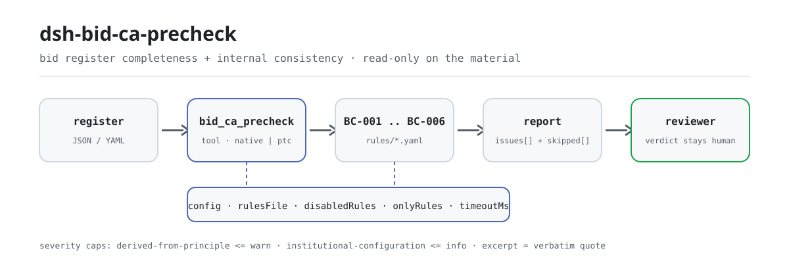
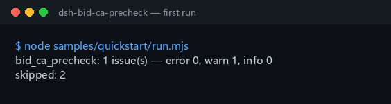

<div align="center">

<picture>
  <source media="(prefers-color-scheme: dark)" srcset="docs/assets/dsh-bid-ca-precheck-flow-dark.svg">
  
</picture>

# dsh-bid-ca-precheck

**Verifica a completude e a coerência interna de um registro de resposta de conformidade da proposta — recebe uma lista do que não bate, onde e como corrigir; o veredicto fica com a comissão de avaliação.**

Um verificador em forma de registro para o DeepSeek Harness: lê um registro de resposta de conformidade da proposta (os requisitos do caderno de encargos e as respostas do proponente, obtidos com os próprios nomes de coluna do registo, em chinês ou em inglês), aplica um pacote de regras versionado (BC-001..BC-006) regra a regra e lista apenas as divergências que consegue apontar dentro do material — sem veredicto de conformidade, sem atribuição de responsabilidade.

[Instalar](#instalação-em-três-passos) · [Configuração](#configuração) · [FAQ](#faq) · [简体中文](README.md) · [English](README.en.md) · [Español](README.es.md) · [Português](README.pt.md) · [हिन्दी](README.hi.md)

[](LICENSE)
[](#compatibilidade)
[](https://www.npmjs.com/package/dsh-bid-ca-precheck)
[](https://github.com/PerryLink/dsh-bid-ca-precheck/actions/workflows/ci.yml)
[](#compatibilidade)

[](https://github.com/PerryLink/dsh-bid-ca-precheck/stargazers)
[](https://www.npmjs.com/package/dsh-bid-ca-precheck)
[](https://dshfind.com/plugins/PerryLink/dsh-bid-ca-precheck?ref=badge)
[](https://securityscorecards.dev/viewer/?uri=github.com/PerryLink/dsh-bid-ca-precheck)
[](https://dsh.market/)
[](https://gitee.com/perrylink/dsh-bid-ca-precheck)

```sh
dsh plugin --profile <name> add dsh-bid-ca-precheck
```

</div>

<sub>Plugin da comunidade, não afiliado ao DeepSeek. Repositório canónico: <https://github.com/PerryLink/dsh-bid-ca-precheck> (o Gitee é um espelho).</sub>

## O que é

`dsh-bid-ca-precheck` lê um registro de resposta de conformidade da proposta — os requisitos do caderno de encargos e as respostas do proponente, obtidos com os próprios nomes de coluna do registo, em chinês ou em inglês —, aplica um pacote de regras versionado e verifica a completude e a coerência interna desse registo: que cada requisito do caderno de encargos tenha uma resposta registada, que o veredicto venha do vocabulário que você configurar, que os números de cláusula sejam únicos no registo, que o registo declare o seu projeto e o seu proponente, que uma cláusula que você marcou como de risco elevado traga evidência e que a coluna de requisitos contenha requisitos reais e não marcadores de modelo.

Não decide se uma proposta é válida, se deve ser rejeitada, se uma resposta constitui desvio substancial, nem quem é responsável.

- **Para quem é**: especialistas em licitações e agentes de cadernos de encargos; não é preciso saber usar a linha de comandos — o material é entregue no chat.
- **O que você entrega**: o material de origem sobre o qual a verificação trabalha (uma tabela, um registo ou um documento); o original nunca é modificado. O Excel pode ser convertido antes para JSON/YAML, no chat se a plataforma permitir.
- **O que ele devolve**: uma lista do que não bate, onde e como corrigir; cada verificação que não pôde ser executada é listada em `skipped` com o motivo.

## Instalação em três passos

1. **Instale** (escolha um canal):

   ```sh
   # canal git (último main; equivale a git+https://github.com/PerryLink/dsh-bid-ca-precheck.git)
   dsh plugin --profile <name> add github:PerryLink/dsh-bid-ca-precheck
   # canal npm (versões publicadas)
   dsh plugin --profile <name> add dsh-bid-ca-precheck
   # canal tarball: pnpm pack neste repo e depois
   dsh plugin --profile <name> add ./dsh-bid-ca-precheck-<version>.tgz
   ```

2. **Configuração mínima** (os padrões já funcionam; uma linha de bundle sem `config` corre toda com os padrões e o pacote de regras em `rules/bid-ca-precheck.yaml`):

   ```yaml
   - insert:
       - id: dsh-bid-ca-precheck
         name: dsh-bid-ca-precheck
   ```

3. **Verifique que monta**:

   ```sh
   dsh --profile <name> --dump-config | grep 'dsh-bid-ca-precheck'
   ```

   Depois entregue um registo — por exemplo o exemplo incluído (corresponde a `samples/quickstart/expected/result.json`):

   ```text
   > Rode a verificação com o exemplo incluído e diga quantos problemas há e de que nível.
   bid_ca_precheck: 1 issue(s) — error 0, warn 1, info 0
   skipped: 2
   ```

   

**Desinstalar**: `dsh plugin --profile <name> remove dsh-bid-ca-precheck` (ou remova a linha do patch do perfil).

<details>
<summary>Usar no WorkBuddy / Coze</summary>

Procure «Tender Compliance Suite» no WorkBuddy / Coze (esta verificação é uma das suas partes; disponibilidade conforme o catálogo) para usar a mesma capacidade sem linha de comandos.

</details>

<details>
<summary>Instalar a partir do mercado do DSH Desktop</summary>

Todos os plugins PerryLink podem ser explorados no mercado integrado do DSH Desktop: **Market → Sources → add source → colar** `https://perrylink-dsh-catalog.perrylink.workers.dev/catalog-source.json` **→ selecionar**. A instalação continua a passar pela verificação de identidade npm do mercado e pela sua confirmação.

</details>

## Capacidades principais

`dsh-bid-ca-precheck` registra a ferramenta `bid_ca_precheck`: lê um registo de resposta de conformidade, aplica o pacote de regras versionado e devolve um relatório.

- **Seis regras num só pacote** — o pacote de regras é dados, não código (`rules/bid-ca-precheck.yaml`); substituí-lo troca todo o conjunto de verificações sem tocar numa linha de TypeScript.
- **Apenas leitura do material** — aceita JSON ou YAML e nunca modifica o original; ESM puro, sem pedidos de rede, sem chamadas ao modelo.
- **Sem citações inventadas** — cada regra traz `document` / `number` / `clause` / `excerpt` / `kind` / `source`; `excerpt` tem de ser uma citação literal, e uma regra cujo texto não foi obtido diz isso em `excerpt` em vez de apresentar uma paráfrase como citação.
- **A gravidade segue a evidência** — `derived-from-principle` tem teto `warn`, a configuração institucional (`institutional-configuration`) teto `info`, e há um teste que o afirma; nenhuma regra deste pacote pode ser `error`.
- **Uma lista vazia nunca é «não há nada de errado»** — cada verificação que não pôde ser executada é reportada em `skipped` com o motivo, e uma regra cuja lista obrigatória não está configurada reporta-se a si mesma em `skipped` em vez de passar em silêncio.
- **Sem linguagem que adjudique** — o relatório apenas enumera divergências; um wording guard impõe isso e todo relatório traz o aviso legal.

| Regra | O que verifica | Gravidade | Tipo de base |
|---|---|---|---|
| `BC-001` | todo requisito tem uma resposta registada | warn | direct |
| `BC-002` | o veredicto usa o seu vocabulário (desativada por padrão) | info | local |
| `BC-003` | os números de cláusula são únicos no registo | warn | principle |
| `BC-004` | o registo nomeia o seu projeto e o seu proponente | warn | principle |
| `BC-005` | uma cláusula de risco elevado traz evidência (desativada por padrão) | warn | direct |
| `BC-006` | a coluna de requisitos não guarda marcadores por substituir | warn | principle |

«Tipo de base» é a forma abreviada do `kind` do pacote: `direct` significa que a cláusula regula diretamente o que é verificado, `principle` é `derived-from-principle` (apenas dedutível de princípio, teto `warn`) e `local` é `institutional-configuration` (limiar da sua instituição, teto `info`).

### Exemplos

São os pontos de entrada reais do plugin; instale uma vez e chame um. A primeira linha é o caso detalhado e as restantes são casos breves.

**Exemplo detalhado** — ferramenta `bid_ca_precheck`, entrada:

```json
{"rows":[{"条款号":"2.1","招标要求":"投标人应具有建筑工程施工总承包二级及以上资质","投标响应":"","响应结论":"满足", ...}]}
```

Saída:

```json
{
  "id": "dsh-bid-ca-precheck.BC-001.de09b5a6",
  "ruleId": "BC-001",
  "severity": "warn",
  "locator": {
    "row": 1,
    "field": "response"
  },
  "found": "第 1 行「response」为空",
  "expected": "「response」应填写",
  "fix": "补填响应内容；本条只核对是否填写，不判断该响应对招标要求是否构成实质性满足"
}
```

*Observado em `dsh-bid-ca-precheck/tests/fixtures/BC-001/BC-001-unsafe.json; dsh-bid-ca-precheck/tests/fixtures/BC-001/cases.json; dsh-bid-ca-precheck/rules/bid-ca-precheck.yaml; dsh-bid-ca-precheck/tests/index.test.ts`*

| Você pergunta | O que ele responde |
|---|---|
| A coluna `response` de um requisito do caderno de encargos está vazia — isso é reportado? | Sim. `BC-001` assinala a linha, porque todo requisito do caderno de encargos deve ter uma resposta registada. Verifica apenas que a coluna `response` está preenchida: não julga se a resposta satisfaz o requisito, o que é competência da comissão de avaliação. |
| Preenchi a coluna `verdict` e o relatório diz que a regra não pôde ser executada. Porquê? | `BC-002` compara cada valor com o vocabulário de veredictos que você configurar, e essa lista vem vazia, por isso até preencher `values` a regra reporta-se a si mesma em `skipped` em vez de adivinhar. Depois de configurada, só reporta um valor que não esteja na sua lista; nunca julga se o veredicto está correto. |
| O mesmo número de cláusula aparece em duas linhas do registo. | `BC-003` reporta o valor `clause` repetido: se um número aparece duas vezes, ninguém consegue dizer que linha responde a que requisito. Os espaços são ignorados, por isso `3.2` e ` 3.2 ` contam como o mesmo número. Verifica apenas a unicidade; não decide qual das duas linhas está certa — um achado costuma significar registo duplicado ou número copiado mal. |
| O registo não diz que projeto cobre nem quem é o proponente. | `BC-004` reporta o campo de cabeçalho em falta e exige tanto `project` como `bidder`. Essa necessidade vem da rastreabilidade —um veredicto que não se liga a um projeto e a um proponente não pode ser revisto depois—, não de uma cláusula que exija um cabeçalho no registo. |
| Que linhas têm de trazer evidência? | `BC-005`: todas as linhas cujo texto de `requirement` contenha, por inclusão, uma das suas palavras-chave de risco elevado. `highRiskKeywords` vem vazia, por isso até a preencher a regra reporta-se em `skipped` em vez de passar em silêncio. Verifica apenas que a coluna `evidence` está preenchida, não se a evidência é válida ou suficiente. |
| Algumas linhas ainda dizem 【……】 ou `待填` na coluna de requisitos. | `BC-006` reporta-as: `【`, `】`, `{{`, `}}`, `XXX`, `待填`, `TBD` e termos semelhantes deixados na coluna `requirement` costumam indicar que o registo foi copiado de um modelo e nunca preenchido. A lista de termos é sua para ajustar. A regra assinala apenas o marcador; não decide se o requisito em si é real. |

## Normas que segue

| Documento | Referência | Regras que a citam |
|---|---|---|
| Lei de Licitação e Contratação da República Popular da China | Aprovada em 1999-08-30, alterada em 2017-12-27 (decisão do Comité Permanente da APN); em vigor desde 2000-01-01 | BC-001, BC-003, BC-004, BC-006 |
| Regulamento de aplicação da Lei de Licitação e Contratação da República Popular da China | Decreto do Conselho de Estado n.º 613 (publicado em 2011-12-20, revisto em 2017-03-01, em vigor desde 2012-02-01) | BC-002 |
| Lei de Licitação e Contratação da República Popular da China | Aprovada em 1999-08-30, alterada em 2017-12-27, em vigor desde 2000-01-01 | BC-005 |

**Limite:** este plugin verifica um **registo de resposta de conformidade da proposta** no que um registo pode exigir de si mesmo —que todo requisito do caderno de encargos tenha uma resposta registada, que os veredictos venham do seu vocabulário e os números de cláusula sejam únicos, que uma cláusula de risco elevado traga evidência e que a coluna de requisitos contenha requisitos reais e não marcadores de modelo—. **Não** decide se uma proposta é válida, se deve ser rejeitada nem se uma resposta constitui desvio substancial. **Essas decisões pertencem à comissão de avaliação e este plugin nunca as toma**: um teste afirma que nenhuma regra aqui pode ser `error`.

> ### ⚠️ Leia isto antes de confiar numa citação do relatório
>
> **O estado de `excerpt` é por regra, não uniforme.** Algumas regras citam a cláusula literalmente (`kind: direct`), outras derivam do princípio dos artigos citados (`kind: derived-from-principle`, teto `warn`) e outras usam limiares que a sua instituição configura (`kind: institutional-configuration`, teto `info`). O pacote nunca parafraseia uma citação: quando o texto não foi obtido, o campo `excerpt` diz isso e o raciocínio fica em `note`; um teste afirma que nenhuma regra reclama uma citação que não tem. **Para qualquer regra ainda marcada como não obtida, substitua o `excerpt` pela cláusula real e eleve `kind` para `direct` quando tiver o texto.**
>
> A conclusão é do revisor: este plugin enumera divergências que consegue apontar no material e não decide factos nem conformidade.

## Configuração

Todos os parâmetros ajustáveis são campos Schemastery `Config` em `src/config.ts` (alteráveis a partir do cordis.yml); os limiares por regra ficam no pacote de regras em `rules/`. Uma sobreposição dirigida por id substitui a linha inteira — repita todas as chaves de que precisa.

| Chave | Tipo | Padrão | Descrição |
|---|---|---|---|
| `rulesFile` | string | `rules/bid-ca-precheck.yaml` | Caminho do pacote de regras, relativo à raiz do pacote |
| `disabledRules` | string[] | `[]` | Ids de regras a desativar; cada uma aparece em `skipped` |
| `onlyRules` | string[] | `[]` | Executar apenas estas regras; vazio executa todas |
| `skipNotes` | string | `""` | Nota acrescentada a cada motivo de `skipped` |
| `timeoutMs` | number | `120000` | Orçamento de tempo limite cooperativo da ferramenta |

Parâmetros por regra que vale a pena conhecer (declarados nas entradas de regra do pacote, não em `Config`):

- `BC-002` `values` — o seu vocabulário de veredictos, p. ex. `[满足, 部分满足, 不满足, 待确认]`. Vazio significa que a regra não corre.
- `BC-005` `highRiskKeywords` — as palavras que marcam uma cláusula como necessitada de evidência, p. ex. `[资格, 业绩, 实质性, 星号条款]`. Vazio significa que a regra não corre; `evidenceField` e `requirementField` renomeiam as duas colunas que ela lê.
- `BC-006` `terms` — os marcadores a procurar; a lista padrão cobre `【】`, `{{}}`, `XXX`, `待填`, `待补充`, `TBD`, `todo`.

Exemplo de sobreposição no patch do seu perfil:

```yaml
- insert:
    - id: dsh-bid-ca-precheck
      name: dsh-bid-ca-precheck
      config:
        disabledRules: [BC-006]
        timeoutMs: 180000
```

<details>
<summary>Tabela de configuração completa (5 chaves)</summary>

| Chave | Tipo | Padrão | Descrição |
|---|---|---|---|
| `rulesFile` | string | `rules/bid-ca-precheck.yaml` | Caminho do pacote de regras, relativo à raiz do pacote |
| `disabledRules` | string[] | `[]` | Ids de regras a desativar; cada uma aparece em `skipped` |
| `onlyRules` | string[] | `[]` | Executar apenas estas regras; vazio executa todas |
| `skipNotes` | string | `""` | Nota acrescentada a cada motivo de `skipped` |
| `timeoutMs` | number | `120000` | Orçamento de tempo limite cooperativo da ferramenta |

</details>

## Formato do material

A ferramenta aceita JSON ou YAML:

```yaml
project: 某某厂房工程
bidder: 某某建设有限公司
rows:
  - { 条款号: "2.1", 招标要求: 投标人应具有建筑工程施工总承包二级及以上资质,
      投标响应: 已提供资质证书复印件，等级为二级, 响应结论: 满足, 证明材料: 资格文件第 12 页 }
  - { Clause: "2.2", Requirement: 近三年至少完成两项同类业绩,
      Response: 已提供合同及验收证明, Verdict: 满足, Evidence: 业绩文件第 3 页 }
```

Os nomes de coluna são comparados sem distinguir maiúsculas e ignorando espaços, sublinhados e hífenes, por isso a coluna chinesa de requisitos e a coluna inglesa `requirement` resolvem para o mesmo campo; o registo mantém os seus próprios nomes, por isso um achado nomeia a coluna que realmente leu. Uma linha pode declarar o seu próprio número via `row`, `序号` ou `行号`. Os campos são opcionais na camada de leitura e validados pelo motor, de modo que um registo exportado parcialmente produz achados de «falta» em vez de falhar.

## Fontes das regras

Os dados das regras ficam em `rules/bid-ca-precheck.yaml`, separados do código: cada regra traz documento, número, cláusula na numeração própria da fonte, trecho literal e URL de origem. O cabeçalho do pacote declara a lacuna de citações por inteiro, e o `note` de cada regra repete a parte que lhe diz respeito. O guarda de carregamento que normalmente exige «o trecho deve ser uma citação real de pelo menos oito caracteres» não distingue uma citação de uma descrição, por isso este pacote apoia-se no cabeçalho, nos `note` por regra e num teste que afirma que todo `excerpt` admite a lacuna. Um pacote que exagere a sua base falha ao carregar em vez de produzir um relatório de aparência sólida. Os limites confirmados na verificação e as conclusões deliberadamente **não** afirmadas vêm com o pacote em `rules/evidence/`.

## FAQ

<details>
<summary>Ele vai dar-nos um veredicto de «conforme / não conforme» ou de rejeição da proposta?</summary>

Não. Apenas enumera as divergências que consegue apontar dentro do material (que linha, que coluna, o que falta, como corrigir); não faz juízos de facto nem de conformidade — essa conclusão pertence sempre à comissão de avaliação. A redação é imposta por um wording guard, todo relatório traz o aviso legal e um teste afirma que nenhuma regra pode ser `error`.

</details>

<details>
<summary>O meu registo é um livro de Excel, posso usá-lo diretamente?</summary>

Sim: converta-o antes para JSON ou YAML, no chat se a plataforma permitir. A ferramenta só lê o material e nunca modifica o original.

</details>

<details>
<summary>Porque é que `BC-002` e `BC-005` nunca reportam?</summary>

Porque as listas de que dependem são suas, não de uma norma: `values` (vocabulário de veredictos) e `highRiskKeywords` vêm vazias, por isso as regras reportam-se em `skipped`. Correm quando as preencher no pacote de regras; e então `BC-002` só verifica que o veredicto registado está na sua lista, e `BC-005` só que a coluna `evidence` está preenchida.

</details>

<details>
<summary>Uma lista `issues` vazia equivale a «não há nada de errado»?</summary>

Não. Cada verificação que não pôde ser executada consta em `skipped` com o motivo (uma lista por configurar, uma coluna em falta). Leia `issues` e `skipped` em conjunto: uma lista vazia significa «nenhuma divergência que consiga apontar», não «o registo está completo».

</details>

<details>
<summary>Aguenta um registo inteiro (centenas ou milhares de linhas) de uma vez?</summary>

A ferramenta corre em `native` e em `ptc`; para lotes (um diretório inteiro de registos) use `ptc`, onde o custo do schema é pago uma vez. A verificação é travessia de tabela e correspondência de colunas em local: sem pedidos de rede, sem chamadas ao modelo; o pacote de regras é cacheado por processo e analisado uma só vez; `timeoutMs` (120 s por padrão) é um orçamento de tempo cooperativo.

</details>

## Resolução de problemas

- **`BC-002` ou `BC-005` reportam-se como `skipped`.** As listas estão vazias. Ambas dependem do seu projeto, não de uma norma, e o plugin não as adivinha.
- **`BC-006` dispara num requisito que escrevi de propósito.** Um termo como `XXX` ou `待填` aparece mesmo. Estreite a lista `terms` ou corrija o registo.
- **O leitor recusa um registo que antes aceitava.** Não encontrou nenhum nome de coluna conhecido; o erro enumera as colunas que viu. Renomeie uma coluna para um alias conhecido ou acrescente o alias à especificação de colunas do plugin.
- **`BC-001` dispara em linhas que considero informativas.** Uma resposta em branco significa «não verificado», exactamente o que um registo de pré-verificação não deve ter. Se uma cláusula realmente não precisa de resposta, registe o motivo no registo em vez de a deixar em branco.
- **O plugin instala mas a ferramenta não aparece.** Confirme que `main` resolve para `lib/index.mjs` e que `pnpm run build` o gerou; um `main` errado faz o carregador saltar a entrada em silêncio.
- **`dsh plugin add` recusa o pacote por incompatibilidade.** A faixa de peers cobre `0.1.x` e `0.2.x`; se o seu runtime ficar fora dela, conceda uma isenção explícita: `dsh plugin --profile <name> allow-version dsh-bid-ca-precheck@0.1.0 --dsh-version <runtime> --accept-risk`
- **`check` informa `manifest-peers` como falha.** O verificador estático compara com uma faixa de peers fixa anterior à linha 0.2. O runtime aplica a compatibilidade de peers na instalação, por isso a faixa declarada é a correta; é um problema conhecido do `dsh-plugin-dev`.
- **As horas parecem deslocadas.** Toda a aritmética é de hora local sobre as cadeias de entrada, sem conversão de fuso horário.

## Limites de segurança

- **Só divergências, sem adjudicação.** O relatório nunca se pronuncia sobre conformidade, responsabilidade ou correção; um wording guard impõe isso, todo relatório traz o aviso e um teste afirma que nenhuma regra pode ser `error`.
- **Portão de citações.** `excerpt` tem de ser uma citação literal; quando o texto não foi obtido, o pacote diz isso e baixa `kind` para o que a evidência sustenta, com a gravidade limitada em conformidade — uma paráfrase nunca é apresentada como citação.
- **As listas vazias ficam visíveis.** Cada verificação que não pôde ser executada é reportada em `skipped` com o motivo; uma regra cuja lista não está configurada reporta-se a si mesma em vez de passar em silêncio.
- **Local e só de leitura.** Sem pedidos de rede, sem chamadas ao modelo, sem telemetria; lê apenas o material entregue à ferramenta e não escreve uma segunda cópia além do resultado e do armazenamento de sessão/log do próprio host (ver [PRIVACY.md](PRIVACY.md)).
- **O registo é um efeito.** O registo da ferramenta devolve o disposer, por isso parar ou recarregar a quente remove-o, sem listeners nem estado global residual.

## Limitações conhecidas

- **Restam lacunas de citação.** Em algumas regras não se obteve o número de cláusula nem o texto literal; o pacote di-lo regra a regra em `excerpt` e `note`, e essas regras ficam limitadas a `warn` ou `info`. Quando tiver o texto, substitua o `excerpt` e eleve `kind` para `direct`.
- **Só o interior do registo.** Não julga se uma resposta satisfaz o requisito, se a evidência é autêntica ou suficiente, nem se uma proposta é válida ou deve ser rejeitada: essas decisões precisam da comissão de avaliação, do caderno de encargos e do método de avaliação.
- **Duas regras estão desativadas por padrão.** O vocabulário de `BC-002` e as palavras-chave de `BC-005` vêm vazios, por isso reportam `skipped` até serem configurados; é deliberado — o plugin não codifica qualquer vocabulário.
- **Só se leem os alias de coluna conhecidos.** Um registo com colunas totalmente desconhecidas é recusado pelo leitor, e o erro enumera as colunas que viu; renomeie uma coluna ou acrescente o alias.
- **O pacote de regras viaja com o pacote.** Trocá-lo troca o conjunto de verificações; não há canal de atualização em linha: substitua `rules/bid-ca-precheck.yaml` ou aponte `rulesFile` para outro sítio.

## Interoperabilidade com outros plugins DSH

Este plugin não reutiliza nenhuma superfície de outro plugin nem modifica nenhuma:

- **Uma só ferramenta.** A ferramenta é `bid_ca_precheck`, no espaço de nomes do próprio plugin; não acrescenta comandos com barra, não registra slots de cliente (não há metade de navegador) e não reclama qualquer prefixo `webServer`.
- **Sem chave de serviço.** Não fornece nenhuma chave de serviço, por isso não pode colidir numa.
- **Sem listeners de eventos partilhados.** Não se liga a eventos sensíveis à ordem como `agent/pre-step` ou `tools/post-execute`, por isso não pode haver inanição nem curto-circuito.
- **Patch que só insere.** O patch do bundle apenas faz `insert` da sua própria linha; nunca sobrepõe o `config` de uma linha integrada.
- **Sem mutação global.** Não altera protótipos, não reescreve `process.env` nem substitui o dispatcher global de fetch.
- **Seguro para concorrência.** A ferramenta declara `isConcurrencySafe: true`: acesso só de leitura ao material, sem estado mutável partilhado, e o pacote de regras é cacheado por caminho e reutilizado em leitura.

## Compatibilidade

| Superfície | Estado |
|---|---|
| Harness | Faixa de peers `>=0.1.2-rc.1 <0.2.0 \|\| >=0.2.0-0 <0.3.0` — verificada para aceitar tanto `0.2.0-rc.2` quanto `0.2.1-rc.2`. `engines.dsh` é declarado como `>=0.2.1-0 <0.3.0` e o host aplica-o desde 0.2.1 |
| Node | `^22.19.0 \|\| >=24.0.0` |
| Plataformas | Todas (ESM puro; sem código nativo, sem rede, sem chamada ao modelo) |
| Modo de ferramenta | Funciona em `native` e `ptc`; para um lote de registos use `ptc` |

## Ecossistema e qualidade

- [Espelho no Gitee](https://gitee.com/perrylink/dsh-bid-ca-precheck) (espelho sincronizado; o GitHub é canónico)
- [Página do plugin no dshfind](https://dshfind.com/plugins/PerryLink/dsh-bid-ca-precheck) (instalações e ranking)
- [Relatório OpenSSF Scorecard](https://securityscorecards.dev/viewer/?uri=github.com/PerryLink/dsh-bid-ca-precheck) (gerado por [.github/workflows/scorecard.yml](.github/workflows/scorecard.yml))
- [DSH Market](https://dsh.market/) (listado)
- **Canal da loja 1024**: `npm i -g dsh1024` uma vez e depois `dsh1024 plugin --profile <name> add dsh-bid-ca-precheck` (conta para o ranking de instalações de [deepseek1024.com](https://deepseek1024.com))
- [Base de conhecimento do ecossistema](https://perrylink.github.io/dsh-plugin-guide/) — dados medidos, não marketing: guia de desenvolvimento · dados de seleção · critérios de manutenção

## Desenvolvimento

```sh
pnpm install                                           # node ^22.19 || >=24
pnpm run typecheck                                     # tsc --noEmit
pnpm test                                              # vitest: suite partilhada de plugins de tabela + fixtures emparelhados
pnpm run build                                         # tsdown -> lib/index.mjs + lib/index.d.mts
pnpm run verify:self-contained                         # as dependências resolvem-se a partir do registry
pnpm run check:lockfile                                # verificação de deriva do lockfile
pnpm run check:readmes                                 # consistência dos README em cinco idiomas
pnpm run check:citations                               # linha de base de citações do pacote de regras
node ../scripts/sync-shared.mjs dsh-bid-ca-precheck     # atualiza src/shared a partir de ../_shared
pnpm pack                                              # o tarball publicado
```

O plugin é **só dados**: `src/model.ts` declara a forma da tabela, o kit partilhado fornece o leitor e o motor de verificação, e o pacote de regras declara cada verificação. Uma nova verificação que caiba num tipo existente só precisa de editar o pacote de regras.

Execução local do exemplo (corra antes `pnpm run build` para existir `lib/`):

```sh
node samples/quickstart/run.mjs --json
# => {"tool":"bid_ca_precheck","issueCount":1,"summary":{"error":0,"warn":1,"info":0},"skippedCount":2}
```

A entrada do exemplo está em `samples/quickstart/input/`, a saída esperada em `samples/quickstart/expected/result.json` e a captura em `docs/assets/quickstart.png`. As imagens do README são geradas programaticamente por [`scripts/gen-readme-assets.py`](scripts/gen-readme-assets.py) (Python + Pillow) e podem ser reexecutadas sem risco; o diagrama de uma só versão e as imagens de demonstração antigas ficam em `docs/assets/` para ligações externas, e os README só citam o novo par claro/escuro.

Topics: `deepseek-harness`, `dsh`, `dsh-plugin`, `cordis`, `bid`, `precheck`

## Família e agradecimentos

Este projeto faz parte da família de plugins DeepSeek Harness da [PerryLink](https://github.com/PerryLink) (todos Apache-2.0). Índice completo: [escolha um verificador pelo material](https://perrylink.github.io/zh/checkers/choose/) e [todos os plugins](https://github.com/PerryLink). Se for útil, **uma estrela ajuda a próxima pessoa a encontrá-lo** — nada fica bloqueado por isso.

- [@PerryLink](https://github.com/PerryLink) — criador e mantenedor: o pacote de regras de dados (BC-001..BC-006), a ferramenta `bid_ca_precheck`, o registo de verificação de citações e a documentação em cinco idiomas.

<details>
<summary>Expandir todos os plugins</summary>

| Plugin | Estado |
|---|---|
| **[dsh-aqua-input-check](https://github.com/PerryLink/dsh-aqua-input-check)** |  |
| **[dsh-archive-check](https://github.com/PerryLink/dsh-archive-check)** |  |
| **[dsh-auto-review](https://github.com/PerryLink/dsh-auto-review)** |  |
| **[dsh-autotier](https://github.com/PerryLink/dsh-autotier)** | 🧊 CONGELADO — ver o README do repo |
| **[dsh-bid-ca-precheck](https://github.com/PerryLink/dsh-bid-ca-precheck)** |  |
| **[dsh-bid-qual-check](https://github.com/PerryLink/dsh-bid-qual-check)** |  |
| **[dsh-cert-mcp](https://github.com/PerryLink/dsh-cert-mcp)** | 🧊 CONGELADO — ver o README do repo |
| **[dsh-checkpoint-rewind](https://github.com/PerryLink/dsh-checkpoint-rewind)** |  |
| **[dsh-click](https://github.com/PerryLink/dsh-click)** |  |
| **[dsh-composer-history](https://github.com/PerryLink/dsh-composer-history)** |  |
| **[dsh-contract-stance](https://github.com/PerryLink/dsh-contract-stance)** |  |
| **[dsh-customs-doc-check](https://github.com/PerryLink/dsh-customs-doc-check)** |  |
| **[dsh-data-quality](https://github.com/PerryLink/dsh-data-quality)** | 🧊 CONGELADO — ver o README do repo |
| **[dsh-demurrage-ledger](https://github.com/PerryLink/dsh-demurrage-ledger)** |  |
| **[dsh-doublecheck](https://github.com/PerryLink/dsh-doublecheck)** |  |
| **[dsh-drill-script-check](https://github.com/PerryLink/dsh-drill-script-check)** |  |
| **[dsh-eia-guide-check](https://github.com/PerryLink/dsh-eia-guide-check)** |  |
| **[dsh-emergency-plan](https://github.com/PerryLink/dsh-emergency-plan)** |  |
| **[dsh-essay-rubric-check](https://github.com/PerryLink/dsh-essay-rubric-check)** |  |
| **[dsh-evidence-check](https://github.com/PerryLink/dsh-evidence-check)** |  |
| **[dsh-export-ctl-check](https://github.com/PerryLink/dsh-export-ctl-check)** |  |
| **[dsh-fast](https://github.com/PerryLink/dsh-fast)** |  |
| **[dsh-fmea-table-check](https://github.com/PerryLink/dsh-fmea-table-check)** |  |
| **[dsh-forecast-penalty](https://github.com/PerryLink/dsh-forecast-penalty)** |  |
| **[dsh-fund-research](https://github.com/PerryLink/dsh-fund-research)** |  |
| **[dsh-github](https://github.com/PerryLink/dsh-github)** |  |
| **[dsh-gongwen-flow-check](https://github.com/PerryLink/dsh-gongwen-flow-check)** |  |
| **[dsh-gongwen-word-check](https://github.com/PerryLink/dsh-gongwen-word-check)** |  |
| **[dsh-guard-plan-qc](https://github.com/PerryLink/dsh-guard-plan-qc)** |  |
| **[dsh-hazchem-check](https://github.com/PerryLink/dsh-hazchem-check)** |  |
| **[dsh-hazplan-check](https://github.com/PerryLink/dsh-hazplan-check)** |  |
| **[dsh-hidden-risk-map](https://github.com/PerryLink/dsh-hidden-risk-map)** |  |
| **[dsh-hs-classify](https://github.com/PerryLink/dsh-hs-classify)** |  |
| **[dsh-icd-rule-check](https://github.com/PerryLink/dsh-icd-rule-check)** |  |
| **[dsh-industry-research](https://github.com/PerryLink/dsh-industry-research)** |  |
| **[dsh-lawcite-adapter](https://github.com/PerryLink/dsh-lawcite-adapter)** |  |
| **[dsh-laya](https://github.com/PerryLink/dsh-laya)** |  |
| **[dsh-lc-doc-check](https://github.com/PerryLink/dsh-lc-doc-check)** |  |
| **[dsh-learning-gap-check](https://github.com/PerryLink/dsh-learning-gap-check)** |  |
| **[dsh-library](https://github.com/PerryLink/dsh-library)** |  |
| **[dsh-local-ai](https://github.com/PerryLink/dsh-local-ai)** |  |
| **[dsh-lsp-actions](https://github.com/PerryLink/dsh-lsp-actions)** |  |
| **[dsh-mask](https://github.com/PerryLink/dsh-mask)** |  |
| **[dsh-mcp-panel](https://github.com/PerryLink/dsh-mcp-panel)** |  |
| **[dsh-medrec-qc](https://github.com/PerryLink/dsh-medrec-qc)** |  |
| **[dsh-memento](https://github.com/PerryLink/dsh-memento)** | 🧊 CONGELADO — ver o README do repo |
| **[dsh-nsfc-form-check](https://github.com/PerryLink/dsh-nsfc-form-check)** |  |
| **[dsh-nurse-record-check](https://github.com/PerryLink/dsh-nurse-record-check)** |  |
| **[dsh-observe](https://github.com/PerryLink/dsh-observe)** |  |
| **[dsh-origin-rvc-check](https://github.com/PerryLink/dsh-origin-rvc-check)** |  |
| **[dsh-ota-review-check](https://github.com/PerryLink/dsh-ota-review-check)** |  |
| **[dsh-output-styles](https://github.com/PerryLink/dsh-output-styles)** |  |
| **[dsh-paper-doc-adapter](https://github.com/PerryLink/dsh-paper-doc-adapter)** |  |
| **[dsh-permission-rules](https://github.com/PerryLink/dsh-permission-rules)** |  |
| **[dsh-permit-report-check](https://github.com/PerryLink/dsh-permit-report-check)** |  |
| **[dsh-pipeline-check](https://github.com/PerryLink/dsh-pipeline-check)** |  |
| **[dsh-pleading-draft](https://github.com/PerryLink/dsh-pleading-draft)** |  |
| **[dsh-plugin-doctor](https://github.com/PerryLink/dsh-plugin-doctor)** | 🚫 APOSENTADO (repo arquivado) |
| **[dsh-plugin-guide](https://github.com/PerryLink/dsh-plugin-guide)** |  |
| **[dsh-plugin-kit](https://github.com/PerryLink/dsh-plugin-kit)** | 🚫 APOSENTADO (repo arquivado) |
| **[dsh-plugin-upgrade](https://github.com/PerryLink/dsh-plugin-upgrade)** | 🚫 APOSENTADO (repo arquivado) |
| **[dsh-policy-brief-draft](https://github.com/PerryLink/dsh-policy-brief-draft)** |  |
| **[dsh-power-loss-split](https://github.com/PerryLink/dsh-power-loss-split)** |  |
| **[dsh-power-ticket-check](https://github.com/PerryLink/dsh-power-ticket-check)** |  |
| **[dsh-ppap-check](https://github.com/PerryLink/dsh-ppap-check)** |  |
| **[dsh-protest-deadline](https://github.com/PerryLink/dsh-protest-deadline)** |  |
| **[dsh-railway-window](https://github.com/PerryLink/dsh-railway-window)** |  |
| **[dsh-repair-order-qc](https://github.com/PerryLink/dsh-repair-order-qc)** |  |
| **[dsh-research-report](https://github.com/PerryLink/dsh-research-report)** |  |
| **[dsh-review-reply-check](https://github.com/PerryLink/dsh-review-reply-check)** |  |
| **[dsh-rulefile-check](https://github.com/PerryLink/dsh-rulefile-check)** |  |
| **[dsh-safety-brief-check](https://github.com/PerryLink/dsh-safety-brief-check)** |  |
| **[dsh-score](https://github.com/PerryLink/dsh-score)** | 🧊 CONGELADO — ver o README do repo |
| **[dsh-session-sync](https://github.com/PerryLink/dsh-session-sync)** |  |
| **[dsh-site-log-check](https://github.com/PerryLink/dsh-site-log-check)** |  |
| **[dsh-skill-pack-security](https://github.com/PerryLink/dsh-skill-pack-security)** |  |
| **[dsh-soe-decision-check](https://github.com/PerryLink/dsh-soe-decision-check)** |  |
| **[dsh-soilwater-check](https://github.com/PerryLink/dsh-soilwater-check)** |  |
| **[dsh-sop-sync-check](https://github.com/PerryLink/dsh-sop-sync-check)** |  |
| **[dsh-spc-gbt-adapter](https://github.com/PerryLink/dsh-spc-gbt-adapter)** |  |
| **[dsh-talk](https://github.com/PerryLink/dsh-talk)** |  |
| **[dsh-tender-extract](https://github.com/PerryLink/dsh-tender-extract)** |  |
| **[dsh-tender-matrix](https://github.com/PerryLink/dsh-tender-matrix)** |  |
| **[dsh-test-drive](https://github.com/PerryLink/dsh-test-drive)** |  |
| **[dsh-ticktick](https://github.com/PerryLink/dsh-ticktick)** | 🚫 APOSENTADO (repo arquivado) |
| **[dsh-translate](https://github.com/PerryLink/dsh-translate)** |  |
| **[dsh-warranty-calc](https://github.com/PerryLink/dsh-warranty-calc)** |  |
| **[dsh-budget](https://github.com/PerryLink/dsh-budget)** | 🧊 CONGELADO — ver o README do repo |
| **[dsh-claude-move](https://github.com/PerryLink/dsh-claude-move)** | 🧊 CONGELADO — ver o README do repo |
| **[dsh-defend](https://github.com/PerryLink/dsh-defend)** | 🧊 CONGELADO — ver o README do repo |
| **[dsh-draw](https://github.com/PerryLink/dsh-draw)** | 🧊 CONGELADO — ver o README do repo |
| **[dsh-reach](https://github.com/PerryLink/dsh-reach)** | 🧊 CONGELADO — ver o README do repo |
| **[dsh-background-agents](https://github.com/PerryLink/dsh-background-agents)** | 🚫 APOSENTADO (repo arquivado) |
| **[dsh-session-pin](https://github.com/PerryLink/dsh-session-pin)** | 🚫 APOSENTADO (repo arquivado) |
| **[dsh-team-rooms](https://github.com/PerryLink/dsh-team-rooms)** | 🚫 APOSENTADO (repo arquivado) |

</details>

## Licença

[LICENSE](LICENSE) (Apache License 2.0) © 2026 dsh-bid-ca-precheck contributors

<p align="center"><sub>Apache-2.0 · Plugin da comunidade, não afiliado ao DeepSeek.</sub></p>
